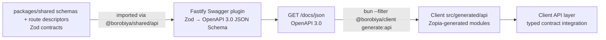

# Borobiya — API Specification

> TL;DR: REST + Socket.IO. Routes use `_auth`, `_public`, `_user`, and `_admin` prefixes with access metadata. Shared Zod descriptors feed Swagger at `/docs` + `/docs/json`. Runtime handlers include public health/security-question catalog, `POST /_auth/{register,login,refresh,logout,forgot-password/*}`, admin-only `GET /_admin/users`, `GET /_admin/users/:id`, `POST /_admin/users`, and `PATCH /_admin/users/:id/status`, authenticated `GET /_user/me` + `POST /_user/complete-security-questions` + `GET /_user/devices`, and the whole `/_user/location` surface (live share create/revoke/list, history grant create/list/read/delete, the windowed own-history read, and the deprecated REST fallback); other documented operations remain contract-only and return 404 until implemented.

---

## 1. Base

```
API:  http://localhost:3000            (Fastify)
Maps: http://localhost:8000            (Martin) — see MAP_SERVER.md
Route: http://localhost:8001/route      (OSRM adapter; graphs are built locally from the selected map dataset)
Map config: GET /map-config              (region, bounds, version, and zoom range)
Swagger UI:   GET /docs
OpenAPI JSON: GET /docs/json
Health:       GET /_public/health      → { status: "ok", uptime, version }
```

The OpenAPI document uses `/` for a directly exposed API and `/api` first when served by Compose through Nginx (with `/` retained as the direct-port alternative). Configure `OPENAPI_SERVER_PATH` when a gateway uses a different prefix.

Headers:
```
Authorization: Bearer <accessToken>   // for _user & _admin
Content-Type: application/json
X-Map-Data-Version: development       // reserved optional version pin; not currently enforced
```

Error shape (uniform):

```json
{ "error": true, "code": "ALREADY_AUTHENTICATED", "message": "...", "issues": [] }
```

- `code` is machine-readable (see §9).
- Zod validation errors include `issues` (flattened).

---

## 2. Route Prefixes — The Law

| Prefix | Auth | Who | Backend hook | Frontend guard | Example |
|--------|------|-----|--------------|----------------|---------|
| `/_auth` | **Guest only** | Not logged in | If JWT present → `403 ALREADY_AUTHENTICATED` | `if loggedIn → redirect /_user/dashboard` | `POST /_auth/login` |
| `/_public` | Open | Everyone | None (optional auth pass-through) | None | `GET /_public/incident-types` |
| `/_user` | Required `user` | Authed users (+ admin may opt-in) | Access-JWT verification and current account-state checks; incomplete accounts may only complete security questions | Require login → `/_auth/login`; incomplete account → onboarding | `POST /_user/complete-security-questions` |
| `/_admin` | Required `admin` | Admins only | Access-JWT verification and role authorization; user creation/status also recheck current role/active/suspended state | Role/state check → `401`/`403` | `POST /_admin/users` |

> Decision to document: Does `admin` role allow `/_user/*`? Spec says “_user — Only authenticated users”; recommended: allow `admin` to call `_user` (useful for debugging), but explicitly document: **Admin can call `_user` endpoints** (since they are users too). Alternatively restrict to `user` only — pick one and keep consistent.

Implementation sketch (see ARCHITECTURE.md §13.3 and SECURITY.md §5).

---

## 3. Auth Routes (`/_auth` — guest only)

### 3.1 POST `/_auth/register`

```ts
Body = z.strictObject({
  username: z.string().min(3).max(30).regex(/^[a-z0-9_]+$/),
  password: z.string().min(8).max(1024).regex(/^(?=.*\p{L})(?=.*\p{Nd}).+$/u), // Unicode letter + decimal digit
  confirmPassword: z.string(),
  securityQuestions: z.array(z.strictObject({
    questionId: z.string().uuid(),
    answer: z.string().trim().min(1).max(200)
  })).length(5)
}).superRefine((d, ctx) => {
  if (d.password !== d.confirmPassword) ctx.addIssue({ path: ["confirmPassword"], ... });
  if (new Set(d.securityQuestions.map(q=>q.questionId)).size !== 5) ctx.addIssue({ path: ["securityQuestions"], ... });
})

→ 201 { user: { id, username, createdAt } }
→ 400 { code: "VALIDATION_ERROR", issues } // invalid body or question IDs not in the catalog
→ 403 { code: "ALREADY_AUTHENTICATED" }
→ 409 { code: "USERNAME_TAKEN" }
→ 429 { code: "RATE_LIMITED" }
```

The handler verifies the five question IDs against the seeded catalog, hashes the password and answers with Argon2id, and writes the user plus all five answer hashes in one transaction. Normalize answers: `trim().toLowerCase()` before hashing. Rate: 5 attempts per 15 minutes per `ip+username`.

### 3.2 POST `/_auth/login`

```text
Request: { username, password, deviceName? }
Browser (Origin header) 200: { accessToken, user } + Set-Cookie refreshToken
Native (no Origin header) 200: { accessToken, refreshToken, user } (store refreshToken in secure storage)
400: { code: "VALIDATION_ERROR" }
401: { code: "INVALID_CREDENTIALS" }
403: { code: "ALREADY_AUTHENTICATED" | "ACCOUNT_INACTIVE" | "ACCOUNT_SUSPENDED" }
429: { code: "RATE_LIMITED" }
```

The refresh cookie is `HttpOnly; Secure; SameSite=Lax` and expires after 7 days; its default browser path follows the login URL, so it works both at the direct API path and behind the `/api` gateway prefix. Browser requests are distinguished by their `Origin` header; native clients omit it and receive the refresh token only in the response body. Login accepts existing credentials without reapplying the new-password letter/digit rule, but caps the submitted password at 1024 characters.
`deviceName` (1–100 characters, trimmed) is an optional platform label for the Active Devices table — a Capacitor build can send `"Samsung S23"`. Web clients omit it and the server summarizes the `User-Agent` instead (`"Chrome on Windows"`, `"Safari on iPhone"`, `"Microsoft Edge on Windows"`); a UA that matches no known browser or platform stores `null`, because the column is user-visible text, not an archive of client detail. It returns `user.mustCompleteSecurityQuestions` with tokens so an admin-created account can authenticate to the required onboarding route; T1.2.6 will gate other `/_user` operations until completion. A suspended account currently returns a generic `ACCOUNT_SUSPENDED` error because suspension expiry/reason columns are future schema work.

Rate: 5/15m per `ip+username`.

### 3.3 POST `/_auth/refresh`

```text
Request: native body { refreshToken } or web HttpOnly cookie (body may be omitted)
Web 200: { accessToken } + rotated HttpOnly refresh-token cookie
Native 200: { accessToken, refreshToken } (store replacement token in secure storage)
400: { code: "VALIDATION_ERROR" } // malformed body
401: { code: "INVALID_REFRESH" } // bad/expired JWT, missing persistence, or a lost concurrent rotation
403: { code: "ALREADY_AUTHENTICATED" | "ACCOUNT_INACTIVE" | "ACCOUNT_SUSPENDED" }
```

The handler verifies the refresh-token signature and expiry, matches the JWT's user/device/session claims to the stored session hash, checks current account state, then conditionally replaces the hash. The conditional update allows only one concurrent refresh to succeed. Tokens use distinct random JWT IDs (`jti`) and carry the stable session ID separately; legacy login tokens whose `jti` is the session ID remain accepted while they roll over. Browser responses keep refresh tokens out of JSON; native clients omit `Origin` and store the body token in secure storage.

### 3.4 POST `/_auth/logout`

```text
Request: web HttpOnly refresh-token cookie or native body { refreshToken }
200: { ok: true }  // invalidate the session; expire the browser cookie
400: { code: "VALIDATION_ERROR" } // malformed body
403: { code: "ALREADY_AUTHENTICATED" }
```

Logout is idempotent: missing, invalid, or expired tokens still receive `{ ok: true }` and a cookie-clear response. A verified token revokes only its claimed session; an unverified token can affect a session only if its hash exactly matches the stored hash. Native clients should also clear their platform secure-storage token after a successful response.

### 3.5 Forgot Password

**Request**

```
POST /_auth/forgot-password/request
Body { username }
→ 200 { questionIds: string[3], questions: string[3] }
→ 400 { code: "VALIDATION_ERROR" }
→ 403 { code: "ALREADY_AUTHENTICATED" }
→ 429 { code: "RATE_LIMITED" }
→ 503 { code: "RECOVERY_UNAVAILABLE" }
```

The server randomly chooses three of the account's five saved questions and persists that exact, ten-minute challenge; the client cannot substitute a different set at verification. Unknown accounts and accounts without five saved answers receive three questions from a stable, server-keyed five-question decoy pool for that username, with the same status and response shape. Question answers/hashes are never returned. Request/verify are limited to five attempts per 15 minutes per IP+username.

**Verify**

```
POST /_auth/forgot-password/verify
Body { username, answers: [{questionId, answer}] } // exactly 3 unique answers from the active challenge
→ 200 { resetToken } // opaque, 10m, single-use
→ 400 { code: "WRONG_ANSWERS" } // same response for unknown users and incorrect/mismatched answers
→ 403 { code: "ALREADY_AUTHENTICATED" }
→ 429 { code: "RATE_LIMITED" }
```

Answers are normalized with `trim().toLowerCase()` and compared against Argon2id hashes. The reset token is 32 cryptographically random bytes encoded as base64url; only its SHA-256 hash is stored. A successful verification consumes the recovery challenge and replaces any older reset token for that account.

**Reset**

```
POST /_auth/forgot-password/reset
Body { resetToken, newPassword, confirmPassword }
→ 200 { ok: true }
→ 400 { code: "INVALID_RESET_TOKEN" | "VALIDATION_ERROR" }
→ 403 { code: "ALREADY_AUTHENTICATED" }
→ 429 { code: "RATE_LIMITED" }
```

The server checks token validity before the expensive password hash, then atomically claims the token in the same transaction that updates the password; only one concurrent reset succeeds. A successful reset stores the Argon2id password hash, deletes outstanding reset tokens, consumes recovery challenges, and revokes the user's refresh sessions. Reset attempts are limited to five per 15 minutes per IP because this request has no username field.

### 3.6 Security Questions Helpers

```
GET /_public/security-questions          // open, returns seeded prompts: {id, text}
GET /_auth/security-questions            // guest alias (contract-only)
```

`GET /_public/security-questions` is live and returns the catalog used by registration and onboarding; question prompts are public, but answer hashes are never returned. The guest alias remains contract-only.

---

## 4. Public Routes (`/_public`)

```
GET /_public/health                      // { status:"ok" }
GET /_public/security-questions
GET /_public/incident-types              // public SOS form dropdown
GET /_public/map/styles/:theme.json     // proxy or redirect to Map Server styles
```

No auth required; may include `X-User-Id` personalization if token present (optional).

---

## 5. User Routes (`/_user` — authed)

### 5.1 Me & Devices

```
GET    /_user/me                         → { id, username, role, isActive, avgRating, mustComplete..., createdAt }
PATCH  /_user/me                         Body { username? } // limited fields
GET    /_user/devices                    → [{ id, deviceId, deviceName, ip, isCurrentDevice, lastActiveAt, isOnline }]
POST   /_user/complete-security-questions Body { securityQuestions[5] } → 200
```

`POST /_user/complete-security-questions` requires an access JWT backed by a matching unrevoked session, five unique question IDs from the seeded catalog, and non-empty answers. The server stores `trim().toLowerCase()` Argon2id answer hashes and atomically clears `mustCompleteSecurityQuestions`; it returns `409 SECURITY_QUESTIONS_ALREADY_COMPLETED` rather than replacing answers if onboarding is already complete. While the flag is true, the user authorization hook returns `403 SECURITY_QUESTIONS_REQUIRED` for every other registered `/_user` route. The same hook returns `401 INVALID_ACCESS_TOKEN` when logout, password reset, or admin action revoked the persisted session, immediately invalidating any access JWT from it. `GET /_user/me` returns the current profile with `Cache-Control: no-store` after onboarding; incomplete accounts receive the security-question gate response. Other `_user` operations shown here remain contract-only.

**`GET /_user/devices` (T2.3.2, live).** Returns the caller's **live sessions** — rows of `user_sessions` that still hold a refresh token — newest `lastActiveAt` first, capped at `MAX_USER_DEVICE_LIST_ITEMS` (50), with `Cache-Control: no-store`. `id` is the session row and `deviceId` is the value `location_shares.priorityDeviceId` pins (T2.3.3), so the picker offers exactly the ids the server accepts; exactly one row has `isCurrentDevice: true` because the `/_user` hook already rejects a revoked or missing session. `deviceName` is the label described in §3.2 and `ip` is the address seen at the last credential exchange (login or refresh rotation). Logged-out and admin-revoked sessions are excluded rather than listed as offline history, since sessions have no retention job of their own; `isOnline` still mirrors session liveness and will only differentiate once socket presence (T2.1.5) drives it.

### 5.2 User Search

```
GET /_user/users/search?q=&category=&incidentType=&minRating=&online=&sort=distance&lat=&lon=&page=&limit=
→ { items: [{ id, username, category, avgRating, isOnline, distance }], total, page, limit }
```

`online` accepts `true` or `false`. `lat` and `lon` must be supplied together; if omitted, distance sorting may use the authenticated user's last known location.

**Live for the share picker (T2.1.7's prerequisite; T4.1.1's first slice).** This build answers a term-bounded search and refuses the rest rather than quietly ignoring filters:
- `q` is required and needs at least 2 characters (a case-insensitive partial username match, wildcards and backslashes escaped). A 1-character term would return most of the account table, and no index backs `ILIKE '%x%'` yet — trigram/prefix indexing and index-backed term-free browsing belong to T4.1.1.
- The caller's own account is never a candidate, in the page or in its `total`: `POST /_user/location/share` refuses it (`self_target`), so a list that offered it could only produce an error the user cannot act on. The dialog still greys it out when it happens to see it (a cached list from before a profile load), but that is presentation, not the rule.
- `minRating` and `online` are honored: unrated accounts count as 0 (a quality floor should not be satisfied by an absence of data), and liveness is the same rule the device list uses — a session still holding a refresh token.
- `category` and `incidentType` answer `400 SEARCH_FILTER_UNSUPPORTED` listing the offending names, because category membership and incident specialty have no tables yet. An empty-string `category=` is treated as absent.
- `distance` is **kilometres, one decimal**, from `lat`/`lon` if given, otherwise from the caller's last stored position, otherwise `null` for every row. Results sort nearest-first with accounts that have no position last, then by username, so nobody is dropped for having an old fix. `total` counts the filtered set in its own statement: page and total are not read in one transaction, so on a busy instance they can differ by whoever signed up in between.
- `sort` accepts only `distance`, so it needs no refusal; `page`/`limit` follow the shared pagination bounds (limit 1–100, default 20).

`Cache-Control: no-store`, because the answer depends on who is asking and where they last were.

### 5.3 Location Sharing

```
POST   /_user/location/share             { targetUserIds: string[], mode:"timed"|"permanent", durationMinutes?: number, note?, priorityDeviceId?: string }
→ 201 { shares: LocationShare[], createdShareIds: string[], reusedShareIds: string[] }
DELETE /_user/location/share/:shareId    → 200 empty body (immediate revoke)
GET    /_user/location/shares            → { owned: LocationShare[], sharedWithMe: (LocationShare & { owner })[] }

POST   /_user/location/history/share     { targetUserIds, from: ISO, to: ISO, maxPoints? }
→ 201 { shares: LocationHistoryShare[], createdShareIds: string[], reusedShareIds: string[] }
GET    /_user/location/history?from=&to= → { points: [{lat,lon,timestamp,accuracy?}], totalPoints } // own history
GET    /_user/location/history/shares    → { owned: LocationHistoryShare[], sharedWithMe: (LocationHistoryShare & { owner })[] }
GET    /_user/location/history/shared/:shareId → the granted window, same shape as above
DELETE /_user/location/history/share/:shareId → 200 empty body (the grant row is deleted)

POST   /_user/location/update            deprecated REST fallback for Socket `location:update` (live)
```

**Client use (T2.1.7, live).** `packages/client/src/api/location.ts` is the only caller of these routes; `ShareDialog.vue` posts a share (with `priorityDeviceId` only while the `409` chooser is open) and `ShareLists.vue` reads both directions, so a browser never guesses at a shape the shared schemas already define.

**`GET /_user/location/shares` (T2.1.4, live).** Both lists contain only **active** shares — `isRevoked = false` and either permanent or still inside `expiresAt` — newest first, capped at the 100 most recent rows per list (`MAX_LOCATION_SHARE_LIST_ITEMS`). `owned` rows are the caller's outgoing shares; `sharedWithMe` rows are incoming shares and each one carries `owner: { id, username, lastLocation }`, where `lastLocation` is the owner's last server-known WGS84 position (`{ lat, lon }`, `null` before the first update) so a receiver can render a marker without a second request. Responses are `Cache-Control: no-store`.

**`DELETE /_user/location/share/:shareId` (T2.1.3, live).** Owner-only and immediate: the row keeps existing for audit but `isRevoked=true` makes it invisible to every reader, including the receiver's live update path. A non-UUID id is `400 VALIDATION_ERROR`; an unknown id or a share owned by another account is `404 SHARE_NOT_FOUND` with the same message, so the endpoint never confirms that somebody else owns it. Revoking an already-revoked id repeats `200` with an empty body, which keeps client retries idempotent. Responses are `Cache-Control: no-store`.

**`POST /_user/location/history/share` (T2.2.3, live).** Grants one fixed window of the caller's stored history to 1–50 unique recipients. Limits: the window may span at most `LOCATION_HISTORY_MAX_SHARE_DAYS` — checked here rather than in the schema because it is configuration, and over that bound the answer is `400 SHARE_RANGE_TOO_LARGE` with `issues: [{ code: "range_too_large", maxShareDays, requestedDays, path: ["to"] }]` and nothing written — and `maxPoints` is an integer from 1 to `MAX_LOCATION_HISTORY_SHARE_POINTS` (10000), stored on the grant so every receiver of that window reads it at the same density — the receiver's read takes no sampling parameter, and the owner changes the density by re-posting the same window with a new value, which the reuse path applies. Recipients are validated as a batch with the identical live-share rule, issue codes (`self_target`, `unknown_target`, `unavailable_target`) and `["targetUserIds", index]` paths; one unusable recipient rejects the whole request. A repeat of the same owner/target/`from`/`to` reuses the existing grant — the unique index over exactly those columns *is* the duplicate rule — and rewrites only `maxPoints`, including back to `null` when the repeat states no preference.

Two properties follow from the shape of a history grant and are worth stating plainly: it needs **no priority device** (it replays rows the server already stored, so there is nothing to broadcast, and `priorityDeviceId` is not part of this payload), and it **does not expire** — it lasts until the retention prune removes the points underneath it, which is also why a window that no longer contains any point is created normally instead of being refused, and reads back as no points. `DELETE /_user/location/history/share/:shareId` (T2.2.4, live) is that real `DELETE`: unlike `location_shares`, this table keeps no `is_revoked` flag. Responses are `Cache-Control: no-store`.

**History reads (T2.2.4, live).** A window read is `[from, to)` on the observation `timestamp` — the same half-open convention the shared range check uses — and returns at most the grant's `maxPoints` points, oldest first, or `LOCATION_HISTORY_READ_POINTS` when the grant stores none. The ceiling and the total are decided in one statement: `row_number()` and `count(*) OVER ()` are computed over the rows the `(user_id, timestamp)` index already yields, so a 30-day window never travels to Node just to be thrown away; the response's `totalPoints` says how many rows the window holds, which is how a player tells a sampled view from the complete record.

- `GET /_user/location/history` reads the caller's own rows and requires explicit `from`/`to` (a 90-day retention default would silently hide how much was omitted). Sampling uses the configured default, because your own history has no grant to carry a target.
- `GET /_user/location/history/shared/:shareId` reads one grant the caller *received*. Nothing about the window or the density is a query parameter: the grant fixes both, so a receiver cannot widen what they were given, and every receiver of one grant sees the same view. A grant id that does not exist and one belonging to a different receiver answer identically with `404 SHARE_NOT_FOUND`, since this is the only endpoint that can probe whether another account shares history with anybody.
- `GET /_user/location/history/shares` lists both directions newest first, capped at `MAX_LOCATION_SHARE_LIST_ITEMS` per list, and is how a receiver learns an id in the first place. Nothing is filtered out: a grant has no expiry and no revoked state, so the list is whatever the account holds. `sharedWithMe` rows carry `owner: { id, username }` — deliberately not `lastLocation`, which a history grant never authorizes.
- `DELETE /_user/location/history/share/:shareId` is owner-only and immediate: the row goes away and the receiver's next read answers `404`. It does not recall points the receiver already loaded, and repeating the delete answers `404` (unlike the live revoke, which repeats `200`, there is no retained row to be idempotent about).

**Expiry & retention (T2.1.6 + T2.2.5, live).** No HTTP surface: a maintenance timer inside the API process retires
`location_shares` rows with `expiresAt <= now` by setting `isRevoked = true` (checked every 15s, at least once a minute,
plus one catch-up pass on startup). Clients see no new status or error code — a share stops being readable the moment its
`expiresAt` passes, because every reader filters on `expiresAt > now`, and the sweep only makes that state permanent and
visible in the table. Practical consequences for clients:

- `GET /_user/location/shares` stops listing the row at the deadline itself, not at the sweep — the list has always filtered on `expiresAt > now`.
- `DELETE /_user/location/share/:shareId` on an expired id still answers `200` (the row exists and stays owner-addressable, only already inactive).
- Re-sharing with the same target after expiry creates a **new** row (`createdShareIds`) instead of reusing the retired one, because reuse only considers active shares.

History retention is enforced by the same scheduler once a day: `location_history` rows with
`created_at < now - LOCATION_HISTORY_RETENTION_DAYS` are deleted in batches of 5,000 (max 40 batches per pass), so a window
requested near the retention edge can legitimately return fewer points than expected. `LOCATION_HISTORY_MAX_SHARE_DAYS` is
validated at startup to be ≤ `LOCATION_HISTORY_RETENTION_DAYS`; the per-request `400 SHARE_RANGE_TOO_LARGE` check above is
part of T2.2.3.

**`POST /_user/location/share` (T2.1.2, live).** Requires the same verified `/_user` access token, active account, and completed-onboarding state as every other user route. Limits: 1-50 unique recipients, `durationMinutes` an integer from 1 to 43200 (30 days, required only for `timed`), and `note` up to 500 characters. Recipients are validated as a batch: the owner's own account, unknown ids, and inactive or suspended accounts are rejected with `400 VALIDATION_ERROR` and `issues[].code` of `self_target`, `unknown_target`, or `unavailable_target`, each with `issues[].path` set to the body path of the offending element (`["targetUserIds", index]`, the shape every other issue in the response uses) so a client can name the person it refused instead of reporting a form-wide error; nothing is written when any recipient is rejected. On success all rows are written in one transaction and each response `shares[]` item follows `LocationShare` (`id`, `ownerId`, `targetUserId`, `mode`, `expiresAt`, `isRevoked`, `priorityDeviceId`, `note`, `createdAt`). A recipient has **one** active arrangement, whatever its mode: a repeated request for the same owner/target reuses that row (`reusedShareIds`) — a `timed` row is extended only forward (a shorter window is a revoke, not a side effect), a switch to `permanent` clears its `expiresAt`, and a switch to `timed` writes the new one — while `createdShareIds` is answered only when the pair has no active row at all. Any other active row for the same pair, left behind when reuse was keyed on mode, is revoked in that same transaction. Concurrent retries serialize on a transaction-scoped advisory lock per owner, so a double-tapped share button cannot create two active rows for one recipient. Responses are `Cache-Control: no-store`.

**Priority device (T2.3.3, live).** `priorityDeviceId` names the device that will broadcast the position for these shares. When the account has exactly one device with a live session the server pins it itself, so a single-device account never has to choose and an omitted field is never a rejection. When it has more than one, the field is required: a share request without it is `409 PRIORITY_DEVICE_REQUIRED` with `issues: [{ code: "multiple_active_devices", deviceIds, path: ["priorityDeviceId"] }]` and nothing is written, so the client can open the chooser from that list and retry. That status is declared on the operation in the OpenAPI document, so a generated client types it as its own outcome rather than an opaque error. An id that is not one of the caller's live devices is `400 VALIDATION_ERROR` with the issue code `unknown_priority_device`; a malformed id is rejected by `shareSchema` before any device lookup. The pin is stored per share row, and a repeated request for an existing share re-points it whenever the requested device differs — including on a permanent share, which otherwise never changes; `note` is still only rewritten together with an extension. Only devices with a live session can be pinned: signing out of the last one stops broadcasts by design, and because the expiry sweep re-points a share whose pinned device no longer has a session, a share is never stranded on a signed-out device while the account has exactly one live device left. The pin governs live broadcasting only: `location:update` (section 8) accepts a fix for the shares that pin the sender's device, while history shares need no selection because they replay rows the server already stored.

### 5.4 SOS — Requester Side

```
POST  /_user/sos/requests                { severity:"low"|"medium"|"high", description(10-500), incidentTypeId, location:{lat,lon,accuracy?,isManual}, photoUrl? }
→ 201 { requestId, status:"pending" }
GET   /_user/sos/requests                ?role=requester → history I created
GET   /_user/sos/requests/:id
POST  /_user/sos/requests/:id/cancel     { cancellationReasonId, customReason? }
POST  /_user/sos/requests/:id/photo      multipart max 5MB → { photoUrl }
```

### 5.5 SOS — Proposals & Missions (Rescuer)

```
GET   /_user/sos/proposals               // inbox: pending proposals for me
POST  /_user/sos/proposals/:id/accept    → { missionId } // only if !isOnMission
POST  /_user/sos/proposals/:id/decline   { reason? }

GET   /_user/sos/missions                ?role=rescuer → my missions
GET   /_user/sos/missions/:id
PATCH /_user/missions/:id/status         { status: "on_the_way"|"arrived"|"in_progress"|"completed" }
POST  /_user/missions/:id/cancel         { cancellationReasonId, customReason? } // hard path
POST  /_user/missions/:id/rate           { rating:1-5, comment? } // only after completed, only requester
GET   /_user/sos/requests/:id/nearest    // optional shortcut to admin nearest logic
```

Mission status order enforced: `pending → on_the_way → arrived → in_progress → completed`; out-of-order → `400 INVALID_STATUS_TRANSITION`.

### 5.6 Sync (reconnection)

```
GET /_user/sync?since=ISO → { events: [...], location: ..., missions: ... }
```

---

## 6. Admin Routes (`/_admin` — admin only)

### 6.1 Users

```
GET   /_admin/users?q=&isActive=&hasCategory=&page=&limit=   → paginated list
GET   /_admin/users/:id                                       → detail + devices + missions
POST  /_admin/users           { username, password, isActive? } → 201 userProfile
PATCH /_admin/users/:id/status { isActive: boolean }
PATCH /_admin/users/:id/unsuspend
// NO DELETE — must not exist
```

`POST /_admin/users` requires a signed, unexpired access JWT with the `admin` role, rechecks that the current admin account is still an active, unsuspended admin, and requires that the token's matching persisted session has not been revoked. The password is stored as an Argon2id hash; the new account always has role `user`, defaults to active unless `isActive` is supplied, and is created without any `user_security_answers` rows. Its response sets `mustCompleteSecurityQuestions: true`. It returns `401 UNAUTHORIZED`/`INVALID_ACCESS_TOKEN` for missing or invalid bearer access tokens, `403 ADMIN_REQUIRED`/`ACCOUNT_INACTIVE`/`ACCOUNT_SUSPENDED` when authorization fails, `400 VALIDATION_ERROR` for invalid bodies, and `409 USERNAME_TAKEN` for a duplicate username.

`PATCH /_admin/users/:id/status` accepts only the strict body `{ isActive: boolean }` and applies the same current-admin and unrevoked-session authorization checks. It returns the updated user profile with `200`, `400 VALIDATION_ERROR` for an invalid UUID/body, `401 UNAUTHORIZED`/`INVALID_ACCESS_TOKEN` (including a revoked session), `403 ADMIN_REQUIRED`/`ACCOUNT_INACTIVE`/`ACCOUNT_SUSPENDED`, or `404 USER_NOT_FOUND`. The status change, audit entry, and (on deactivation) refresh-session revocation run in one database transaction. The audit entry records `user_activated` or `user_deactivated`, target type/id, and prior/new active state; repeated requests for the existing state are idempotent and do not create duplicate events. Deactivation clears every stored refresh-token hash and marks sessions offline; both `/_user` and `/_admin` authorization checks require a matching session with a non-null refresh-token hash, so outstanding access JWTs are invalidated immediately. Reactivation does not restore those sessions, so the user must sign in again. The route returns `Cache-Control: no-store`.

The list and detail routes use the same signed-admin-token, current-account, and unrevoked-session checks. `GET /_admin/users` supports case-insensitive username substring search (`q`), `isActive`, `hasCategory`, and `page`/`limit` (defaults 1/20, max 100); it returns profiles only, never password hashes. Category assignment tables are not part of the current database schema yet, so current users are all unassigned: `hasCategory=true` returns an empty page and `false` includes otherwise-matching users. `GET /_admin/users/:id` returns the profile and device-session records — the same `deviceSchema` rows as `GET /_user/devices`, `deviceId` included, so a pinned priority device is identifiable from either view — where `isCurrentDevice` compares the returned session ID with the requesting admin's session. Its missions array is currently empty because the mission tables are introduced by T3.5.1. Both read routes return `Cache-Control: no-store`; an invalid UUID/query returns `400 VALIDATION_ERROR`, and an unknown user returns `404 USER_NOT_FOUND`.

### 6.2 Incidents & Categories

```
POST  /_admin/incidents           { name, icon?, color?, description? }
GET   /_admin/incidents
PATCH /_admin/incidents/:id
POST  /_admin/categories          { name, description?, incidentTypeIds: string[] }
GET   /_admin/categories
PATCH /_admin/categories/:id     { name?, description?, incidentTypeIds? }
POST  /_admin/categories/:id/users   { userIds: string[] }
DELETE /_admin/categories/:id/users/:userId
```

### 6.3 SOS Dispatch

```
GET   /_admin/sos/requests                    → all SOS, filter status
GET   /_admin/sos/requests/:id
GET   /_admin/sos/requests/:id/nearest       → { responders: [{userId, distance, avgRating, categoryName, lastActiveAt}] }
POST  /_admin/sos/requests/:id/dispatch      { rescuerIds: string[] } → creates proposals + emits
GET   /_admin/stats                           → { counts: sosByStatus, activeMissions, onlineUsers }
```

### 6.4 Cancellation Reasons (admin config)

```
GET   /_admin/cancellation-reasons
POST  /_admin/cancellation-reasons { type:"requester"|"rescuer", key, label, labelFa, requiresCustomText, isActive }
```

Populated by T1.1.3; the table is introduced in a follow-up migration rather than the initial auth-table migration (see SECURITY.md for the reason list).

---

## 7. Zod + km-api + Zopia — Contract Flow



**Adding a new endpoint:**

1. Add request and response Zod schemas in `packages/shared/src/schemas/`.
2. Add a descriptor in `packages/shared/src/api/`:

   ```ts
   import { defineRoute } from "@borobiya/shared/api";

   export const myRoute = defineRoute({
     method: "POST",
     url: "/_user/my",
     schema: { body: mySchema, responses: { 201: myResponseSchema, 400: errorSchema } },
     meta: {
       operationId: "userCreateMyResource",
       summary: "Create a resource",
       tags: ["user"],
       access: "authenticated"
     }
   });
   ```

   `access` is `public`, `guest`, `authenticated`, or `admin`. The descriptor preserves `method`, `url`, `schema`, and `meta` while adapting the request/response schemas and metadata to `km-api`'s `makeApiConfig` format.
3. Register a real Fastify handler in the server module using the descriptor's method and `makeExpressPathShape()`; keep application logic outside `packages/shared`. Until registered, the endpoint is contract-only and returns 404.
4. The Swagger plugin builds `/docs/json` from every shared descriptor without registering placeholder handlers. Contract-only operations carry `x-borobiya-runtime-status: contract-only`. Implemented handlers include public health/security-question catalog, auth register/login/refresh/logout/forgot-password flows, user profile/onboarding/devices, partial-username user search, admin user list/detail/create/status, and the whole `/_user/location` surface — live share create/revoke/list, realtime `location:update` with its deprecated REST fallback, and history grant create/list/read/delete with the windowed own-history read; SOS, mission, and the remaining search operations (place search, reverse geocode) remain contract-only.
5. Start the API, then run `bun --filter @borobiya/client generate:api`. The script fetches `http://localhost:3000/docs/json` by default and writes Zopia output to `packages/client/src/generated/api/` (ignored by Git). Override the source with `API_OPENAPI_URL` or the output directory with `ZOPIA_OUTPUT_DIR`.
6. Use generated modules in client API integration and form validation.

---

## 8. Realtime (Socket.IO)

**Auth:** `io(auth:{token: accessToken})` → server verifies JWT in `handshake`.

Mounted at `/socket.io` on the API port (behind nginx/Vite as `/api/socket.io`, which proxies the WebSocket upgrade and falls back to long polling). The handshake middleware applies the same rules as the `/_user` REST hook — verified access JWT, existing account whose role still matches, active, unsuspended, onboarding-complete, and backed by a persisted session — and closes the connection with `UNAUTHORIZED`, `INVALID_ACCESS_TOKEN`, `ACCOUNT_INACTIVE`, `ACCOUNT_SUSPENDED`, `SECURITY_QUESTIONS_REQUIRED`, or `SERVICE_UNAVAILABLE` (a database that cannot answer during the handshake; retry the connection). Each socket joins `user:{userId}` and admins additionally join `admin`. Neither path may reject instead: Socket.IO middleware and event listeners are callback-based, so a rejected promise there is never observed, and Node ends the process on an unhandled rejection.

**`location:update` (T2.1.5, live)** — payload `locationUpdateSchema` (`lat`, `lon`, optional `accuracy`, `timestamp`, `priorityDeviceId`). Server order: per-connection throttle (60/min) → payload validation → the reported `priorityDeviceId` must equal the session device of the connection (T2.3.4) → every active outgoing share whose pinned priority device (if any) matches that connection is accepted → the fix is written once in a transaction that updates `users.last_location` (`ST_SetSRID(ST_MakePoint(lon, lat), 4326)::geography`) and inserts `location_history` → `location:peer-update { userId, lat, lon, accuracy, timestamp }` is emitted to each accepting target's room and echoed to the sender's own room so other tabs on the account stay in sync. The ack is `{ ok, status, peers? }` or `{ ok: false, code, message, retryAfterMs? }` with codes `VALIDATION_ERROR`, `INVALID_TIMESTAMP` (a device clock more than 5 minutes ahead, or an observation older than 24 hours), `WRONG_DEVICE`, `RATE_LIMITED`, `SERVICE_UNAVAILABLE` (a storage failure under the update, reported instead of ending the process), and `UNAUTHORIZED`. A fix is stored even when no share is active, because SOS dispatch (T3.3.1) reads `users.last_location` as the last known position — which is also why the observation-age bound exists: a client that flushes a day of buffered fixes after reconnecting would otherwise drag that marker back to where the device stood yesterday and every receiver would follow it there.

The deprecated `POST /_user/location/update` fallback runs the identical service path and, when a realtime server is attached, fans the accepted fix out to peers too, so a polled fix is never silently local-only.

**Rooms:** `user:{userId}`, `admin`, `mission:{missionId}`.

Full event catalog:

| Direction | Event | Payload | Who |
|-----------|-------|---------|-----|
| C→S | `location:update` | `{lat,lon,accuracy,timestamp,priorityDeviceId}` | owner on share/mission |
| S→C | `location:peer-update` | `{userId, lat, lon, accuracy, timestamp}` | targets + mission participants |
| C→S | `sos:create` | same as REST body | requester (alt to REST) |
| S→C | `sos:new-request` | `{sosRequest}` | `admin` room |
| S→C | `admin:nearest-responders` | `{sosRequestId, responders[]}` | admin who requested |
| S→C | `sos:proposal-received` | `{proposal}` | `user:{rescuerId}` |
| S→C | `sos:proposal-accepted` | `{proposal, missionId}` | `admin` + `user:{requesterId}` |
| C→S | `mission:update-status` | `{missionId, status}` | rescuer |
| S→C | `mission:status-updated` | `{missionId, status, by, at}` | `mission:{id}` room |
| C→S | `mission:cancel` | `{missionId, reason}` | both |
| S→C | `mission:cancelled-by-requester` | `{missionId, reason}` | `mission:{id}` |
| S→C | `mission:cancelled-by-rescuer` | `{missionId, rescuerId, reason, rescuerLocation}` | `admin` room (urgent) |
| S→C | `system:suspended` | `{reason, until}` | suspended user |
| C→S | `ping` / S→C `pong` | heartbeat | all |

Polling fallback: `GET /_user/sync?since=` if WebSocket blocked.

---

## 9. Error Codes

| HTTP | Code | When |
|------|------|------|
| 400 | `VALIDATION_ERROR` | Invalid input, selected security-question ID not in the catalog, an unusable location-share recipient (issue codes `self_target`, `unknown_target`, `unavailable_target`), or a share request naming a priority device that has no live session (`unknown_priority_device`) |
| 400 | `SHARE_RANGE_TOO_LARGE` | A history share spans more than `LOCATION_HISTORY_MAX_SHARE_DAYS`; `issues[0]` carries `maxShareDays` and `requestedDays` |
| 400 | `SEARCH_FILTER_UNSUPPORTED` | User search names a filter with no backing table yet (`category`, `incidentType`); `issues[0].filters` lists them |
| 400 | `WRONG_ANSWERS` | Security answers do not match the active recovery challenge |
| 400 | `INVALID_RESET_TOKEN` | Reset token is invalid, expired, or already used |
| 401 | `UNAUTHORIZED` | Missing credentials |
| 401 | `INVALID_ACCESS_TOKEN` | Malformed, invalid-signature, expired, or wrong-use bearer access JWT |
| 403 | `FORBIDDEN` | Wrong role (generic contract code) |
| 403 | `ADMIN_REQUIRED` | A verified access token or current account does not have the admin role |
| 403 | `ALREADY_AUTHENTICATED` | A request with an `Authorization` header hits a guest-only `/_auth/*` endpoint |
| 403 | `ACCOUNT_INACTIVE` | Login/refresh or authenticated operation for a deactivated account |
| 403 | `ACCOUNT_SUSPENDED` | Login/refresh or authenticated operation for a suspended account |
| 403 | `SECURITY_QUESTIONS_REQUIRED` | `mustCompleteSecurityQuestions` blocks non-onboarding `_user` routes |
| 403 | `ON_MISSION` | Try accept second proposal while busy |
| 409 | `SECURITY_QUESTIONS_ALREADY_COMPLETED` | Onboarding endpoint cannot replace an account's completed security answers |
| 404 | `NOT_FOUND` | Unknown id for a generic operation |
| 404 | `USER_NOT_FOUND` | Admin status update targets a missing user |
| 404 | `SHARE_NOT_FOUND` | A live or history share id is unknown, belongs to another account, or (for a received history read) was never granted to the caller |
| 409 | `USERNAME_TAKEN` | Duplicate |
| 409 | `WRONG_DEVICE` | GPS from non-priority device |
| 409 | `INVALID_STATUS_TRANSITION` | Bad mission order |
| 409 | `PRIORITY_DEVICE_REQUIRED` | Multi-device without selection; `issues[0].deviceIds` carries the live devices for the chooser |
| 429 | `RATE_LIMITED` | Too many req |
| 503 | `RECOVERY_UNAVAILABLE` | Security-question catalog or recovery challenge storage is unavailable |
| — | `SERVICE_UNAVAILABLE` | A storage or account lookup failed under a realtime handshake or `location:update` ack; retry, because nothing was written |
| 413 | `PAYLOAD_TOO_LARGE` | Photo >5MB |
| — | `CANCEL_RATE_LIMITED` | 3 cancels/hour |
| 500 | `INTERNAL_ERROR` | A failure no handler answered (a store or serializer error). The detail is logged, never sent; safe to retry |

Use `code` for client i18n and retry logic (never English message). Framework-level 4xx (an unparseable body, an unsupported content type, a payload over the limit) arrive through one error handler that maps them onto these codes by status, so `FST_ERR_*` names are never part of the contract; a thrown 503 keeps its status and becomes `SERVICE_UNAVAILABLE`.

---

## 10. Pagination

All list endpoints accept `?page=1&limit=20` (default 20, max 100) and return:

```json
{ "items": [...], "total": 100, "page": 1, "limit": 20, "totalPages": 5 }
```

---

## 11. Example Flows (curl)

**Register → Login → Share**

```bash
curl -X POST http://localhost:3000/_auth/register -H 'Content-Type: application/json' -d '{
  "username":"ali_123","password":"pass1234","confirmPassword":"pass1234",
  "securityQuestions":[
    {"questionId":"<uuid1>","answer":"fluffy"},
    {"questionId":"<uuid2>","answer":"tehran"}
  ]
}'
curl -X POST http://localhost:3000/_auth/login -d '{"username":"ali_123","password":"pass1234"}'
# → { accessToken }
TOKEN=...
curl http://localhost:3000/_user/me -H "Authorization: Bearer $TOKEN"
curl -X POST http://localhost:3000/_user/location/share -H "Authorization: Bearer $TOKEN" -d '{"targetUserIds":["..."],"mode":"timed","durationMinutes":60}'
```

**SOS full:**

```bash
curl -X POST http://localhost:3000/_user/sos/requests -H "Authorization: Bearer $TOKEN" -d '{
  "severity":"high","description":"Car accident near Azadi square, need help","incidentTypeId":"...","location":{"lat":35.7,"lon":51.38,"isManual":false}
}'
# Admin
curl http://localhost:3000/_admin/sos/requests/REQUEST_ID/nearest -H "Authorization: Bearer $ADMIN_TOKEN"
curl -X POST http://localhost:3000/_admin/sos/requests/REQUEST_ID/dispatch -H "Authorization: Bearer $ADMIN_TOKEN" -d '{"rescuerIds":["..."]}'
# Rescuer
curl -X POST http://localhost:3000/_user/sos/proposals/PROP_ID/accept -H "Authorization: Bearer $RESCUER_TOKEN"
curl -X PATCH http://localhost:3000/_user/missions/MISSION_ID/status -H "Authorization: Bearer $RESCUER_TOKEN" -d '{"status":"on_the_way"}'
```

---

## 12. Frontend Router Mirrors

| Client page | API call |
|-------------|----------|
| `/_auth/login` | `POST /_auth/login` |
| `/_auth/register` | `GET /_public/security-questions` + `POST /_auth/register` |
| `/_auth/forgot-password` | 3-step forgot |
| `/_user/dashboard` | `GET /_user/me`, `GET /_user/location/shares`, `GET /_user/location/history/shares`, `DELETE /_user/location/share/:shareId`, plus the share dialog's `GET /_user/users/search` and `POST /_user/location/share`; live socket |
| `/_user/map` | Map Server tiles/styles + `GET /_user/users/search` |
| `/_user/sos/history` | `GET /_user/sos/requests` + `missions` |
| `/_admin/users` | `GET /_admin/users`, `PATCH .../status` |
| `/_admin/dispatch` | `GET /_admin/sos/requests/:id/nearest`, `POST .../dispatch` |

---

## 13. Implementation Rule

> **No endpoint bypasses Zod.** Every route's `schema.body/query/params` must be `zodToJsonSchema(schemaFromShared)`. Lint fails if `req.body` accessed without validation.

