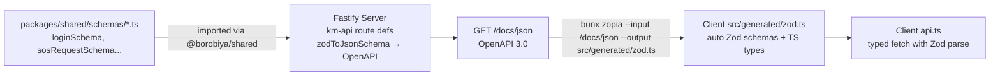

# Borobiya — API Specification

> TL;DR: REST + Socket.IO. Route prefixes enforce access: `_auth` (guest-only), `_public` (open), `_user` (authed user), `_admin` (admin). Every request validated by Zod from `packages/shared`. Swagger at `/docs` + `/docs/json` for Zopia codegen.

---

## 1. Base

```
API:  http://localhost:3000            (Fastify)
Map:  http://localhost:8000            (Martin/OSRM/Photon) — see MAP_SERVER.md
Swagger UI:   GET /docs
OpenAPI JSON: GET /docs/json
Health:       GET /_public/health      → { status: "ok", uptime, version }
```

Headers:
```
Authorization: Bearer <accessToken>   // for _user & _admin
Content-Type: application/json
X-Map-Data-Version: 2025-05-01        // optional, from Map Server
```

Error shape (uniform):

```json
{ "error": true, "code": "ALREADY_AUTHENTICATED", "message": "...", "issues": [] }
```

- `code` is machine-readable (see §9).
- Zod validation errors include `issues` (flattened).

---

## 2. Route Prefixes — The Law

| Prefix | Auth | Who | Backend hook | Frontend guard | Example |
|--------|------|-----|--------------|----------------|---------|
| `/_auth` | **Guest only** | Not logged in | If JWT present → `403 ALREADY_AUTHENTICATED` | `if loggedIn → redirect /_user/dashboard` | `POST /_auth/login` |
| `/_public` | Open | Everyone | None (optional auth pass-through) | None | `GET /_public/incident-types` |
| `/_user` | Required `user` | Authed users (+ admin may opt-in) | `authenticate` + `authorize(['user','admin'])` | Require login → `/_auth/login` | `POST /_user/sos/requests` |
| `/_admin` | Required `admin` | Admins only | `authenticate` + `authorize(['admin'])` | Role check → `403` | `POST /_admin/users` |

> Decision to document: Does `admin` role allow `/_user/*`? Spec says “_user — Only authenticated users”; recommended: allow `admin` to call `_user` (useful for debugging), but explicitly document: **Admin can call `_user` endpoints** (since they are users too). Alternatively restrict to `user` only — pick one and keep consistent.

Implementation sketch (see ARCHITECTURE.md §13.3 and SECURITY.md §5).

---

## 3. Auth Routes (`/_auth` — guest only)

### 3.1 POST `/_auth/register`

```ts
Body = z.object({
  username: z.string().min(3).max(30).regex(/^[a-z0-9_]+$/),
  password: z.string().min(8).regex(/^(?=.*[A-Za-z])(?=.*\d).+$/), // 1 letter + 1 number
  confirmPassword: z.string(),
  securityQuestions: z.array(z.object({
    questionId: z.string().uuid(),
    answer: z.string().min(1).max(200)
  })).length(5)
}).superRefine((d, ctx) => {
  if (d.password !== d.confirmPassword) ctx.addIssue({ path: ["confirmPassword"], ... });
  if (new Set(d.securityQuestions.map(q=>q.questionId)).size !== 5) ctx.addIssue({ path: ["securityQuestions"], ... });
})

→ 201 { user: { id, username, createdAt } }
→ 400 { code: "VALIDATION_ERROR", issues }
→ 409 { code: "USERNAME_TAKEN" }
```

Normalize answers: `trim().toLowerCase()` before argon2 hash.

### 3.2 POST `/_auth/login`

```ts
Body { username, password } → 200 { accessToken, refreshToken, user: { id, username, role, mustCompleteSecurityQuestions } }
→ 401 { code: "INVALID_CREDENTIALS" }
→ 403 { code: "ACCOUNT_SUSPENDED", suspendedUntil, reason }
→ 403 { code: "SECURITY_QUESTIONS_REQUIRED" } // when mustCompleteSecurityQuestions
→ 429 { code: "RATE_LIMITED" }
```

Rate: 5/15m per `ip+username`.

### 3.3 POST `/_auth/refresh`

```ts
Body { refreshToken } or cookie → 200 { accessToken, refreshToken }
→ 401 { code: "INVALID_REFRESH" }
```

### 3.4 POST `/_auth/logout`

```ts
→ 200 { ok: true }  // invalidate refreshTokenHash in user_sessions
```

### 3.5 Forgot Password

**Request**

```
POST /_auth/forgot-password/request
Body { username } → 200 { questionIds: string[3], questions: string[3] }
```
- Server randomly picks 3 of user's 5 (do not allow client choice).
- Rate-limit 5/15m.

**Verify**

```
POST /_auth/forgot-password/verify
Body { username, answers: [{questionId, answer}] } // len 3
→ 200 { resetToken } // JWT, 10m, single-use
→ 400 { code: "WRONG_ANSWERS" }
```

**Reset**

```
POST /_auth/forgot-password/reset
Body { resetToken, newPassword, confirmPassword }
→ 200 { ok: true }
→ 400 { code: "INVALID_RESET_TOKEN"/"VALIDATION_ERROR" }
```

### 3.6 Security Questions Helpers

```
GET /_public/security-questions          // open, returns all 15 seeded: {id, text}
GET /_auth/security-questions            // alias for guest
```

---

## 4. Public Routes (`/_public`)

```
GET /_public/health                      // { status:"ok" }
GET /_public/security-questions
GET /_public/incident-types              // public SOS form dropdown
GET /_public/map/styles/:theme.json     // proxy or redirect to Map Server styles
```

No auth required; may include `X-User-Id` personalization if token present (optional).

---

## 5. User Routes (`/_user` — authed)

### 5.1 Me & Devices

```
GET    /_user/me                         → { id, username, role, isActive, avgRating, mustComplete..., createdAt }
PATCH  /_user/me                         Body { username? } // limited fields
GET    /_user/devices                    → [{ id, deviceName, ip, isCurrentDevice, lastActiveAt, isOnline }]
POST   /_user/complete-security-questions Body { securityQuestions[5] } → 200
```

### 5.2 User Search

```
GET /_user/users/search?q=&category=&incidentType=&minRating=&online=&sort=distance&lat=&lon=&page=&limit=
→ { items: [{ id, username, category, avgRating, isOnline, distance }], total, page, limit }
```

`online` accepts `true` or `false`. `lat` and `lon` must be supplied together; if omitted, distance sorting may use the authenticated user's last known location.

### 5.3 Location Sharing

```
POST   /_user/location/share             { targetUserIds: string[], mode:"timed"|"permanent", durationMinutes?: number, note? }
→ 201 { shareId, expiresAt? }
DELETE /_user/location/share/:id         → 200 (immediate revoke)
GET    /_user/location/shares            → { owned: [], sharedWithMe: [] }

POST   /_user/location/history/share     { targetUserIds, from: ISO, to: ISO, maxPoints? }
→ 201 { shareId }
GET    /_user/location/history?from=&to= → { points: [{lat,lon,timestamp}] } // own history
GET    /_user/location/history/shared/:shareId → polyline for receiver

POST   /_user/location/update            deprecated in favor of Socket location:update; REST fallback
```

Retain ENV limits: `from-to <= MAX_SHARE_DAYS`, else `400 SHARE_RANGE_TOO_LARGE`.

### 5.4 SOS — Requester Side

```
POST  /_user/sos/requests                { severity:"low"|"medium"|"high", description(10-500), incidentTypeId, location:{lat,lon,accuracy?,isManual}, photoUrl? }
→ 201 { requestId, status:"pending" }
GET   /_user/sos/requests                ?role=requester → history I created
GET   /_user/sos/requests/:id
POST  /_user/sos/requests/:id/cancel     { cancellationReasonId, customReason? }
POST  /_user/sos/requests/:id/photo      multipart max 5MB → { photoUrl }
```

### 5.5 SOS — Proposals & Missions (Rescuer)

```
GET   /_user/sos/proposals               // inbox: pending proposals for me
POST  /_user/sos/proposals/:id/accept    → { missionId } // only if !isOnMission
POST  /_user/sos/proposals/:id/decline   { reason? }

GET   /_user/sos/missions                ?role=rescuer → my missions
GET   /_user/sos/missions/:id
PATCH /_user/missions/:id/status         { status: "on_the_way"|"arrived"|"in_progress"|"completed" }
POST  /_user/missions/:id/cancel         { cancellationReasonId, customReason? } // hard path
POST  /_user/missions/:id/rate           { rating:1-5, comment? } // only after completed, only requester
GET   /_user/sos/requests/:id/nearest    // optional shortcut to admin nearest logic
```

Mission status order enforced: `pending → on_the_way → arrived → in_progress → completed`; out-of-order → `400 INVALID_STATUS_TRANSITION`.

### 5.6 Sync (reconnection)

```
GET /_user/sync?since=ISO → { events: [...], location: ..., missions: ... }
```

---

## 6. Admin Routes (`/_admin` — admin only)

### 6.1 Users

```
GET   /_admin/users?q=&isActive=&hasCategory=&page=&limit=   → paginated list
GET   /_admin/users/:id                                       → detail + devices + missions
POST  /_admin/users           { username, password, isActive? } // no security questions
PATCH /_admin/users/:id/status { isActive: boolean }
PATCH /_admin/users/:id/unsuspend
// NO DELETE — must not exist
```

### 6.2 Incidents & Categories

```
POST  /_admin/incidents           { name, icon?, color?, description? }
GET   /_admin/incidents
PATCH /_admin/incidents/:id
POST  /_admin/categories          { name, description?, incidentTypeIds: string[] }
GET   /_admin/categories
PATCH /_admin/categories/:id     { name?, description?, incidentTypeIds? }
POST  /_admin/categories/:id/users   { userIds: string[] }
DELETE /_admin/categories/:id/users/:userId
```

### 6.3 SOS Dispatch

```
GET   /_admin/sos/requests                    → all SOS, filter status
GET   /_admin/sos/requests/:id
GET   /_admin/sos/requests/:id/nearest       → { responders: [{userId, distance, avgRating, categoryName, lastActiveAt}] }
POST  /_admin/sos/requests/:id/dispatch      { rescuerIds: string[] } → creates proposals + emits
GET   /_admin/stats                           → { counts: sosByStatus, activeMissions, onlineUsers }
```

### 6.4 Cancellation Reasons (admin config)

```
GET   /_admin/cancellation-reasons
POST  /_admin/cancellation-reasons { type:"requester"|"rescuer", key, label, labelFa, requiresCustomText, isActive }
```

Seeded on first migration (see SECURITY.md §10).

---

## 7. Zod + km-api + Zopia — Contract Flow



**Adding a new endpoint:**

1. Add request and response Zod schemas in `packages/shared/src/schemas/`.
2. Add a descriptor in `packages/shared/src/api/`:

   ```ts
   import { defineRoute } from "@borobiya/shared/api";

   export const myRoute = defineRoute({
     method: "POST",
     url: "/_user/my",
     schema: { body: mySchema, responses: { 201: myResponseSchema, 400: errorSchema } },
     meta: {
       operationId: "userCreateMyResource",
       summary: "Create a resource",
       tags: ["user"],
       access: "authenticated"
     }
   });
   ```

   `access` is `public`, `guest`, `authenticated`, or `admin`. The descriptor preserves `method`, `url`, `schema`, and `meta` while adapting the request/response schemas and metadata to `km-api`'s `makeApiConfig` format.
3. In the server workspace, attach a handler through the Fastify adapter; a shared descriptor does not contain application handlers or register a server route itself.
4. T1.0.6 wires the `km-api` configs into `/docs/json`; then run `bunx zopia --input http://localhost:3000/docs/json`.
5. Use generated schemas in client form validation.

---

## 8. Realtime (Socket.IO)

**Auth:** `io(auth:{token: accessToken})` → server verifies JWT in `handshake`.

**Rooms:** `user:{userId}`, `admin`, `mission:{missionId}`.

Full event catalog:

| Direction | Event | Payload | Who |
|-----------|-------|---------|-----|
| C→S | `location:update` | `{lat,lon,accuracy,timestamp,priorityDeviceId}` | owner on share/mission |
| S→C | `location:peer-update` | `{userId, lat, lon, accuracy, timestamp}` | targets + mission participants |
| C→S | `sos:create` | same as REST body | requester (alt to REST) |
| S→C | `sos:new-request` | `{sosRequest}` | `admin` room |
| S→C | `admin:nearest-responders` | `{sosRequestId, responders[]}` | admin who requested |
| S→C | `sos:proposal-received` | `{proposal}` | `user:{rescuerId}` |
| S→C | `sos:proposal-accepted` | `{proposal, missionId}` | `admin` + `user:{requesterId}` |
| C→S | `mission:update-status` | `{missionId, status}` | rescuer |
| S→C | `mission:status-updated` | `{missionId, status, by, at}` | `mission:{id}` room |
| C→S | `mission:cancel` | `{missionId, reason}` | both |
| S→C | `mission:cancelled-by-requester` | `{missionId, reason}` | `mission:{id}` |
| S→C | `mission:cancelled-by-rescuer` | `{missionId, rescuerId, reason, rescuerLocation}` | `admin` room (urgent) |
| S→C | `system:suspended` | `{reason, until}` | suspended user |
| C→S | `ping` / S→C `pong` | heartbeat | all |

Polling fallback: `GET /_user/sync?since=` if WebSocket blocked.

---

## 9. Error Codes

| HTTP | Code | When |
|------|------|------|
| 400 | `VALIDATION_ERROR` | Zod fail |
| 401 | `UNAUTHORIZED` | Missing/invalid JWT |
| 403 | `FORBIDDEN` | Wrong role |
| 403 | `ALREADY_AUTHENTICATED` | Authed user hits `/_auth/*` |
| 403 | `ACCOUNT_SUSPENDED` | `isSuspended` |
| 403 | `SECURITY_QUESTIONS_REQUIRED` | `mustCompleteSecurityQuestions` blocks `_user` |
| 403 | `ON_MISSION` | Try accept second proposal while busy |
| 404 | `NOT_FOUND` | Unknown id |
| 409 | `USERNAME_TAKEN` | Duplicate |
| 409 | `WRONG_DEVICE` | GPS from non-priority device |
| 409 | `INVALID_STATUS_TRANSITION` | Bad mission order |
| 409 | `PRIORITY_DEVICE_REQUIRED` | Multi-device without selection |
| 429 | `RATE_LIMITED` | Too many req |
| 413 | `PAYLOAD_TOO_LARGE` | Photo >5MB |
| — | `CANCEL_RATE_LIMITED` | 3 cancels/hour |

Use `code` for client i18n and retry logic (never English message).

---

## 10. Pagination

All list endpoints accept `?page=1&limit=20` (default 20, max 100) and return:

```json
{ "items": [...], "total": 100, "page": 1, "limit": 20, "totalPages": 5 }
```

---

## 11. Example Flows (curl)

**Register → Login → Share**

```bash
curl -X POST http://localhost:3000/_auth/register -H 'Content-Type: application/json' -d '{
  "username":"ali_123","password":"pass1234","confirmPassword":"pass1234",
  "securityQuestions":[
    {"questionId":"<uuid1>","answer":"fluffy"},
    {"questionId":"<uuid2>","answer":"tehran"}
  ]
}'
curl -X POST http://localhost:3000/_auth/login -d '{"username":"ali_123","password":"pass1234"}'
# → { accessToken }
TOKEN=...
curl http://localhost:3000/_user/me -H "Authorization: Bearer $TOKEN"
curl -X POST http://localhost:3000/_user/location/share -H "Authorization: Bearer $TOKEN" -d '{"targetUserIds":["..."],"mode":"timed","durationMinutes":60}'
```

**SOS full:**

```bash
curl -X POST http://localhost:3000/_user/sos/requests -H "Authorization: Bearer $TOKEN" -d '{
  "severity":"high","description":"Car accident near Azadi square, need help","incidentTypeId":"...","location":{"lat":35.7,"lon":51.38,"isManual":false}
}'
# Admin
curl http://localhost:3000/_admin/sos/requests/REQUEST_ID/nearest -H "Authorization: Bearer $ADMIN_TOKEN"
curl -X POST http://localhost:3000/_admin/sos/requests/REQUEST_ID/dispatch -H "Authorization: Bearer $ADMIN_TOKEN" -d '{"rescuerIds":["..."]}'
# Rescuer
curl -X POST http://localhost:3000/_user/sos/proposals/PROP_ID/accept -H "Authorization: Bearer $RESCUER_TOKEN"
curl -X PATCH http://localhost:3000/_user/missions/MISSION_ID/status -H "Authorization: Bearer $RESCUER_TOKEN" -d '{"status":"on_the_way"}'
```

---

## 12. Frontend Router Mirrors

| Client page | API call |
|-------------|----------|
| `/_auth/login` | `POST /_auth/login` |
| `/_auth/register` | `GET /_public/security-questions` + `POST /_auth/register` |
| `/_auth/forgot-password` | 3-step forgot |
| `/_user/dashboard` | `GET /_user/me`, `GET /_user/location/shares`, live socket |
| `/_user/map` | Map Server tiles/styles + `GET /_user/users/search` |
| `/_user/sos/history` | `GET /_user/sos/requests` + `missions` |
| `/_admin/users` | `GET /_admin/users`, `PATCH .../status` |
| `/_admin/dispatch` | `GET /_admin/sos/requests/:id/nearest`, `POST .../dispatch` |

---

## 13. Implementation Rule

> **No endpoint bypasses Zod.** Every route's `schema.body/query/params` must be `zodToJsonSchema(schemaFromShared)`. Lint fails if `req.body` accessed without validation.

