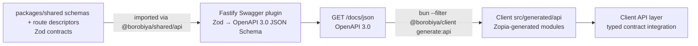

# Borobiya — API Specification

> TL;DR: REST + Socket.IO. Routes use `_auth`, `_public`, `_user`, and `_admin` prefixes with access metadata. Shared Zod descriptors feed Swagger at `/docs` + `/docs/json`. Runtime handlers include public health/security-question/incident-type catalogs (`GET /_public/health`, `GET /_public/security-questions`, `GET /_public/incident-types`), `POST /_auth/{register,login,refresh,logout,forgot-password/*}`, admin-only `GET /_admin/users`, `GET /_admin/users/:id`, `POST /_admin/users`, and `PATCH /_admin/users/:id/status`, authenticated `GET /_user/me` + `POST /_user/complete-security-questions` + `GET /_user/devices` + `GET /_user/users/search` (with `category`, `incidentType`, `minRating`, `online`, and distance filters), the admin incident-type and responder-category catalogs including member listing, assignment, and removal (`/_admin/incidents`, `/_admin/categories`), the whole `/_user/location` surface (live share create/revoke/list, history grant create/list/read/delete, the windowed own-history read, and the deprecated REST fallback), and SOS creation + photo upload + admin queue/nearest-responder/dispatch endpoints (`POST /_user/sos/requests`, `POST /_user/sos/requests/:id/photo`, `GET /_admin/sos/requests`, `GET /_admin/sos/requests/:id`, `GET /_admin/sos/requests/:id/nearest`, `GET /_admin/sos/requests/:id/missions`, `POST /_admin/sos/requests/:id/dispatch`, `GET /_user/sos/proposals`, `POST /_user/sos/proposals/:id/accept`, `POST /_user/sos/proposals/:id/decline`, plus realtime `sos:new-request` broadcasts to `admin`, `sos:proposal-received` to `user:<id>`, and `sos:proposal-accepted` to the requester and admin); unimplemented descriptors remain contract-only and return 404; consult each operation’s runtime-status flag.

---

## 1. Base

```
API:  http://localhost:3000            (Fastify)
Maps: http://localhost:8000            (Martin) — see MAP_SERVER.md
Route: http://localhost:8001/route      (OSRM adapter; graphs are built locally from the selected map dataset)
Map config: GET /map-config              (region, bounds, version, and zoom range)
Swagger UI:   GET /docs
OpenAPI JSON: GET /docs/json
Health:       GET /_public/health      → { status: "ok", uptime, version }   (the one route the global throttle skips)
```

The OpenAPI document uses `/` for a directly exposed API and `/api` first when served by Compose through Nginx (with `/` retained as the direct-port alternative). Configure `OPENAPI_SERVER_PATH` when a gateway uses a different prefix.

Headers:
```
Authorization: Bearer <accessToken>   // for _user & _admin
Content-Type: application/json
X-Map-Data-Version: development       // reserved optional version pin; not currently enforced
```

Caching and throttling are defaults rather than per-route habits:

- Every response carries `cache-control: no-store`, applied by an `onSend` hook in `plugins/security.ts` so
  it also covers replies no handler produced — a throttled `429`, Fastify's `404` for an unknown path, and the
  `401` the `/_user` hook returns before routing. A handler that sets its own `cache-control` still wins, which
  makes `GET /_public/security-questions` (`public, max-age=3600`) the only deliberately cacheable response in
  the API. The per-route `no-store` calls elsewhere are kept as documentation of intent, not as the mechanism.
- The global request throttle (`RATE_LIMIT_MAX` / `RATE_LIMIT_WINDOW_MS`, per client IP once `TRUSTED_PROXY_IPS`
  is configured) covers every route **except** `GET /_public/health`: an orchestrator must never be able to
  mistake a busy-but-healthy instance for a dead one, which is what happens when the probe that decides whether
  to restart a container starts answering `429` during a load spike. The exemption is one descriptor field,
  `ApiRouteMeta.rateLimitExempt`, read both by `app.ts` (which sets the route's `rateLimit: false`) and by the
  OpenAPI generator (which then does not attach its implicit `429` to that operation) — so the contract cannot
  advertise an error the runtime is unable to produce. `/docs` and `/docs/json` remain throttled: they are
  developer surfaces, not liveness probes.

Error shape (uniform):

```json
{ "error": true, "code": "ALREADY_AUTHENTICATED", "message": "...", "issues": [] }
```

- `code` is machine-readable (see §9).
- Zod validation errors include `issues` (flattened).

---

## 2. Route Prefixes — The Law

| Prefix | Auth | Who | Backend hook | Frontend guard | Example |
|--------|------|-----|--------------|----------------|---------|
| `/_auth` | **Guest only** | Not logged in | If JWT present → `403 ALREADY_AUTHENTICATED` | `if loggedIn → redirect /_user/dashboard` | `POST /_auth/login` |
| `/_public` | Open | Everyone | None (optional auth pass-through) | None | `GET /_public/incident-types` |
| `/_user` | Required `user` | Authed users (+ admin may opt-in) | Access-JWT verification and current account-state checks; incomplete accounts may only complete security questions | Require login → `/_auth/login`; incomplete account → onboarding | `POST /_user/complete-security-questions` |
| `/_admin` | Required `admin` | Admins only | Access-JWT verification and role authorization; user creation/status also recheck current role/active/suspended state | Role/state check → `401`/`403` | `POST /_admin/users` |

> Decision to document: Does `admin` role allow `/_user/*`? Spec says “_user — Only authenticated users”; recommended: allow `admin` to call `_user` (useful for debugging), but explicitly document: **Admin can call `_user` endpoints** (since they are users too). Alternatively restrict to `user` only — pick one and keep consistent.

Implementation sketch (see ARCHITECTURE.md §13.3 and SECURITY.md §5).

---

## 3. Auth Routes (`/_auth` — guest only)

### 3.1 POST `/_auth/register`

```ts
Body = z.strictObject({
  username: z.string().min(3).max(30).regex(/^[a-z0-9_]+$/),
  password: z.string().min(8).max(1024).regex(/^(?=.*\p{L})(?=.*\p{Nd}).+$/u), // Unicode letter + decimal digit
  confirmPassword: z.string(),
  securityQuestions: z.array(z.strictObject({
    questionId: z.string().uuid(),
    answer: z.string().trim().min(1).max(200)
  })).length(5)
}).superRefine((d, ctx) => {
  if (d.password !== d.confirmPassword) ctx.addIssue({ path: ["confirmPassword"], ... });
  if (new Set(d.securityQuestions.map(q=>q.questionId)).size !== 5) ctx.addIssue({ path: ["securityQuestions"], ... });
})

→ 201 { user: { id, username, createdAt } }
→ 400 { code: "VALIDATION_ERROR", issues } // invalid body or question IDs not in the catalog
→ 403 { code: "ALREADY_AUTHENTICATED" }
→ 409 { code: "USERNAME_TAKEN" }
→ 429 { code: "RATE_LIMITED" }
```

The handler verifies the five question IDs against the seeded catalog, hashes the password and answers with Argon2id, and writes the user plus all five answer hashes in one transaction. Normalize answers: `trim().toLowerCase()` before hashing. Rate: 5 attempts per 15 minutes per `ip+username`.

### 3.2 POST `/_auth/login`

```text
Request: { username, password, deviceName? }
Browser (Origin header) 200: { accessToken, user } + Set-Cookie refreshToken
Native (no Origin header) 200: { accessToken, refreshToken, user } (store refreshToken in secure storage)
400: { code: "VALIDATION_ERROR" }
401: { code: "INVALID_CREDENTIALS" }
403: { code: "ALREADY_AUTHENTICATED" | "ACCOUNT_INACTIVE" | "ACCOUNT_SUSPENDED" }
429: { code: "RATE_LIMITED" }
```

The refresh cookie is `HttpOnly; Secure; SameSite=Lax` and expires after 7 days; its default browser path follows the login URL, so it works both at the direct API path and behind the `/api` gateway prefix. Browser requests are distinguished by their `Origin` header; native clients omit it and receive the refresh token only in the response body. Login accepts existing credentials without reapplying the new-password letter/digit rule, but caps the submitted password at 1024 characters.
`deviceName` (1–100 characters, trimmed) is an optional platform label for the Active Devices table — a Capacitor build can send `"Samsung S23"`. Web clients omit it and the server summarizes the `User-Agent` instead (`"Chrome on Windows"`, `"Safari on iPhone"`, `"Microsoft Edge on Windows"`); a UA that matches no known browser or platform stores `null`, because the column is user-visible text, not an archive of client detail. It returns `user.mustCompleteSecurityQuestions` with tokens so an admin-created account can authenticate to the required onboarding route; T1.2.6 will gate other `/_user` operations until completion. A suspended account currently returns a generic `ACCOUNT_SUSPENDED` error because suspension expiry/reason columns are future schema work.

Rate: 5/15m per `ip+username`.

### 3.3 POST `/_auth/refresh`

```text
Request: native body { refreshToken } or web HttpOnly cookie (body may be omitted)
Web 200: { accessToken } + rotated HttpOnly refresh-token cookie
Native 200: { accessToken, refreshToken } (store replacement token in secure storage)
400: { code: "VALIDATION_ERROR" } // malformed body
401: { code: "INVALID_REFRESH" } // bad/expired JWT, missing persistence, or a lost concurrent rotation
403: { code: "ALREADY_AUTHENTICATED" | "ACCOUNT_INACTIVE" | "ACCOUNT_SUSPENDED" }
```

The handler verifies the refresh-token signature and expiry, matches the JWT's user/device/session claims to the stored session hash, checks current account state, then conditionally replaces the hash. The conditional update allows only one concurrent refresh to succeed. Tokens use distinct random JWT IDs (`jti`) and carry the stable session ID separately; legacy login tokens whose `jti` is the session ID remain accepted while they roll over. Browser responses keep refresh tokens out of JSON; native clients omit `Origin` and store the body token in secure storage.

### 3.4 POST `/_auth/logout`

```text
Request: web HttpOnly refresh-token cookie or native body { refreshToken }
200: { ok: true }  // invalidate the session; expire the browser cookie
400: { code: "VALIDATION_ERROR" } // malformed body
403: { code: "ALREADY_AUTHENTICATED" }
```

Logout is idempotent: missing, invalid, or expired tokens still receive `{ ok: true }` and a cookie-clear response. A verified token revokes only its claimed session; an unverified token can affect a session only if its hash exactly matches the stored hash. Native clients should also clear their platform secure-storage token after a successful response.

### 3.5 Forgot Password

**Request**

```
POST /_auth/forgot-password/request
Body { username }
→ 200 { questionIds: string[3], questions: string[3] }
→ 400 { code: "VALIDATION_ERROR" }
→ 403 { code: "ALREADY_AUTHENTICATED" }
→ 429 { code: "RATE_LIMITED" }
→ 503 { code: "RECOVERY_UNAVAILABLE" }
```

The server randomly chooses three of the account's five saved questions and persists that exact, ten-minute challenge; the client cannot substitute a different set at verification. Unknown accounts and accounts without five saved answers receive three questions from a stable, server-keyed five-question decoy pool for that username, with the same status and response shape. Question answers/hashes are never returned. Request/verify are limited to five attempts per 15 minutes per IP+username.

**Verify**

```
POST /_auth/forgot-password/verify
Body { username, answers: [{questionId, answer}] } // exactly 3 unique answers from the active challenge
→ 200 { resetToken } // opaque, 10m, single-use
→ 400 { code: "WRONG_ANSWERS" } // same response for unknown users and incorrect/mismatched answers
→ 403 { code: "ALREADY_AUTHENTICATED" }
→ 429 { code: "RATE_LIMITED" }
```

Answers are normalized with `trim().toLowerCase()` and compared against Argon2id hashes. The reset token is 32 cryptographically random bytes encoded as base64url; only its SHA-256 hash is stored. A successful verification consumes the recovery challenge and replaces any older reset token for that account.

**Reset**

```
POST /_auth/forgot-password/reset
Body { resetToken, newPassword, confirmPassword }
→ 200 { ok: true }
→ 400 { code: "INVALID_RESET_TOKEN" | "VALIDATION_ERROR" }
→ 403 { code: "ALREADY_AUTHENTICATED" }
→ 429 { code: "RATE_LIMITED" }
```

The server checks token validity before the expensive password hash, then atomically claims the token in the same transaction that updates the password; only one concurrent reset succeeds. A successful reset stores the Argon2id password hash, deletes outstanding reset tokens, consumes recovery challenges, and revokes the user's refresh sessions. Reset attempts are limited to five per 15 minutes per IP because this request has no username field.

### 3.6 Security Questions Helpers

```
GET /_public/security-questions          // open, returns seeded prompts: {id, text}
GET /_auth/security-questions            // guest alias (contract-only)
```

`GET /_public/security-questions` is live and returns the catalog used by registration and onboarding; question prompts are public, but answer hashes are never returned. The guest alias remains contract-only.

---

## 4. Public Routes (`/_public`)

```
GET /_public/health                      // { status:"ok" }
GET /_public/security-questions
GET /_public/incident-types              // public SOS form dropdown
GET /_public/map/styles/:theme.json     // proxy or redirect to Map Server styles
```

No auth required; may include `X-User-Id` personalization if token present (optional).

---

## 5. User Routes (`/_user` — authed)

### 5.1 Me & Devices

```
GET    /_user/me                         → { id, username, role, isActive, avgRating, mustComplete..., createdAt }
PATCH  /_user/me                         Body { username? } // limited fields
GET    /_user/devices                    → [{ id, deviceId, deviceName, ip, isCurrentDevice, lastActiveAt, isOnline }]
POST   /_user/complete-security-questions Body { securityQuestions[5] } → 200
```

`POST /_user/complete-security-questions` requires an access JWT backed by a matching unrevoked session, five unique question IDs from the seeded catalog, and non-empty answers. The server stores `trim().toLowerCase()` Argon2id answer hashes and atomically clears `mustCompleteSecurityQuestions`; it returns `409 SECURITY_QUESTIONS_ALREADY_COMPLETED` rather than replacing answers if onboarding is already complete. While the flag is true, the user authorization hook returns `403 SECURITY_QUESTIONS_REQUIRED` for every other registered `/_user` route. The same hook returns `401 INVALID_ACCESS_TOKEN` when logout, password reset, or admin action revoked the persisted session, immediately invalidating any access JWT from it. `GET /_user/me` returns the current profile with `Cache-Control: no-store` after onboarding; incomplete accounts receive the security-question gate response. Other `_user` operations shown here remain contract-only.

**`GET /_user/devices` (T2.3.2, live).** Returns the caller's **live sessions** — rows of `user_sessions` that still hold a refresh token — newest `lastActiveAt` first, capped at `MAX_USER_DEVICE_LIST_ITEMS` (50), with `Cache-Control: no-store`. `id` is the session row and `deviceId` is the value `location_shares.priorityDeviceId` pins (T2.3.3), so the picker offers exactly the ids the server accepts; exactly one row has `isCurrentDevice: true` because the `/_user` hook already rejects a revoked or missing session. `deviceName` is the label described in §3.2 and `ip` is the address seen at the last credential exchange (login or refresh rotation). Logged-out and admin-revoked sessions are excluded rather than listed as offline history, since sessions have no retention job of their own; `isOnline` still mirrors session liveness and will only differentiate once socket presence (T2.1.5) drives it.

### 5.2 User Search

```
GET /_user/users/search?q=&category=&incidentType=&minRating=&online=&sort=distance|username&radiusKm=&lat=&lon=&page=&limit=
→ { items: [{ id, username, category, avgRating, isOnline, distance }], total, page, limit, totalPages }
```

`online` accepts `true` or `false`. `lat` and `lon` must be supplied together; if omitted, distance sorting uses the authenticated user's last known location when available.

**Live for the share picker, responder filtering and directory browsing (T2.1.7 + T3.1.4 + T4.1.1).** Authenticated accounts may browse reachable active accounts without `q`, paginated with a 20-row default and a 100-row ceiling; the one-term picker deliberately continues to wait for at least two characters.
- `q` is optional. When present it needs at least 2 characters (case-insensitive substring match, wildcards and backslashes escaped). PostgreSQL `pg_trgm` indexes contains matches, while the existing unique username B-tree backs the default username order for term-free browsing. Do not interpret a query result as a currently consenting GPS recipient.
- The caller's own account is never a candidate, in the page or in its `total`: `POST /_user/location/share` refuses it (`self_target`), so a list that offered it could only produce an error the user cannot act on.
- `category` and `incidentType` are honored against `categories`, `category_users`, and `category_incident_types`, projecting the matching responder category name (or primary alphabetical category when unfiltered).
- `minRating` and `online` are honored: unrated accounts count as 0, and `online` checks active unrevoked socket-connected sessions (`user_sessions.is_online = true` with non-null `refresh_token_hash`).
- `distance` is **kilometres, one decimal**, from `lat`/`lon` if given, otherwise from the caller's last stored position, otherwise `null` for every row. Results sort nearest-first with accounts that have no position last, then by username, so nobody is dropped for having an old fix.
- `sort` accepts `distance|username`; named searches default to nearest-first, term-free browsing to username-first (ties by id). `page`/`limit` follow the shared pagination bounds (limit 1–100, default 20).
- Optional `radiusKm` is 0.1–500 km. It filters with PostGIS `ST_DWithin` in the page **and** total query before pagination; it uses `lat`/`lon` when given, otherwise the caller’s stored position. A caller without a stored position and no explicit coordinates gets zero matches, not invented 0 km or an unbounded result. VM PostGIS spatial performance remains to be measured; PGlite only verifies a test-stand-in for the geography operations.

`Cache-Control: no-store`, because the answer depends on who is asking and where they last were.

### 5.3 Location Sharing

```
POST   /_user/location/share             { targetUserIds: string[], mode:"timed"|"permanent", durationMinutes?: number, note?, priorityDeviceId?: string }
→ 201 { shares: LocationShare[], createdShareIds: string[], reusedShareIds: string[] }
DELETE /_user/location/share/:shareId    → 200 empty body (immediate revoke)
GET    /_user/location/shares            → { owned: (LocationShare & { targetUsername })[], sharedWithMe: (LocationShare & { owner })[] }

POST   /_user/location/history/share     { targetUserIds, from: ISO, to: ISO, maxPoints? }
→ 201 { shares: LocationHistoryShare[], createdShareIds: string[], reusedShareIds: string[] }
GET    /_user/location/history?from=&to= → { points: [{lat,lon,timestamp,accuracy?}], totalPoints } // own history
GET    /_user/location/history/shares    → { owned: (LocationHistoryShare & { targetUsername })[], sharedWithMe: (LocationHistoryShare & { owner })[] }
GET    /_user/location/history/shared/:shareId → the granted window, same shape as above
DELETE /_user/location/history/share/:shareId → 200 empty body (the grant row is deleted)

POST   /_user/location/update            deprecated REST fallback for Socket `location:update` (live)
```

**Client use (T2.1.7, live).** `packages/client/src/api/location.ts` is the only caller of these routes; `ShareDialog.vue` posts a share (with `priorityDeviceId` only while the `409` chooser is open) and `ShareLists.vue` reads both directions, so a browser never guesses at a shape the shared schemas already define.

**`GET /_user/location/shares` (T2.1.4, live).** Both lists contain only **active** shares — `isRevoked = false` and either permanent or still inside `expiresAt` — newest first, capped at the 100 most recent rows per list (`MAX_LOCATION_SHARE_LIST_ITEMS`). `owned` rows are the caller's outgoing shares; `sharedWithMe` rows are incoming shares and each one carries `owner: { id, username, lastLocation }`, where `lastLocation` is the owner's last server-known WGS84 position (`{ lat, lon }`, `null` before the first update) so a receiver can render a marker without a second request. Since P2-Q1, `owned` rows also carry `targetUsername: string | null` — the *other* party's name for the same reason `sharedWithMe` carries `owner.username`: a list of uuids does not answer "who can see me right now". It is nullable and read with a **left** join on purpose: a share whose target row cannot be read still has to appear, because that row is how the owner revokes it. `POST /_user/location/share` does not answer with the label (its schema is strict), so a client must not expect it there. Responses are `Cache-Control: no-store`.

**`DELETE /_user/location/share/:shareId` (T2.1.3, live).** Owner-only and immediate: the row keeps existing for audit but `isRevoked=true` makes it invisible to every reader, including the receiver's live update path. A non-UUID id is `400 VALIDATION_ERROR`; an unknown id or a share owned by another account is `404 SHARE_NOT_FOUND` with the same message, so the endpoint never confirms that somebody else owns it. Revoking an already-revoked id repeats `200` with an empty body, which keeps client retries idempotent. Responses are `Cache-Control: no-store`.

**`POST /_user/location/history/share` (T2.2.3, live).** Grants one fixed window of the caller's stored history to 1–50 unique recipients. Limits: the window may span at most `LOCATION_HISTORY_MAX_SHARE_DAYS` — checked here rather than in the schema because it is configuration, and over that bound the answer is `400 SHARE_RANGE_TOO_LARGE` with `issues: [{ code: "range_too_large", maxShareDays, requestedDays, path: ["to"] }]` and nothing written — and `maxPoints` is an integer from 1 to `MAX_LOCATION_HISTORY_SHARE_POINTS` (10000), stored on the grant so every receiver of that window reads it at the same density — the receiver's read takes no sampling parameter, and the owner changes the density by re-posting the same window with a new value, which the reuse path applies. Recipients are validated as a batch with the identical live-share rule, issue codes (`self_target`, `unknown_target`, `unavailable_target`) and `["targetUserIds", index]` paths; one unusable recipient rejects the whole request. A repeat of the same owner/target/`from`/`to` reuses the existing grant — the unique index over exactly those columns *is* the duplicate rule — and rewrites only `maxPoints`, including back to `null` when the repeat states no preference.

Two properties follow from the shape of a history grant and are worth stating plainly: it needs **no priority device** (it replays rows the server already stored, so there is nothing to broadcast, and `priorityDeviceId` is not part of this payload), and it **does not expire** — it lasts until the retention prune removes the points underneath it, which is also why a window that no longer contains any point is created normally instead of being refused, and reads back as no points. `DELETE /_user/location/history/share/:shareId` (T2.2.4, live) is that real `DELETE`: unlike `location_shares`, this table keeps no `is_revoked` flag. Responses are `Cache-Control: no-store`.

**History reads (T2.2.4, live).** A window read is `[from, to)` on the observation `timestamp` — the same half-open convention the shared range check uses — and returns at most the grant's `maxPoints` points, oldest first, or `LOCATION_HISTORY_READ_POINTS` when the grant stores none. The ceiling and the total are decided in one statement: `row_number()` and `count(*) OVER ()` are computed over the rows the `(user_id, timestamp)` index already yields, so a 30-day window never travels to Node just to be thrown away; the response's `totalPoints` says how many rows the window holds, which is how a player tells a sampled view from the complete record.

- `GET /_user/location/history` reads the caller's own rows and requires explicit `from`/`to` (a 90-day retention default would silently hide how much was omitted). Sampling uses the configured default, because your own history has no grant to carry a target.
- `GET /_user/location/history/shared/:shareId` reads one grant the caller *received*. Nothing about the window or the density is a query parameter: the grant fixes both, so a receiver cannot widen what they were given, and every receiver of one grant sees the same view. A grant id that does not exist and one belonging to a different receiver answer identically with `404 SHARE_NOT_FOUND`, since this is the only endpoint that can probe whether another account shares history with anybody.
- `GET /_user/location/history/shares` lists both directions newest first, capped at `MAX_LOCATION_SHARE_LIST_ITEMS` per list, and is how a receiver learns an id in the first place. Nothing is filtered out: a grant has no expiry and no revoked state, so the list is whatever the account holds. `sharedWithMe` rows carry `owner: { id, username }` — deliberately not `lastLocation`, which a history grant never authorizes. `owned` rows carry `targetUsername` under the same left-join rule as the live list.
- `DELETE /_user/location/history/share/:shareId` is owner-only and immediate: the row goes away and the receiver's next read answers `404`. It does not recall points the receiver already loaded, and repeating the delete answers `404` (unlike the live revoke, which repeats `200`, there is no retained row to be idempotent about).

**Expiry & retention (T2.1.6 + T2.2.5, live).** No HTTP surface: a maintenance timer inside the API process retires
`location_shares` rows with `expiresAt <= now` by setting `isRevoked = true` (checked every 15s, at least once a minute,
plus one catch-up pass on startup). Clients see no new status or error code — a share stops being readable the moment its
`expiresAt` passes, because every reader filters on `expiresAt > now`, and the sweep only makes that state permanent and
visible in the table. Practical consequences for clients:

- `GET /_user/location/shares` stops listing the row at the deadline itself, not at the sweep — the list has always filtered on `expiresAt > now`.
- `DELETE /_user/location/share/:shareId` on an expired id still answers `200` (the row exists and stays owner-addressable, only already inactive).
- Re-sharing with the same target after expiry creates a **new** row (`createdShareIds`) instead of reusing the retired one, because reuse only considers active shares.

History retention is enforced by the same scheduler once a day: `location_history` rows with
`created_at < now - LOCATION_HISTORY_RETENTION_DAYS` are deleted in batches of 5,000 (max 40 batches per pass), so a window
requested near the retention edge can legitimately return fewer points than expected. `LOCATION_HISTORY_MAX_SHARE_DAYS` is
validated at startup to be ≤ `LOCATION_HISTORY_RETENTION_DAYS`; the per-request `400 SHARE_RANGE_TOO_LARGE` check above is
part of T2.2.3.

**`POST /_user/location/share` (T2.1.2, live).** Requires the same verified `/_user` access token, active account, and completed-onboarding state as every other user route. Limits: 1-50 unique recipients, `durationMinutes` an integer from 1 to 43200 (30 days, required only for `timed`), and `note` up to 500 characters. Recipients are validated as a batch: the owner's own account, unknown ids, and inactive or suspended accounts are rejected with `400 VALIDATION_ERROR` and `issues[].code` of `self_target`, `unknown_target`, or `unavailable_target`, each with `issues[].path` set to the body path of the offending element (`["targetUserIds", index]`, the shape every other issue in the response uses) so a client can name the person it refused instead of reporting a form-wide error; nothing is written when any recipient is rejected. On success all rows are written in one transaction and each response `shares[]` item follows `LocationShare` (`id`, `ownerId`, `targetUserId`, `mode`, `expiresAt`, `isRevoked`, `priorityDeviceId`, `note`, `createdAt`). A recipient has **one** active arrangement, whatever its mode: a repeated request for the same owner/target reuses that row (`reusedShareIds`) — a `timed` row is extended only forward (a shorter window is a revoke, not a side effect), a switch to `permanent` clears its `expiresAt`, and a switch to `timed` writes the new one — while `createdShareIds` is answered only when the pair has no active row at all. Any other active row for the same pair, left behind when reuse was keyed on mode, is revoked in that same transaction. Concurrent retries serialize on a transaction-scoped advisory lock per owner, so a double-tapped share button cannot create two active rows for one recipient. Responses are `Cache-Control: no-store`.

**Priority device (T2.3.3, live).** `priorityDeviceId` names the device that will broadcast the position for these shares. When the account has exactly one device with a live session the server pins it itself, so a single-device account never has to choose and an omitted field is never a rejection. When it has more than one, the field is required: a share request without it is `409 PRIORITY_DEVICE_REQUIRED` with `issues: [{ code: "multiple_active_devices", deviceIds, path: ["priorityDeviceId"] }]` and nothing is written, so the client can open the chooser from that list and retry. That status is declared on the operation in the OpenAPI document, so a generated client types it as its own outcome rather than an opaque error. An id that is not one of the caller's live devices is `400 VALIDATION_ERROR` with the issue code `unknown_priority_device`; a malformed id is rejected by `shareSchema` before any device lookup. The pin is stored per share row, and a repeated request for an existing share re-points it whenever the requested device differs — including on a permanent share, which otherwise never changes; `note` is still only rewritten together with an extension. Only devices with a live session can be pinned: signing out of the last one stops broadcasts by design, and because the expiry sweep re-points a share whose pinned device no longer has a session, a share is never stranded on a signed-out device while the account has exactly one live device left. The pin governs live broadcasting only: `location:update` (section 8) accepts a fix for the shares that pin the sender's device, while history shares need no selection because they replay rows the server already stored.

### 5.4 SOS — Requester Side

```
POST  /_user/sos/requests                { severity:"low"|"medium"|"high", description(10-500), incidentTypeId, location:{lat,lon,accuracy?,isManual}, photoUrl? }
→ 201 { requestId, status:"pending" }
GET   /_user/sos/requests                ?role=requester → history I created
GET   /_user/sos/requests/:id
POST  /_user/sos/requests/:id/cancel     { cancellationReasonId, customReason? }
POST  /_user/sos/requests/:id/photo      multipart max 5MB → { photoUrl }
```

**`POST /_user/sos/requests/:id/photo` (T3.2.3, live).** `multipart/form-data` with exactly one file part named `photo` and nothing else; `@fastify/multipart` runs with `files: 1`, `fields: 5`, `fileSize` = `SOS_PHOTO_MAX_SIZE_MB` × 1 MiB (README §14's knob, defaulting to spec §11.2's 5 MB — the shared `MAX_SOS_PHOTO_BYTES` is that default, not a second limit), and `throwFileSizeLimit` on so an oversized body never reaches the handler at all. The rules, in the order a request meets them:

- `401` unless the caller passes the `/_user` guard (live session, active and unsuspended account, completed onboarding) — and `401` rather than `413` even for a 6 MB body, because the parser only claims the stream and the guard runs before the route would look at it. Past the guard, the route shares filing an SOS's budget (3 per minute per account, `SECURITY.md` §3) on its own counter, so a fourth photo in a minute is a `429` while an SOS can still be created.
- `400 VALIDATION_ERROR` if the path segment is not a UUID, if the content type is not multipart (`expected_multipart`), if the body has no file (`no_file`), or if any part is named something other than `photo` (`unexpected_field`, `TOO_MANY_PARTS`). A wrongly named field is refused with both names in the message rather than chosen for the caller, and a stray `caption` is refused rather than dropped: losing a note about an emergency in silence is worse than a 400 that says where to put it.
- `413 PHOTO_TOO_LARGE` above the configured ceiling. The message states that limit in MB — the *configured* one, so a deployment that set 2 MB reads 2 MB back — and does not ask the sender to compress a file the server has already measured.
- `400 VALIDATION_ERROR` with `issues[].code` of `empty`, `too_large`, `unsupported_format`, or `truncated` and `path: ["photo"]` when the bytes themselves are wrong. `docs/SECURITY.md` §9 asks for magic-byte validation; `src/security/image-payload.ts` does it and is stricter than a header sniff — it requires the format's closing structure too, so a 40-byte file that starts with a PNG signature is `truncated` rather than stored. The declared `Content-Type` and the file name are never consulted, and the refusal names what arrived when it recognizes it (a GIF, a PDF, a ZIP, a `data:` URL, markup), because "unsupported format" is advice nobody can act on.
- `404 SOS_REQUEST_NOT_FOUND` with one message for a request that does not exist and one owned by somebody else — the ownership test is folded into the `WHERE` of the update, so this route cannot walk the SOS table by probing ids. Only the requester may attach a photo to a request; a `200` for an admin's upload would put words in a survivor's mouth.
- No rule about *when* a photo may arrive. The endpoint deliberately imposes none — not on `status`, not on `cancelled_at`, not one per request — for the same reason `POST /_user/sos/requests` invents no duplicate-suppression rule: nothing in spec §11.2, §11.7, or `SECURITY.md` §9 states one, and a policy invented here would be a promise the docs do not keep. A re-post therefore replaces which file the request points at (`photo_url` is one column), and the superseded bytes stay on the volume until a retention rule for orphans is written with the read route.

On success the bytes are written into `UPLOAD_DIR` under a name the server chose — `<random uuid>.<png|jpg|webp>`, mode `0600`, staged as `<name>.<uuid>.part` and renamed, so a crash leaves a stray `.part` rather than a truncated photo that reads as a complete one, and a caller-supplied file name never reaches the filesystem at all. `sos_requests.photo_url` is set to `/uploads/<that name>`, the app-relative shape `SECURITY.md` §9 reserves for the read route, and the extension comes from the sniffed format rather than from anything the client sent. The response is `200 { photoUrl }` with `Cache-Control: no-store`, echoing the path the row holds rather than recomputing it. The read path is separate: a bearer-authenticated requester, admin, or pending/accepted proposal recipient calls `GET /_user/sos/requests/:id/photo-access` and receives `{ url, expiresAt }` with a 60-second signed URL. A browser `` then loads `/api` plus that URL (`GET /uploads/:id?requestId=&expires=&signature=`); Fastify rechecks the current `sos_requests.photo_url` so a superseded or unlinked photo cannot be read, and serves JPEG/PNG/WebP bytes with `Cache-Control: no-store`. Unauthenticated/nonparticipant issuance fails without disclosing whether the request exists. The signed URL is a short-lived bearer capability and must not be logged or shared; nginx disables access logging on `/api/uploads/` and never mounts the upload directory statically. A re-post replaces the URL the request points at and leaves the previous file on the volume; destroying a picture someone already submitted as evidence is not a decision this endpoint gets to make, and no orphan-retention rule exists yet.

**`POST /_user/sos/requests` (T3.2.2, live).** Requires the same verified `/_user` access token, active and unsuspended account, and completed-onboarding state as every other user route, because dispatch is entitled to trust that the account behind a request exists and is in good standing — those checks run before the body is read. Everything the SOS form promises is enforced here as well, through `createSosRequestSchema`: `severity` is one of `low | medium | high`; `description` is trimmed and bounded at 10–500 characters, the same rule the table's own `CHECK` carries so no row can exist that the API would refuse to return; `incidentTypeId` is a UUID; and `location` is `{ lat ∈ [-90, 90], lon ∈ [-180, 180], accuracy? ≥ 0, isManual }`, where `isManual: true` is what a pin the human moved on the map looks like and an omitted `accuracy` is stored as NULL rather than 0 — "the device reported no radius" and "the device reported a perfect fix" are opposite facts. An invented extra field is refused rather than half-stored, so a client that guesses at the shape learns immediately.

An incident type the catalog does not contain is `400 VALIDATION_ERROR` with `issues: [{ code: "unknown_incident_type", message: "The incident type <id> does not exist. Pick one of the types an admin has created.", path: ["incidentTypeId"] }]` and nothing is filed. The catalog is data, and nothing is seeded: on a fresh install that refusal is the *expected* first answer until an admin creates at least one type (§6.2), which is why the SOS screen fills its dropdown from the catalog the server offers instead of a hardcoded list. `incident_types` has no enabled/disabled column, so availability here is existence — and the probe and the insert run in one transaction, which is why an admin deleting a type concurrently cannot leave a request that names nothing.

`photoUrl` is refused with `400 PHOTO_URL_NOT_ACCEPTED`, even though §11.2 lists it among the fields of an SOS and the schema therefore accepts its shape: the only writer of that column is `POST /_user/sos/requests/:id/photo` (T3.2.3), because a URL the requester supplies is an address the dispatcher's browser would have to load in order to read the evidence (§9). Refusing it beats accepting and ignoring it, which would leave a client wondering where its photo went. Success answers `201 { requestId, status }`, with the status read back from the row rather than assumed (`pending` today), and `Cache-Control: no-store`. The route carries §3's per-user throttle — 3 requests per minute keyed by the verified `userId`, enforced after the session guard so an unauthenticated flood spends none of it — and the fourth attempt in a minute is the shared `429 RATE_LIMITED` envelope with `retry-after`, whether or not the earlier bodies were valid. Listing, detail, and cancellation remain contract-only (photo access requires the signed URL issued by `GET /_user/sos/requests/:id/photo-access`).

### 5.5 SOS — Proposals & Missions (Rescuer)

```
GET   /_user/sos/proposals               ?page=&limit= → { items, total, page, limit, totalPages } // live: my pending proposals
POST  /_user/sos/proposals/:id/accept    → { missionId } // live: only if !isOnMission
POST  /_user/sos/proposals/:id/decline   { reason? } // live: optional 1–500 chars after trim, empty 200 response

GET   /_user/sos/missions                ?role=rescuer → my missions
GET   /_user/sos/missions/:id
PATCH /_user/missions/:id/status         { status: "on_the_way"|"arrived"|"in_progress"|"completed" }
POST  /_user/missions/:id/cancel         { cancellationReasonId, customReason? } // hard path
POST  /_user/missions/:id/rate           { rating:1-5, comment? } // live; completed mission requester only
GET   /_user/sos/requests/:id/nearest    // optional shortcut to admin nearest logic
```

`GET /_user/sos/missions/:id/presence` returns `{missionId,requester:{online,lastSeenAt},rescuer:{online,lastSeenAt}}` only for active-mission participants or an active admin session; foreign, unknown and terminal missions return the same 404. This no-store transport snapshot does **not** reveal GPS fixes, indicate human presence or authorize navigation. A session with a stale heartbeat is offline even if its persisted bit remains true; the client shows a five-minute grace badge followed by **manual review**, not automatic cancellation. HTTP refresh does not extend that grace.

`GET /_user/sos/missions/:id` includes `rating: 1..5 | null` in its participant/admin-scoped detail response. Requesters can see whether their rating was already recorded; assigned rescuers can view their mission's received stars in history. List rows do not include the rating.

`POST /_user/missions/:id/rate` is live for the completed mission's own requester. It requires an integer `rating` from 1 to 5 and optionally accepts a trimmed `comment` of at most 500 characters (unknown fields are rejected). The first rating returns `200` with an empty body; an unknown or foreign mission (including an admin/rescuer caller) returns `404 MISSION_NOT_FOUND`, an incomplete mission returns `409 MISSION_NOT_COMPLETED`, and a repeated rating returns `409 MISSION_ALREADY_RATED` without changing the original. Invalid input returns `400 VALIDATION_ERROR`; unauthenticated callers get 401. Responses carry `Cache-Control: no-store`. The unique mission/rater index arbitrates concurrent submissions. `mission_ratings` (`0018`) persists one rating per completed mission; database triggers serialize rating writes on the responder's user row and recompute the one-decimal `users.avg_rating` cache on insert/update/delete (NULL with no ratings). A rating's mission and participants cannot be changed. The requester UI is available in `/_user/sos-history`; rescuer history is `/_user/mission-history`.

`GET /_user/sos/proposals` is live behind the verified `/_user` session guard; only pending proposals with `rescuer_id` equal to the caller are listed. Each production item also carries `details` (incident type name, requester username, severity, description, incident location, optional stored photo path, and incident time); photo paths are **not** public URLs, and a participant must request a short-lived signed link via `GET /_user/sos/requests/:id/photo-access`. Distance is computed only when the browser user opts in to geolocation and is labeled straight-line rather than a route ETA. It returns newest first with an exact total even on an out-of-range page, strict pagination validation, and `Cache-Control: no-store`. The client polls every 30 seconds and also refreshes when its own `sos:proposal-received` socket event arrives. `POST /_user/sos/proposals/:id/accept` is live: accepts only the caller’s pending proposal, atomically creates a pending mission and initial history, marks the rescuer busy, auto-declines that rescuer’s other pending proposals, and updates the SOS to accepted. Repeating the successful request returns the same `{missionId}` without duplicating a mission or event. Unknown/foreign proposal ids return 404, unavailable/closed proposals 409, and a busy rescuer (flag or active mission row) gets `400 RESCUER_ON_MISSION`; all responses are `Cache-Control: no-store`. On commit it notifies requester and admin via `sos:proposal-accepted` and refreshes the admin SOS queue. `POST /_user/sos/proposals/:id/decline` is live: only the caller may decline a pending proposal; `reason` is optional, trimmed, and 1–500 characters when present. The reason is stored on the proposal, cleared if admin re-dispatches it, and never replaced by a retry within the same dispatch generation. A reopened proposal gets a new ID so stale accept/decline URLs return 404 rather than deciding a new offer. Repeated decline within the same generation returns 200 with an empty body; foreign/unknown IDs return 404 and accepted/expired proposals return 409. It does not mark the rescuer busy or change the SOS status. These responses also use `Cache-Control: no-store`.

Mission status order enforced: `pending → on_the_way → arrived → in_progress → completed`; out-of-order → `400 INVALID_STATUS_TRANSITION`.

### 5.6 Sync (reconnection)

```
GET /_user/sync?since=ISO[&cursor=UUID] → { events: missionStatusSteps[≤100], location: null, missions: missionSnapshots[≤100], missionsTruncated, nextCursor }
```

---

## 6. Admin Routes (`/_admin` — admin only)

### 6.1 Users

```
GET   /_admin/users?q=&isActive=&hasCategory=&page=&limit=   → paginated list
GET   /_admin/users/:id                                       → detail + devices + missions
POST  /_admin/users           { username, password, isActive? } → 201 userProfile
PATCH /_admin/users/:id/status { isActive: boolean }
PATCH /_admin/users/:id/unsuspend
// NO DELETE — must not exist
```

`POST /_admin/users` requires a signed, unexpired access JWT with the `admin` role, rechecks that the current admin account is still an active, unsuspended admin, and requires that the token's matching persisted session has not been revoked. The password is stored as an Argon2id hash; the new account always has role `user`, defaults to active unless `isActive` is supplied, and is created without any `user_security_answers` rows. Its response sets `mustCompleteSecurityQuestions: true`. It returns `401 UNAUTHORIZED`/`INVALID_ACCESS_TOKEN` for missing or invalid bearer access tokens, `403 ADMIN_REQUIRED`/`ACCOUNT_INACTIVE`/`ACCOUNT_SUSPENDED` when authorization fails, `400 VALIDATION_ERROR` for invalid bodies, and `409 USERNAME_TAKEN` for a duplicate username.

`PATCH /_admin/users/:id/status` accepts only the strict body `{ isActive: boolean }` and applies the same current-admin and unrevoked-session authorization checks. It returns the updated user profile with `200`, `400 VALIDATION_ERROR` for an invalid UUID/body, `401 UNAUTHORIZED`/`INVALID_ACCESS_TOKEN` (including a revoked session), `403 ADMIN_REQUIRED`/`ACCOUNT_INACTIVE`/`ACCOUNT_SUSPENDED`, or `404 USER_NOT_FOUND`. The status change, audit entry, and (on deactivation) refresh-session revocation run in one database transaction. The audit entry records `user_activated` or `user_deactivated`, target type/id, and prior/new active state; repeated requests for the existing state are idempotent and do not create duplicate events. Deactivation clears every stored refresh-token hash and marks sessions offline; both `/_user` and `/_admin` authorization checks require a matching session with a non-null refresh-token hash, so outstanding access JWTs are invalidated immediately. Reactivation does not restore those sessions, so the user must sign in again. The route returns `Cache-Control: no-store`.

The list and detail routes use the same signed-admin-token, current-account, and unrevoked-session checks. `GET /_admin/users` supports case-insensitive username substring search (`q`), `isActive`, `hasCategory`, and `page`/`limit` (defaults 1/20, max 100); it returns profiles with assigned `categories[]`, never password hashes. `GET /_admin/users/:id` returns the profile, `categories[]`, and device-session records — the same `deviceSchema` rows as `GET /_user/devices`, `deviceId` included, so a pinned priority device is identifiable from either view — where `isCurrentDevice` compares the returned session ID with the requesting admin's session. Its missions array is currently empty until mission read endpoints land in T3.5. Both read routes return `Cache-Control: no-store`; an invalid UUID/query returns `400 VALIDATION_ERROR`, and an unknown user returns `404 USER_NOT_FOUND`.

### 6.2 Incidents & Categories

```
POST  /_admin/incidents           { name, slug?, icon?, color?, description? }
GET   /_admin/incidents
PATCH /_admin/incidents/:id       { name?, slug?, icon?, color?, description? } (null clears icon/color/description)
POST  /_admin/categories          { name, description?, incidentTypeIds: string[] }
GET   /_admin/categories
PATCH /_admin/categories/:id     { name?, description?, incidentTypeIds? }
POST  /_admin/categories/:id/users   { userIds: string[] }
DELETE /_admin/categories/:id/users/:userId
```

`POST /_admin/incidents`, `GET /_admin/incidents`, and `PATCH /_admin/incidents/:id`, together with `GET`/`POST /_admin/categories`, `PATCH /_admin/categories/:id`, `POST /_admin/categories/:id/users` and `DELETE /_admin/categories/:id/users/:userId` (T3.1.2, T3.1.3), all using the same signed-admin-token, current-account, and unrevoked-session checks as the admin user routes.

The caller sends a `name`, not an identifier: the server derives the URL-safe `slug` from it (lowercased, accents folded, non-alphanumerics collapsed to `-`), and an explicit `slug` in the body overrides the derivation — the only way to add a type whose name has no ASCII letters or digits. Both directions obey one rule (`^[a-z0-9]+(?:-[a-z0-9]+)*$`, at most 64 characters): the body schema, the derivation, and the response payload all use the same schema, so a slug can never be legal in the field you typed it into and illegal in the read that returns it, which the server refuses with `400 VALIDATION_ERROR` and an `invalid_incident_slug` issue on `slug` rather than inventing one. A blank `description` is stored as `NULL`, so "no description" has exactly one representation; `icon` and `color` have no blank form (the schema requires a non-empty string), so clearing them means sending `null` on a PATCH — an empty string there is a validation error.

`GET /_admin/incidents` returns the whole catalog as a bare array ordered by `name`, because that is what an admin scans to find one entry, and `Cache-Control: no-store`. `PATCH` sends only the fields it names; unknown ids answer `404 INCIDENT_TYPE_NOT_FOUND`, and a body with no fields is a `400`, never a no-op write. Renaming onto another type's slug answers `409 INCIDENT_TYPE_SLUG_TAKEN`, and both the create path (through the unique index) and the rename path refuse a duplicate rather than silently suffixing it — the message names the type that already holds the slug, falling back to a nameless refusal only if that row is deleted in the same instant. Every accepted create and every change that actually altered a value appends an `admin_audit_log` row (`incident_type_created` / `incident_type_updated`, with the changed fields and their before/after values) in the same transaction as the write; a PATCH that changed nothing writes no audit row.

`POST /_admin/categories` takes `{ name, description?, incidentTypeIds }`; the id list is required (an empty array is a legal category that answers nothing) and every id must exist, otherwise the whole request is refused with `400 VALIDATION_ERROR` and one `unknown_incident_type` issue per bad id, each carrying its index in the caller's array — the same shape the share routes use for `unknown_target`, so a form can mark the entry instead of asking the admin to retype the list. Validation runs before the insert, inside the same transaction, so a refused request cannot leave a half-built category behind.

`PATCH /_admin/categories/:id` treats `incidentTypeIds` as the whole new set (delete then re-insert), because the contract has no way to say "add one" and diffing a field the caller named would let a stale admin list silently delete assignments it never displayed. The set is rewritten only when it actually differs, and an update that changed neither the name, the description, nor the set writes nothing at all — including no audit row. `GET /_admin/categories` returns the list ordered by category name with each `incidentTypeIds` ordered by incident-type name, so the same data renders identically twice; `Cache-Control: no-store`.

Assignment is idempotent: `POST /_admin/categories/:id/users` inserts through `on conflict ("category_id","user_id") do nothing`, so re-assigning an existing member is a `200` with an empty body rather than a failure, and an empty set of newly-added members produces no audit entry. Unknown accounts are refused the same way unknown incident types are (`unknown_user` per index); a missing category is `404 CATEGORY_NOT_FOUND`. `DELETE /_admin/categories/:id/users/:userId` answers `200` when the pair was deleted *and* when the user simply was not a member — the admin asked for a state, and it holds — while an unknown category is `404 CATEGORY_NOT_FOUND`. This differs from share revocation on purpose: there, "you were never granted this" is information the caller needs.

Nothing assigns membership by default: no trigger, no seed row, and no column default on `category_users`. Both category-membership read projections (T3.1.4) are live: `GET /_admin/categories` includes ordered `members[]` (`{ id, username, displayName }`), `GET /_admin/users` and `GET /_admin/users/:id` project `categories[]` and honor `hasCategory`, and `GET /_user/users/search` filters by `category` and `incidentType` across `category_users` and `category_incident_types`.

### 6.3 SOS Dispatch

```
GET   /_admin/sos/requests                    → paginated SOS queue, optional status filter
GET   /_admin/sos/requests/:id                → single SOS request detail
GET   /_admin/sos/requests/:id/nearest        → { responders: [{ userId, username, distance, avgRating, categoryName, lastActiveAt }] }
POST  /_admin/sos/requests/:id/dispatch       { rescuerIds: string[] } → 201 { proposals } + emits sos:proposal-received
GET   /_admin/stats                           → { counts: sosByStatus, activeMissions, onlineUsers } (contract-only)
```

`GET /_user/sos/requests?role=requester&page&limit` now returns only the caller’s SOS rows in stable newest-first pages, and `GET /_user/sos/requests/:id` returns only the owning requester’s record (foreign/unknown IDs share a 404). `role=rescuer` is explicitly rejected with `400 SOS_ROLE_UNSUPPORTED`; responders use the participant-scoped mission history endpoint instead. Owner paging is backed by `sos_requests_requester_created_at_idx` (`0017`). After submission, a requester can use `/_user/sos-history` to find the request again, inspect its state and securely view its photo via the short-lived photo-access endpoint (not by loading the stored photo URL directly).

The `/_admin/dispatch` replacement shortcut reuses `GET /_admin/sos/requests/:id`, the terminal-inclusive mission list and `GET /_admin/sos/requests/:id/nearest` before `POST /_admin/sos/requests/:id/dispatch`: it requests `?excludeAssigned=true` on the nearest read so previous assignees are excluded **in SQL before** the ten-responder limit; the ordinary nearest picker retains its existing default. Fewer than 10 offers are sent only if fewer than 10 new qualified responders are available. The backend remains authoritative for concurrent status/busy checks and may reject a stale one-click attempt; no dispatch happens automatically on an alert.

`GET /_user/sos/cancellation-reasons?type=requester|rescuer` lists active, database-managed reasons. `POST /_user/sos/requests/:id/cancel` takes `{cancellationReasonId, customReason?}` from the requester and validates an active requester-scoped reason (10–200 characters for Other). The SOS row is locked before all involved responder and mission rows. A pending/dispatched SOS is cancelled and its pending offers expire; an accepted SOS also terminates **every** active mission with one history step each and releases each responder only if no other active mission still needs them. A repeat returns empty `200` without notifications; foreign/unknown IDs return `404`, and an accepted SOS with no active mission or a terminal non-requester state returns `409 SOS_ALREADY_IN_PROGRESS`. Every committed active-mission cancellation emits `mission:cancelled-by-requester` once to the union of its private mission, requester, rescuer and admin rooms; delivery errors cannot turn the committed HTTP response into a 500.

`GET /_user/sos/missions?role=requester|rescuer&page&limit` returns only the caller’s missions with active ones first and bounded pagination; `GET /_user/sos/missions/:id` permits its two participants and an admin (foreign/unknown IDs share the same 404). These reads were pulled forward to keep the mission desk usable after reload; the full SOS history UI remains T3.7.1. `GET /_user/sos/missions/:id/navigation` returns `{missionId,incident:{lat,lon}}` with `Cache-Control: no-store` **only** when the authenticated caller is the assigned rescuer of an active (`pending|on_the_way|arrived|in_progress`) mission. Owner/status filtering occurs in the SQL join with the SOS; requester, admin, terminal, foreign and unknown missions share `404 MISSION_NOT_FOUND`. It supplies the destination to the local route chooser, not an authenticated routing proxy. `POST /_user/missions/:id/cancel` is live for the active mission’s rescuer: the body must select a current rescuer reason, with 10–200-character custom text for Other. The SOS→rescuer→mission locked transaction writes one cancelled history step, releases the rescuer unless another active mission exists, and sets SOS to `cancelled_by_rescuer` only when its last active mission stops. Same-step retries return empty `200` without new events, invalid terminal transitions return `409`, and foreign/unknown IDs return `404`. A separate 3/hour/account budget returns `429`; the third cancellation in a UTC day and every Other reason create durable admin-review alerts (`0016` migration). Review does not leave an unable rescuer on an active mission. After commit, a minimal `mission:cancelled-by-rescuer` event goes to participant rooms, while admins receive the full payload including last-known rescuer location and `reviewRequired`. The T3.6.5 admin console validates and deduplicates these notices, then checks the affected SOS by ID before allowing replacement dispatch.

`GET /_admin/sos/requests/:id/missions` returns only **active** missions by default for an existing SOS to an authorized admin; `?includeTerminal=true` opts into all assignments (including completed/cancelled) for history. Bad IDs and missing requests return 404, invalid filter values return 400, non-admins cannot access it, and responses are `Cache-Control: no-store`. This read lets dispatch recover live-room subscriptions after a reload; it never exposes location history or bypasses mission publishing consent. `GET /_user/sos/missions?role=requester&sosRequestId=<uuid>` filters the caller's missions to one SOS in SQL, keeping existing pagination and owner scoping. `GET /_user/sos/missions/:id/timeline` lets only the requester or rescuer read that mission's persisted status rows; `GET /_admin/sos/missions/:id/timeline` uses the full active-admin-session guard. Both timeline reads return ordered `{id,missionId,fromStatus,toStatus,changedBy,createdAt}` rows (timestamp first, legal status progression to break equal-timestamp ties), including cancellation and completion, with a shared 404 for foreign/unknown IDs and `Cache-Control: no-store`; an empty timeline is `[]`. Neither returns location history or cancellation reason text.

`GET /_user/sos/requests/:id`, `GET /_admin/sos/requests/:id`, and `GET /_user/sos/missions/:id` now return detail records with `cancelledBy`, `cancelledAt`, and `cancellationReason: {id,key,label,labelFa,customText} | null`, while the paginated lists retain the old compact record schema. SOS `cancelledBy` is derived from its current status; a `cancelled_by_rescuer` SOS awaiting replacement has **null** SOS-level reason and timestamp, because the rescuer's cancellation reason/time belong to the individual mission detail. Requester cancellation populates the SOS and each affected mission. Inactive reason-catalog entries remain readable in existing cancellation records; neither location nor cross-account history is exposed by these fields.

`PATCH /_user/missions/:id/status` is live for the mission's rescuer only. The body chooses the **next** step from `pending → on_the_way → arrived → in_progress → completed`; a same-step retry is idempotent (no duplicate history), a skip/reversal/terminal revival is `409 INVALID_MISSION_TRANSITION`, and a foreign or unknown mission is `404 MISSION_NOT_FOUND`. A successful transaction atomically writes one `mission_status_history` row and returns a full mission; completion releases the rescuer and completes the SOS only after its last active mission ends. All responses use `Cache-Control: no-store`. After a new step commits, `mission:status-updated {missionId,status,by,at}` is delivered once to the mission-room union with requester, rescuer and admin rooms; a same-step retry emits nothing. `mission:subscribe {missionId}` joins the private `mission:{id}` room only after an active session and participant/admin database check, returning `{ok:true}` or an unavailable/unauthorized ack. Socket failures never make a committed PATCH retryable.

`GET /_admin/sos/requests` (`page`, `limit`, optional `status`), `GET /_admin/sos/requests/:id`, `GET /_admin/sos/requests/:id/nearest` (T3.3.2), and `POST /_admin/sos/requests/:id/dispatch` (T3.3.3 + T3.4.5) are live behind the standard admin guard with `Cache-Control: no-store`; unknown request ids answer `404 SOS_REQUEST_NOT_FOUND`. Nearest responders match active, unsuspended, non-busy responders (`is_on_mission = false` and no active mission row) whose category maps to the SOS `incident_type_id` and who have a stored `last_location`, ordered by PostGIS spherical `ST_Distance` (up to 10 results). `POST /_admin/sos/requests/:id/dispatch` locks the SOS row and ordered responder rows in one transaction, rejects non-dispatchable SOS statuses with `409 INVALID_SOS_STATUS`, rejects busy responders with `409 RESCUER_BUSY`, creates/refreshes `mission_proposals`, transitions `pending` / `cancelled_by_rescuer` SOS rows to `dispatched`, appends an `sos_dispatched` audit entry, and emits `sos:proposal-received` to each `user:{rescuerId}` room plus `sos:new-request` to `admin`. `GET /_admin/stats` remains contract-only.

### 6.4 Cancellation Reasons (admin config)

```
GET   /_admin/cancellation-reasons
POST  /_admin/cancellation-reasons { type:"requester"|"rescuer", key, label, labelFa, requiresCustomText, isActive }
```

Populated by T1.1.3; the table is introduced in a follow-up migration rather than the initial auth-table migration (see SECURITY.md for the reason list).

---

## 7. Zod + km-api + Zopia — Contract Flow



**Adding a new endpoint:**

1. Add request and response Zod schemas in `packages/shared/src/schemas/`.
2. Add a descriptor in `packages/shared/src/api/`:

   ```ts
   import { defineRoute } from "@borobiya/shared/api";

   export const myRoute = defineRoute({
     method: "POST",
     url: "/_user/my",
     schema: { body: mySchema, responses: { 201: myResponseSchema, 400: errorSchema } },
     meta: {
       operationId: "userCreateMyResource",
       summary: "Create a resource",
       tags: ["user"],
       access: "authenticated"
     }
   });
   ```

   `access` is `public`, `guest`, `authenticated`, or `admin`. The descriptor preserves `method`, `url`, `schema`, and `meta` while adapting the request/response schemas and metadata to `km-api`'s `makeApiConfig` format.
3. Register a real Fastify handler in the server module using the descriptor's method and `makeExpressPathShape()`; keep application logic outside `packages/shared`. Until registered, the endpoint is contract-only and returns 404.
4. The Swagger plugin builds `/docs/json` from every shared descriptor without registering placeholder handlers. Contract-only operations carry `x-borobiya-runtime-status: contract-only`, and `openapi.info.description` is derived directly from that status map. Implemented handlers include public health/security-question/incident-type catalogs (`GET /_public/health`, `GET /_public/security-questions`, `GET /_public/incident-types`), auth register/login/refresh/logout/forgot-password flows, user profile/onboarding/devices, partial-username user search (with category/specialty filters), admin user list/detail/create/status, the admin incident-type and responder-category catalogs including member listing, assignment, and removal, SOS request creation (`POST /_user/sos/requests`), photo attachment (`POST /_user/sos/requests/:id/photo`), pending rescuer proposal inbox (`GET /_user/sos/proposals`), proposal decisions (`POST /_user/sos/proposals/:id/accept` and `POST /_user/sos/proposals/:id/decline`), and signed photo viewing (`GET /_user/sos/requests/:id/photo-access`, `GET /uploads/:id`), admin SOS reads and dispatch (`GET /_admin/sos/requests`, `GET /_admin/sos/requests/:id`, `GET /_admin/sos/requests/:id/nearest`, `GET /_admin/sos/requests/:id/missions`, `POST /_admin/sos/requests/:id/dispatch`) with realtime `sos:new-request` broadcasts to the `admin` room and `sos:proposal-received` deliveries to `user:<id>`, and the whole `/_user/location` surface — live share create/revoke/list, realtime `location:update` and `location:share-ended` with the deprecated REST fallback, and history grant create/list/read/delete with the windowed own-history read; place-search/reverse-geocode operations remain contract-only; requester mission rating (`POST /_user/missions/:id/rate`) is live.
5. Start the API, then run `bun --filter @borobiya/client generate:api`. The script fetches `http://localhost:3000/docs/json` by default and writes Zopia output to `packages/client/src/generated/api/` (ignored by Git). Override the source with `API_OPENAPI_URL` or the output directory with `ZOPIA_OUTPUT_DIR`.
6. Use generated modules in client API integration and form validation.

---

## 8. Realtime (Socket.IO)

**Auth:** `io(auth:{token: accessToken})` → server verifies JWT in `handshake`.

Mounted at `/socket.io` on the API port (behind nginx/Vite as `/api/socket.io`, which proxies the WebSocket upgrade and falls back to long polling). The handshake middleware applies the same rules as the `/_user` REST hook — verified access JWT, existing account whose role still matches, active, unsuspended, onboarding-complete, and backed by a persisted session — and closes the connection with `UNAUTHORIZED`, `INVALID_ACCESS_TOKEN`, `ACCOUNT_INACTIVE`, `ACCOUNT_SUSPENDED`, `SECURITY_QUESTIONS_REQUIRED`, or `SERVICE_UNAVAILABLE` (a database that cannot answer during the handshake; retry the connection). Each socket joins `user:{userId}` and admins additionally join `admin`. Neither path may reject instead: Socket.IO middleware and event listeners are callback-based, so a rejected promise there is never observed, and Node ends the process on an unhandled rejection.

**`location:update` (T2.1.5, live)** — payload `locationUpdateSchema` (`lat`, `lon`, optional `accuracy`, `timestamp`, `priorityDeviceId`). Server order: per-connection throttle (60/min) → payload validation → the reported `priorityDeviceId` must equal the session device of the connection (T2.3.4) → every active outgoing share whose pinned priority device (if any) matches that connection is accepted → the fix is written once in a transaction that updates `users.last_location` (`ST_SetSRID(ST_MakePoint(lon, lat), 4326)::geography`) and inserts `location_history` → `location:peer-update { userId, lat, lon, accuracy, timestamp }` is emitted to each accepting target's room and echoed to the sender's own room so other tabs on the account stay in sync. The ack is `{ ok, status, peers? }` or `{ ok: false, code, message, retryAfterMs? }` with codes `VALIDATION_ERROR`, `INVALID_TIMESTAMP` (a device clock more than 5 minutes ahead, or an observation older than 24 hours), `WRONG_DEVICE`, `RATE_LIMITED`, `SERVICE_UNAVAILABLE` (a storage failure under the update, reported instead of ending the process), and `UNAUTHORIZED`. A fix is stored even when no share is active, because SOS dispatch (T3.3.1) reads `users.last_location` as the last known position — which is also why the observation-age bound exists: a client that flushes a day of buffered fixes after reconnecting would otherwise drag that marker back to where the device stood yesterday and every receiver would follow it there.

The deprecated `POST /_user/location/update` fallback runs the identical service path and, when a realtime server is attached, fans the accepted fix out to peers too, so a polled fix is never silently local-only.

**`location:share-ended` (T2.1.5 follow-up, live)** — server-to-client notification `{ shareId, userId, reason: "revoked" | "expired" }` emitted only to `user:{targetUserId}` whenever `DELETE /_user/location/share/:shareId` retires an active share or the minute sweep in `location/jobs.ts` marks an overdue timed share inactive. Receivers drop the companion's marker and decrement open share state immediately without polling `GET /_user/location/shares`.

**Rooms:** `user:{userId}`, `admin`, `mission:{missionId}`. The implemented application events and acknowledgements have a shared type-only map (`packages/shared/src/types/realtime.ts`) used by both Socket.IO endpoints (T4.3.1). It does not replace schema parsing or session/membership checks for untrusted wire data. Planned event names below are not part of that live map.

Full event catalog:

| Direction | Event | Payload | Who |
|-----------|-------|---------|-----|
| C→S | `location:update` | `{lat,lon,accuracy,timestamp,priorityDeviceId}` | authenticated owner; ordinary live-share fan-out only |
| S→C | `location:peer-update` | `{userId, lat, lon, accuracy, timestamp}` | active share recipients + sender |
| S→C | `location:share-ended` | `{shareId, userId, reason: "revoked"\|"expired"}` | `user:{targetUserId}` when a live share ends |
| C→S | `sos:create` *(planned; use REST)* | same as REST body | requester |
| S→C | `sos:new-request` | `{sosRequest}` | `admin` room |
| S→C | `admin:nearest-responders` *(planned; use REST)* | `{sosRequestId, responders[]}` | admin who requested |
| S→C | `sos:proposal-received` | `{proposal, sosRequest}` | `user:{rescuerId}` |
| S→C | `sos:proposal-accepted` | `{proposal, missionId}` | `admin` + `user:{requesterId}` |
| C→S | `mission:subscribe` | `{missionId}` → ack `{ok:true}` or `{ok:false,code}` | authenticated active-mission participant/admin; live + DB recheck |
| C→S | `mission:location-publish` | `{missionId,location:{lat,lon,accuracy?,timestamp,priorityDeviceId}}` → accepted/rejected ack | explicitly consented requester/rescuer/admin on active mission; live session, priority device, 60/min and fresh-fix checks |
| S→C | `mission:location` | `{missionId,userId,role,lat,lon,accuracy,timestamp}` | sender + `mission:{id}` only after active-mission recheck; role is requester/rescuer/admin; timestamp is server receipt time |
| C→S | `mission:update-status` *(planned; use PATCH REST now)* | `{missionId, status}` | rescuer |
| S→C | `mission:status-updated` | `{missionId, status, by, at}` | union of `mission:{id}`, requester, rescuer and admin rooms |
| S→C | `mission:cancelled-by-rescuer` | `{missionId,sosRequestId,rescuerId,reason,at}`; admin also gets `{rescuerLocation,reviewRequired}` | participant rooms (redacted); admin room (full) |
| C→S | `mission:cancel` *(planned; use REST)* | `{missionId, reason}` | both |
| S→C | `mission:cancelled-by-requester` | `{missionId,sosRequestId,requesterId,rescuerId,reason,at}` | union of mission, requester, rescuer and admin rooms |
| S→C | `system:suspended` *(planned; Privacy-v2, not Phase 2)* | `{reason, until}` | suspended user |
| Transport | Socket.IO ping/pong (25s/10s) | internal transport heartbeat; app-level offline/grace UI remains T4.3.2–3 | all |

`GET /_user/sync?since=<ISO>[&cursor=<UUID>]` is live (T4.3.4): authenticated ordinary users only, no-store, 30-day lookback, participant-scoped mission status steps ordered by timestamp/id with a 100-step cursor, and active/recently changed mission snapshots with a 100-item limit and an explicit `missionsTruncated` flag. Invalid/foreign cursors or stale/future windows return 400; use paginated mission reads for older gaps or a truncated list. `location` is always `null` because neither a socket reconnection nor this read confers GPS consent. Proposal inbox, shares and admin queue reconcile through their own guarded reads on reconnect; no SSE fallback is implied.

---

## 9. Error Codes

Rows whose HTTP column is `—` belong to phases that have not shipped a handler yet (missions, cancellation rate
limits): the code is reserved so the client can handle it before the server ever sends it, and nothing returns it
today. Every row naming a real status is produced by a registered handler.

| HTTP | Code | When |
|------|------|------|
| 400 | `VALIDATION_ERROR` | Invalid input, selected security-question ID not in the catalog, an unusable location-share recipient (issue codes `self_target`, `unknown_target`, `unavailable_target`), an admin category naming an incident type that does not exist (`unknown_incident_type`, one issue per index) or assigning an account that does not exist (`unknown_user`), or a share request naming a priority device that has no live session (`unknown_priority_device`) |
| 404 | `SOS_PHOTO_NOT_FOUND` | Photo missing, superseded, or unavailable to the caller; invalid/expired signed URL |
| 400 | `PHOTO_URL_NOT_ACCEPTED` | `POST /_user/sos/requests` received `photoUrl` instead of uploading via `POST /_user/sos/requests/:id/photo` |
| 400 | `SHARE_RANGE_TOO_LARGE` | A history share spans more than `LOCATION_HISTORY_MAX_SHARE_DAYS`; `issues[0]` carries `maxShareDays` and `requestedDays` |
| 400 | `WRONG_ANSWERS` | Security answers do not match the active recovery challenge |
| 400 | `INVALID_RESET_TOKEN` | Reset token is invalid, expired, or already used |
| 401 | `UNAUTHORIZED` | Missing credentials |
| 401 | `INVALID_ACCESS_TOKEN` | Malformed, invalid-signature, expired, or wrong-use bearer access JWT |
| 403 | `FORBIDDEN` | Wrong role (generic contract code) |
| 403 | `ADMIN_REQUIRED` | A verified access token or current account does not have the admin role |
| 403 | `ALREADY_AUTHENTICATED` | A request with an `Authorization` header hits a guest-only `/_auth/*` endpoint |
| 403 | `ACCOUNT_INACTIVE` | Login/refresh or authenticated operation for a deactivated account |
| 403 | `ACCOUNT_SUSPENDED` | Login/refresh or authenticated operation for a suspended account |
| 403 | `SECURITY_QUESTIONS_REQUIRED` | `mustCompleteSecurityQuestions` blocks non-onboarding `_user` routes for non-admin accounts |
| 400 | `RESCUER_ON_MISSION` | Try to accept another proposal while the busy flag or an active mission row remains |
| 409 | `SECURITY_QUESTIONS_ALREADY_COMPLETED` | Onboarding endpoint cannot replace an account's completed security answers |
| 404 | `NOT_FOUND` | Unknown id for a generic operation |
| 404 | `USER_NOT_FOUND` | Admin status update targets a missing user |
| 404 | `INCIDENT_TYPE_NOT_FOUND` | Admin incident-type update names an id that does not exist |
| 404 | `CATEGORY_NOT_FOUND` | Admin category update, member assignment, or member removal names a category that does not exist |
| 404 | `SOS_REQUEST_NOT_FOUND` | Admin SOS read/dispatch or requester photo upload names an SOS request id that does not exist |
| 404 | `SHARE_NOT_FOUND` | A live or history share id is unknown, belongs to another account, or (for a received history read) was never granted to the caller |
| 409 | `USERNAME_TAKEN` | Duplicate |
| 409 | `INCIDENT_TYPE_SLUG_TAKEN` | An admin create or rename lands on a slug another incident type already owns; `issues[0].slug` carries the slug that collided |
| 409 | `INVALID_SOS_STATUS` | `POST /_admin/sos/requests/:id/dispatch` targets an SOS request whose status is not `pending`, `dispatched`, or `cancelled_by_rescuer` |
| 409 | `RESCUER_BUSY` | `POST /_admin/sos/requests/:id/dispatch` selects a responder who is already assigned to an active mission |
| 409 | `WRONG_DEVICE` | GPS from non-priority device |
| 409 | `INVALID_STATUS_TRANSITION` | Bad mission order |
| 409 | `PRIORITY_DEVICE_REQUIRED` | Multi-device without selection; `issues[0].deviceIds` carries the live devices for the chooser |
| 429 | `RATE_LIMITED` | Too many req |
| 503 | `RECOVERY_UNAVAILABLE` | Security-question catalog or recovery challenge storage is unavailable |
| — | `SERVICE_UNAVAILABLE` | A storage or account lookup failed under a realtime handshake or `location:update` ack; retry, because nothing was written |
| 413 | `PHOTO_TOO_LARGE` / `PAYLOAD_TOO_LARGE` | Uploaded SOS evidence photo exceeds `SOS_PHOTO_MAX_SIZE_MB` (default 5 MB) |
| — | `CANCEL_RATE_LIMITED` | 3 cancels/hour |
| 500 | `INTERNAL_ERROR` | A failure no handler answered (a store or serializer error). The detail is logged, never sent; safe to retry |

Use `code` for client i18n and retry logic (never English message). Framework-level 4xx (an unparseable body, an unsupported content type, a payload over the limit) arrive through one error handler that maps them onto these codes by status, so `FST_ERR_*` names are never part of the contract; a thrown 503 keeps its status and becomes `SERVICE_UNAVAILABLE`.

---

## 10. Pagination

All list endpoints accept `?page=1&limit=20` (default 20, max 100) and return:

```json
{ "items": [...], "total": 100, "page": 1, "limit": 20, "totalPages": 5 }
```

---

## 11. Example Flows (curl)

**Register → Login → Share**

```bash
curl -X POST http://localhost:3000/_auth/register -H 'Content-Type: application/json' -d '{
  "username":"ali_123","password":"pass1234","confirmPassword":"pass1234",
  "securityQuestions":[
    {"questionId":"<uuid1>","answer":"fluffy"},
    {"questionId":"<uuid2>","answer":"tehran"}
  ]
}'
curl -X POST http://localhost:3000/_auth/login -d '{"username":"ali_123","password":"pass1234"}'
# → { accessToken }
TOKEN=...
curl http://localhost:3000/_user/me -H "Authorization: Bearer $TOKEN"
curl -X POST http://localhost:3000/_user/location/share -H "Authorization: Bearer $TOKEN" -d '{"targetUserIds":["..."],"mode":"timed","durationMinutes":60}'
```

**SOS full:**

```bash
curl -X POST http://localhost:3000/_user/sos/requests -H "Authorization: Bearer $TOKEN" -d '{
  "severity":"high","description":"Car accident near Azadi square, need help","incidentTypeId":"...","location":{"lat":35.7,"lon":51.38,"isManual":false}
}'
# Admin
curl http://localhost:3000/_admin/sos/requests/REQUEST_ID/nearest -H "Authorization: Bearer $ADMIN_TOKEN"
curl -X POST http://localhost:3000/_admin/sos/requests/REQUEST_ID/dispatch -H "Authorization: Bearer $ADMIN_TOKEN" -d '{"rescuerIds":["..."]}'
# Rescuer
curl -X POST http://localhost:3000/_user/sos/proposals/PROP_ID/accept -H "Authorization: Bearer $RESCUER_TOKEN"
curl -X PATCH http://localhost:3000/_user/missions/MISSION_ID/status -H "Authorization: Bearer $RESCUER_TOKEN" -d '{"status":"on_the_way"}'
```

---

Place search (T4.1.2): the **Map Server** gateway `GET /geocode?q=&limit=5&bbox=` validates and bounds the query, forwards it to local Photon, and returns GeoJSON (`FeatureCollection`). The client `searchPlaces` adapter calls this same-origin path and converts valid point features to the shared `{ placeId, name, address, lat, lon, type, importance? }[]` contract; invalid hits are skipped, errors are not treated as empty success, and cancellation is supported. T4.1.4 uses this adapter in the map search panel (300 ms debounce, abort/stale guard, retry and selected-result fly-to constrained to the loaded map library). T4.1.3 calls the separate same-origin `GET /reverse?lat=&lon=` gateway on map click/long-press, converts its Photon GeoJSON to a copyable address, and keeps empty results distinct from upstream errors. Both gateway routes are distinct from the contract-only `/_user` Swagger geocode descriptors.

---

## 12. Frontend Router Mirrors

| Client page | API call |
|-------------|----------|
| `/_auth/login` | `POST /_auth/login` |
| `/_auth/register` | `GET /_public/security-questions` + `POST /_auth/register` |
| `/_auth/forgot-password` | 3-step forgot |
| `/_user/dashboard` | `GET /_user/me`, `GET /_user/location/shares`, `GET /_user/location/history/shares`, `DELETE /_user/location/share/:shareId`, plus the share dialog's `GET /_public/incident-types`, `GET /_user/users/search`, `POST /_user/location/share`, and `POST /_user/location/history/share`; live socket |
| `/_user/location-shares` | `GET /_user/location/shares`, `GET /_user/location/history/shares`, `DELETE /_user/location/share/:shareId`, `DELETE /_user/location/history/share/:shareId`, plus the share dialog's live/history creation flows |
| `/_user/devices` | `GET /_user/devices`, `GET /_user/location/shares`; changing a priority device re-posts `POST /_user/location/share` for that one recipient (reuse re-points the row; the expiry cannot move) |
| `/_user/map` | Map Server tiles/styles via `/map-config`; history playback reads `GET /_user/location/history?from&to` for one's own track and `GET /_user/location/history/shared/:shareId` (no query — the grant fixes range and density) for a companion's, with the grant list from `GET /_user/location/history/shares`; local `GET /geocode` feeds the debounced place-search panel and selection flies the camera to an in-bounds result; map click/long-press calls `GET /reverse` and opens a copyable-address sheet; live companion markers bootstrap from `GET /_user/location/shares` (`sharedWithMe[].owner.lastLocation`, which carries **no** timestamp — hence a stale-by-construction dot), follow `location:peer-update` ignoring one's own echo, and clear immediately on `location:share-ended` |
| `/_user/sos-history` *(planned placeholder)* | `GET /_user/sos/requests` + `missions` *(contract-only)* |
| `/_admin/users` | `GET /_admin/users`, `GET /_admin/users/:id`, `POST /_admin/users`, `PATCH .../status` |
| `/_admin/incidents` | `GET /_admin/incidents`, `POST /_admin/incidents`, `PATCH /_admin/incidents/:id` |
| `/_admin/categories` | `GET /_admin/categories`, `POST /_admin/categories`, `PATCH /_admin/categories/:id`, `POST /_admin/categories/:id/users`, `DELETE /_admin/categories/:id/users/:userId` |
| `/_admin/dispatch` | `GET /_admin/sos/requests`, `GET /_admin/sos/requests/:id`, `GET /_admin/sos/requests/:id/nearest`, `GET /_admin/sos/requests/:id/missions`, `POST /_admin/sos/requests/:id/dispatch`, plus `sos:new-request` realtime socket |

---

## 13. Implementation Rule

> **No endpoint bypasses Zod.** Every route's `schema.body/query/params` must be `zodToJsonSchema(schemaFromShared)`. Lint fails if `req.body` accessed without validation.

