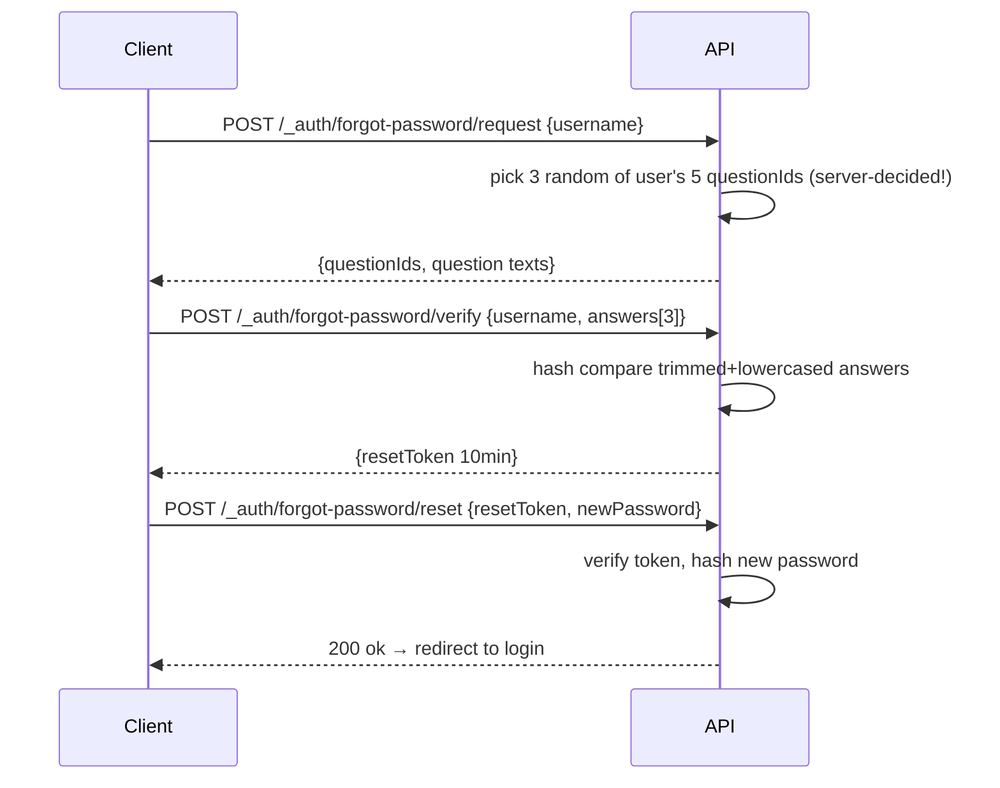

# Borobiya — Architecture

> TL;DR: Admin Web + User Web + Android → Fastify API + Socket.IO + PostgreSQL/PostGIS → Independent Map Server (Martin + OSRM + Photon). All map data is self-hosted PBF vector tiles, routable and searchable offline on LAN.

---

## Table of Contents
1. [High-Level Diagram](#1-high-level-diagram)
2. [Logical Layers](#2-logical-layers)
3. [Data Flow — Auth](#3-data-flow--auth)
4. [Data Flow — Location Sharing](#4-data-flow--location-sharing)
5. [Data Flow — SOS Rescue](#5-data-flow--sos-rescue)
6. [Map Server — Deep Dive](#6-map-server--deep-dive)
7. [Realtime Architecture (Socket.IO)](#7-realtime-architecture-socketio)
8. [Database Architecture (PostGIS)](#8-database-architecture-postgis)
9. [Frontend Architecture](#9-frontend-architecture)
10. [Monorepo & Shared Contract](#10-monorepo--shared-contract)
11. [Security Overview](#11-security-overview)
12. [Deployment Topologies](#12-deployment-topologies)
13. [Scalability Path](#13-scalability-path)
14. [Tech Stack Rationale](#14-tech-stack-rationale)
15. [Decision Log (ADR)](#15-decision-log-adr)

---

## 1. High-Level Diagram

```mermaid
graph TB
  subgraph Clients
    A[Admin Web<br/>Vue+Vuetify]
    U[User Web<br/>Vue+Vuetify]
    M[Android<br/>Ionic+Vue/Capacitor]
  end

  subgraph Edge
    NGINX[Nginx Reverse Proxy<br/>:80/:443]
  end

  subgraph Backend
    API[Fastify API Server<br/>:3000<br/>REST + Socket.IO]
    SOCK[Socket.IO<br/>Rooms: user, admin, mission]
    CRON[Cron Jobs<br/>prune history, expire shares]
  end

  subgraph Data
    PG[(PostgreSQL 16 + PostGIS 3.4<br/>users, missions, location_history)]
    REDIS[(Redis<br/>rate-limit + socket adapter<br/>optional for single-instance)]
  end

  subgraph MapServer [Independent Map Server :8000]
    direction TB
    MARTIN[Martin / TileServer-GL<br/>GET /tiles/{z}/{x}/{y}.pbf]
    STYLE[Styles<br/>/styles/light.json<br/>/styles/dark.json]
    ROUTING[Routing Engine<br/>OSRM / Valhalla<br/>POST /route]
    GEOCODE[Geocoding<br/>Photon / Nominatim<br/>GET /geocode, /reverse]
    DATA[(Data Volume<br/>pmtiles/mbtiles + OSRM graph + search index)]
  end

  A --> NGINX
  U --> NGINX
  M --> NGINX
  NGINX --> API
  A <--> SOCK
  U <--> SOCK
  M <--> SOCK
  API --> PG
  API --> REDIS
  SOCK --> REDIS
  CRON --> PG
  API -.->|config only| MapServer
  A -->|tiles/styles/route/geocode| MapServer
  U -->|tiles/styles/route/geocode| MapServer
  M -->|tiles/styles/route/geocode| MapServer
```

**Key Invariant:** Clients talk to **two origins**:
- `https://borobiya.local/api` → Fastify
- `https://map.borobiya.local` (or `:8000`) → Map Server

No third-party at runtime. Fully LAN-exploitable.

---

## 2. Logical Layers

| Layer | Owns | Communicates via |
|-------|------|-------------------|
| **Client** | UI, map rendering, GPS capture, camera | HTTPS REST + WebSocket to API; HTTPS to Map Server |
| **API** | Auth, business logic, SOS orchestration, rate-limit | SQL to Postgres; pub/sub to Socket; config to Map Server |
| **Socket** | Rooms, heartbeat, live location fan-out | In-memory (or Redis adapter when scaled) |
| **Postgres/PostGIS** | Truth: users, shares, missions, history | SQL, with `GEOGRAPHY(Point,4326)` for geo queries |
| **Map Server** | Tiles, routing graph, search index | File/DB volume, no dependency on API |

---

## 3. Data Flow — Auth

```mermaid
sequenceDiagram
  actor User
  participant Client
  participant API
  participant DB
  User->>Client: POST /_auth/register {username,password,securityQuestions[5]}
  Client->>API: validates Zod registerSchema
  API->>DB: check username unique, questionIds distinct
  API->>DB: hash password+answers (argon2id), insert user
  API-->>Client: 201 {user}
  User->>Client: POST /_auth/login {username,password}
  Client->>API: rate-limit 5/15min per IP+username
  API->>DB: verify hash, check isActive/isSuspended/mustCompleteSecurityQuestions
  API-->>Client: {accessToken 15m, user} + HttpOnly refresh cookie (web)
  Note over Client: Web stores access in memory; native clients may receive refreshToken in body for secure storage
```

**Forgot Password:**



---

## 4. Data Flow — Location Sharing

```mermaid
sequenceDiagram
  participant Owner
  participant Target
  participant API
  participant Socket
  participant DB
  Owner->>API: POST /_user/location/share {targetUserIds, mode, durationMinutes}
  API->>DB: validate targets exist & isActive
  API->>API: check activeDevices>1 → require priorityDeviceId selection
  API->>DB: insert location_shares (expiresAt if timed)
  Owner->>Socket: location:update {lat,lon,accuracy, priorityDeviceId} every 3-5s throttled
  Socket->>API: authenticate via JWT, verify priorityDeviceId matches
  API->>DB: upsert users.lastLocation (PostGIS), insert location_history
  API->>Socket: emit location:peer-update to room user:{targetId}
  Target->>Target: render marker via MapLibre
  Note over API,DB: Cron every minute: expire timed shares; daily prune history > RETENTION_DAYS
```

Multi-device conflict resolution is **mandatory**: only `priorityDeviceId`'s GPS accepted.

---

## 5. Data Flow — SOS Rescue

See also [`DIAGRAMS/SOS_FLOW.md`](./DIAGRAMS/SOS_FLOW.md) for full state machine + diagram.

Summary:

```mermaid
sequenceDiagram
  participant Requester
  participant Admin
  participant Rescuer
  participant API
  participant Socket
  participant OSRM as MapServer:OSRM
  Requester->>API: POST /_user/sos/requests {severity,description,incidentTypeId,location,photo}
  API->>Socket: emit sos:new-request to room admin
  Admin->>Admin: sees pulsing marker + sound
  Admin->>API: POST /_admin/sos/requests/:id/dispatch {rescuerIds} (nearest 10 suggested by SQL)
  API->>Socket: emit sos:proposal-received to each rescuer room user:{rescuerId}
  Rescuer->>API: POST /_user/sos/proposals/:id/accept (only if isOnMission=false)
  API->>API: create mission, set rescuer.isOnMission=true, decline other proposals for rescuer
  API->>Socket: mission:proposal-accepted → Requester+Admin; mission:status-updated
  Rescuer->>OSRM: POST /route {from: rescuer.lastLocation, to: sos.location, profile: car/bike/foot}
  OSRM-->>Rescuer: 2-3 alternatives {distance,duration,polyline}
  Rescuer->>Rescuer: Start Navigation → pitch 60/45/0, map.fitBounds + follow
  Rescuer->>API: PATCH /_user/missions/:id/status {on_the_way→arrived→in_progress→completed}
  API->>Socket: mission:status-updated to mission:{id} room
  Requester->>API: POST /_user/missions/:id/rate {1-5,comment} after completed
```

**Cancellation branches:**
- `cancelled_by_requester`: requires `cancellationReasonId`; sets `isOnMission=false` on rescuer if engaged.
- `cancelled_by_rescuer`: “hard path” — requires reason, emits `mission:cancelled-by-rescuer` urgent to `admin` room, admin re-dispatches.

---

## 6. Map Server — Deep Dive

Detailed setup instructions → [MAP_SERVER.md](./MAP_SERVER.md)

### 6.1 Components

| Capability | Candidate Tools | Recommendation for Dev |
|------------|----------------|------------------------|
| Vector tile serving | **Martin** (Rust, PMTiles/MBTiles + PostGIS), Tegola, TileServer-GL | Martin — lightweight, PBF-native |
| Tile generation | **Planetiler** (JVM, fast) , Tippecanoe | Planetiler → `pmtiles` |
| Routing | **OSRM** (C++, fastest), Valhalla (more profiles), GraphHopper | OSRM for dev (prebuilt profiles) |
| Geocoding | **Photon** (ES-backed, light), Nominatim (heavier), Pelias | Photon for dev, Nominatim for prod scale |
| Style hosting | Static JSON + sprites + glyphs served by Martin/nginx | nginx or Martin static |
| Data storage | PMTiles single file + OSRM graph + Photon index on host volume | Docker volume `map-data:/data` |

### 6.2 Why Separate

- Map rebuilds (GBs) should not restart API.
- Can be deployed on different VM/physical box in LAN (e.g., powerful NAS for tiles).
- Clients fetch tiles directly — API not a bottleneck.

### 6.3 Versioning & Update

- Tiles versioned via path ` /tiles/v{DATE}/{z}/{x}/{y}.pbf` or header `X-Map-Data-Version`.
- Update pipeline: `bun run map:update --region=iran` → download PBF → generate → stage → admin approves promote → symlink swap (zero downtime).

### 6.4 Offline Guarantees

- Zero requests to `tile.openstreetmap.org`, `api.mapbox.com`, `maps.googleapis.com`.
- Geocode/Reverse/Route all resolve within LAN. Test by `iptables DROP` outbound — app must still function (except login if auth is local, which it is).

---

## 7. Realtime Architecture (Socket.IO)

```
Namespace: / (default)
Auth: handshake.auth.token (JWT accessToken) → middleware verifies

Rooms:
  user:{userId}         — private inbox (proposals, peer location)
  admin                 — all admins (new SOS, cancellations, stats)
  mission:{missionId}   — requester + rescuer + admin for mission live loop

Events (full list in API.md § Realtime):
  Client→Server: location:update, sos:create, mission:update-status, mission:cancel
  Server→Client: location:peer-update, sos:new-request, sos:proposal-received,
                 mission:status-updated, mission:cancelled-by-*, admin:nearest-responders
```

**Disconnection:**
- Heartbeat `ping` 25s → server `pong` timeout 10s → mark `user_sessions.isOnline=false`.
- Grace period 5 min before auto-cancel consideration (no auto-cancel in v1, just badge).
- Reconnect: refresh JWT if needed, rejoin rooms, `GET /_user/sync?since=lastDisconnectAt` for missed events.

**Scaling:** Single instance → in-memory adapter fine. Multi-instance → `socket.io-redis` adapter + `sticky sessions` via nginx `ip_hash`.

---

## 8. Database Architecture (PostGIS)

### 8.1 Core Tables

See [`DIAGRAMS/ERD.md`](./DIAGRAMS/ERD.md) for full ERD.

Key spatial column:

```sql
-- users.lastLocation
last_location GEOGRAPHY(Point, 4326)  -- WGS84 lon/lat
CREATE INDEX idx_users_last_location_gist ON users USING GIST (last_location);

-- sos_requests.location
location GEOGRAPHY(Point, 4326) NOT NULL
```

### 8.2 Nearest Responder Query (critical)

```sql
SELECT
  u.id, u.username, u.avg_rating, u.last_location,
  ST_Distance(u.last_location, :sosLocation::geography) AS distance_m
FROM users u
JOIN category_users cu ON cu.user_id = u.id
JOIN category_incident_types cit ON cit.category_id = cu.category_id
WHERE cit.incident_type_id = :sosIncidentTypeId
  AND u.is_active = true
  AND u.is_suspended = false
  AND u.is_on_mission = false
  AND u.last_location IS NOT NULL
ORDER BY distance_m ASC, u.avg_rating DESC
LIMIT 10;
```

Requires GiST index on `last_location`. For large scale, add `ST_DWithin` radius filter.

### 8.3 Retention & Pruning

- `location_history` partitioned by month (optional for scale).
- Daily cron: `DELETE FROM location_history WHERE created_at < NOW() - INTERVAL 'RETENTION_DAYS days'`

---

## 9. Frontend Architecture

### 9.1 Monorepo Layout

```
packages/client/src/
  views/_auth/   _public/   _user/   _admin/   ← prefix = access rule
  components/map/  sos/  location/  common/
  stores/  (pinia: auth, map, location, sos, theme)
  composables/ (vueuse: useGeolocation, useMap, useSocket)
  router/  (beforeEach guard per prefix)
  lib/ apiClient, maplibre setup
  styles/ tailwind + vuetify theme tokens
```

### 9.2 Routing Guard Matrix

| Path prefix | Guard | Redirect if fails |
|-------------|-------|-------------------|
| `/_auth/*` | `if loggedIn → redirect to / _user/dashboard` | already authed |
| `/_public/*` | none | — |
| `/_user/*` | `require auth` | `/_auth/login` |
| `/_admin/*` | `require role=admin` | `403` |

Backend mirrors these with Fastify hooks `authenticate` + `authorize`.

### 9.3 Map Integration

- `MapLibre GL JS` initialized with `style: MAP_STYLE_LIGHT or DARK`.
- Theme toggle → `map.setStyle(newStyle)` preserving `center, zoom, pitch, bearing, markers`.
- Markers: custom SVG (not raster), clustered via `supercluster` if >100.
- Navigation mode: `map.easeTo({ pitch, bearing, zoom })` throttled 1s on location.

### 9.4 State Management (Pinia)

- `authStore`: tokens, user, `mustCompleteSecurityQuestions` redirect.
- `mapStore`: style, center, markers, routing state.
- `sosStore`: SOS requests, proposals, missions, status timeline.
- `locationStore`: shares, history, priorityDevice.
- `themeStore`: dark/light, Vuetify+Tailwind sync.

---

## 10. Monorepo & Shared Contract

```
packages/shared/          ← single source of truth
  schemas/auth.ts          loginSchema, registerSchema, forgotSchemas
  schemas/sos.ts           sosRequestSchema, dispatchSchema, cancelSchemas
  schemas/location.ts      shareSchema, historyShareSchema
  schemas/user.ts
  api/                     km-api route definitions

server/  --imports-->  shared/schemas  --km-api--> Fastify + OpenAPI /docs/json
client/  --zopia <--  /docs/json      → generated zod+types
```

Workflow per [API.md](./API.md#15-combined-workflow).

---

## 11. Security Overview

Full details → [SECURITY.md](./SECURITY.md)

- `argon2id` for passwords + security answers (normalize `trim().toLowerCase()`).
- JWT: `access 15m` (auth header) + `refresh 7d` (httpOnly cookie / Capacitor secure storage).
- Rate limits via `@fastify/rate-limit` (Redis if scaled).
- Auto-suspend on abuse (failed logins 10/15min, location spam 50/s, SOS cancel spam).
- No delete endpoint; helmet; CORS allowlist; Zod-only validation.

---

## 12. Deployment Topologies

### LAN / Intranet (core guarantee)

```
[LAN Switch]
  ├─ Server VM: api:3000 + map-server:8000 + postgres (Docker Compose)
  ├─ Client laptops: browser → http://borobiya.local
  └─ Android devices: APK → http://192.168.1.10:3000 (via Capacitor config)
  Internet ✕ (firewalled) — app still works
```

### Cloud (optional)

Same `docker-compose.yml` behind nginx TLS + Let's Encrypt, VM: Ubuntu 22.04/24.04.

### Dev Windows

Bun + Postgres local + Martin binary → `data/maps/tehran.pmtiles`; no Docker.

---

## 13. Scalability Path

- **Phase 1 (now):** 1 API instance, 1 PG, in-memory socket, PMTiles file — handles ~100 concurrent on 2GB.
- **Next (1k concurrent on 4GB):** add Redis for rate-limit + socket adapter, 2 API replicas (sticky sessions), PG read replica, Tile CDN (nginx cache).
- **Later (national):** split PG (missions sharded), Tile CDN at edge POPs, PMTiles on S3-compatible storage.

Performance targets: map load <2s LAN, location update <500ms socket, route <1s.

---

## 14. Tech Stack Rationale

| Choice | Why | Alternative rejected |
|--------|-----|----------------------|
| Vue 3 + Vuetify 3 | Mature Material, theme system maps to dark/light | React: larger rewrite for existing team |
| Tailwind | Utility + responsive, co-exists with Vuetify | Pure Vuetify: less custom layout control |
| MapLibre | MIT, vector, no token, offline-first | Mapbox GL: paywall + online |
| Fastify | Faster than Express/Nest, great OpenAPI plugin | Nest: heavier for small team |
| Postgres + PostGIS | `ST_Distance` nearest query essential | Mongo: weaker geo + joins |
| Martin | Rust, single binary, PMTiles native | TileServer-GL: heavier, raster legacy |
| OSRM | Fastest routing, mature profiles | Valhalla: more config for bike/foot elevation |
| Photon | Light ES index, offline feasible | Nominatim: heavy Postgres import |
| Zod + km-api + Zopia | End-to-end type safety, AI-friendly contract | tRPC: locks frontend+backend together |
| Bun | Faster install/dev than Node | Node 20 fallback documented |
| Socket.IO | Rooms, reconnection, fallback to polling | raw WS: more boilerplate |
| Ionic+Capacitor | One codebase, Camera/GPS plugins | Native Android: 2x code |
| Vitest | Vite-native | Jest: slower with ESM |

---

## 15. Decision Log (ADR)

| # | Date | Decision | Context |
|---|------|----------|---------|
| 001 | 2025-05-01 | PBF vector tiles mandatory, raster forbidden | Instant theme switch, offline, crisp |
| 002 | 2025-05-01 | Map Server separate container/service | Zero-downtime tile updates, independent scaling |
| 003 | 2025-05-01 | Route prefixes _auth/_public/_user/_admin with guest-only guard | Prevent auth leakage, AI-clear boundaries |
| 004 | 2025-05-01 | 5 security questions, server picks 3, hash answers | No email/phone; recovery via knowledge |
| 005 | 2025-05-01 | mustCompleteSecurityQuestions flag for admin-created users | Onboarding without questions |
| 006 | 2025-05-01 | Priority device selection when multi-device | Avoid GPS conflict |
| 007 | 2025-05-01 | Admin cannot delete users (only active toggle) | Audit trail + no data loss |
| 008 | 2025-05-01 | Rescuer cancel = hard path + instant admin alert | Prevent abandonment |
| 009 | 2025-05-01 | Zod+km-api+Zopia shared contract | Type safety + AI consumption |
| 010 | 2025-05-02 | Martin + Planetiler + OSRM + Photon for MVP | Lightest viable offline stack |

> Add new ADRs as `| 011 | YYYY-MM-DD | ...` — do not remove history.

