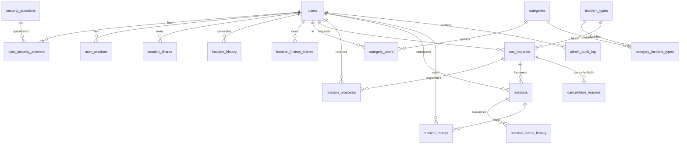

# Diagrams — Entity Relationship Diagram (ERD)

> Generated from spec §17 (Data Storage) + §8/11. Renders on GitHub via Mermaid.

---



---

## Tables & Columns (PostgreSQL)

```sql
-- Users
CREATE TABLE users (
  id UUID PRIMARY KEY,
  username VARCHAR(30) UNIQUE NOT NULL CHECK (username ~ '^[a-z0-9_]+$'),
  password_hash TEXT NOT NULL,
  role VARCHAR(10) NOT NULL DEFAULT 'user' CHECK (role IN ('user','admin')),
  is_active BOOLEAN NOT NULL DEFAULT true,
  is_suspended BOOLEAN NOT NULL DEFAULT false,
  suspended_until TIMESTAMPTZ,
  suspension_reason TEXT,
  is_on_mission BOOLEAN NOT NULL DEFAULT false,
  must_complete_security_questions BOOLEAN NOT NULL DEFAULT false,
  avg_rating NUMERIC(2,1) CHECK (avg_rating IS NULL OR avg_rating BETWEEN 0 AND 5), -- cached avg from mission_ratings
  last_location GEOGRAPHY(Point,4326),
  preferences JSONB,              -- { theme: 'light'|'dark' }
  created_at TIMESTAMPTZ DEFAULT now()
);
CREATE INDEX idx_users_last_location_gist ON users USING GIST (last_location);
CREATE INDEX idx_users_username ON users (username);

-- Security
CREATE TABLE security_questions (
  id UUID PRIMARY KEY,
  text TEXT UNIQUE NOT NULL,
  created_at TIMESTAMPTZ DEFAULT now()
);
-- Seed 15–20 rows

CREATE TABLE user_security_answers (
  id UUID PRIMARY KEY,
  user_id UUID NOT NULL REFERENCES users(id) ON DELETE CASCADE,
  question_id UUID NOT NULL REFERENCES security_questions(id),
  answer_hash TEXT NOT NULL,
  created_at TIMESTAMPTZ DEFAULT now(),
  UNIQUE(user_id, question_id)
);

CREATE TABLE user_sessions (
  id UUID PRIMARY KEY,
  user_id UUID NOT NULL REFERENCES users(id) ON DELETE CASCADE,
  device_id TEXT NOT NULL,
  device_name TEXT,
  refresh_token_hash TEXT,
  ip TEXT,
  last_active_at TIMESTAMPTZ DEFAULT now(),
  is_online BOOLEAN NOT NULL DEFAULT false
);
CREATE INDEX idx_sessions_user ON user_sessions (user_id);

-- Location
CREATE TABLE location_shares (
  id UUID PRIMARY KEY DEFAULT gen_random_uuid(),
  owner_id UUID NOT NULL REFERENCES users(id) ON DELETE CASCADE,
  target_user_id UUID NOT NULL REFERENCES users(id) ON DELETE CASCADE,
  mode VARCHAR(10) NOT NULL,
  expires_at TIMESTAMPTZ,
  is_revoked BOOLEAN NOT NULL DEFAULT false,
  priority_device_id TEXT,
  note TEXT,
  created_at TIMESTAMPTZ NOT NULL DEFAULT now(),
  CONSTRAINT location_shares_mode_check CHECK (mode IN ('timed', 'permanent')),
  CONSTRAINT location_shares_owner_target_check CHECK (owner_id <> target_user_id),
  CONSTRAINT location_shares_expiry_mode_check CHECK (
    (mode = 'timed' AND expires_at IS NOT NULL) OR (mode = 'permanent' AND expires_at IS NULL)
  )
);
CREATE INDEX location_shares_owner_created_at_idx ON location_shares (owner_id, created_at);
CREATE INDEX location_shares_target_created_at_idx ON location_shares (target_user_id, created_at);
CREATE INDEX location_shares_expires_at_idx ON location_shares (expires_at);

CREATE TABLE location_history (           -- live (T2.2.1)
  id BIGSERIAL PRIMARY KEY,
  user_id UUID NOT NULL REFERENCES users(id) ON DELETE CASCADE,
  lat DOUBLE PRECISION NOT NULL,
  lon DOUBLE PRECISION NOT NULL,
  accuracy DOUBLE PRECISION,
  timestamp TIMESTAMPTZ NOT NULL,
  created_at TIMESTAMPTZ NOT NULL DEFAULT now(),
  CONSTRAINT location_history_lat_check CHECK (lat BETWEEN -90 AND 90),
  CONSTRAINT location_history_lon_check CHECK (lon BETWEEN -180 AND 180),
  CONSTRAINT location_history_accuracy_check CHECK (accuracy IS NULL OR accuracy >= 0)
);
CREATE INDEX idx_location_history_user_time ON location_history (user_id, timestamp);

CREATE TABLE location_history_shares (    -- live (T2.2.2)
  id UUID PRIMARY KEY DEFAULT gen_random_uuid(),
  owner_id UUID NOT NULL REFERENCES users(id),
  target_user_id UUID NOT NULL REFERENCES users(id),
  from_time TIMESTAMPTZ NOT NULL,
  to_time TIMESTAMPTZ NOT NULL,
  created_at TIMESTAMPTZ NOT NULL DEFAULT now(),
  CONSTRAINT location_history_shares_owner_target_check CHECK (owner_id <> target_user_id),
  CONSTRAINT location_history_shares_window_check CHECK (to_time > from_time),
  CONSTRAINT location_history_shares_owner_target_window_unique UNIQUE (owner_id, target_user_id, from_time, to_time)
);
CREATE INDEX location_history_shares_owner_idx ON location_history_shares (owner_id, from_time);
CREATE INDEX location_history_shares_target_idx ON location_history_shares (target_user_id, from_time);

-- Categories & Incidents
CREATE TABLE incident_types (
  id UUID PRIMARY KEY,
  name TEXT NOT NULL,
  slug TEXT UNIQUE NOT NULL,
  icon TEXT,
  color TEXT,
  description TEXT,
  created_at TIMESTAMPTZ NOT NULL DEFAULT now()
);

CREATE TABLE categories (
  id UUID PRIMARY KEY,
  name TEXT NOT NULL,
  description TEXT,
  created_at TIMESTAMPTZ NOT NULL DEFAULT now()
);

> All three `created_at` columns in this block — both catalogs and `sos_requests` — are
> `NOT NULL DEFAULT now()`, one step past the first draft of this diagram: the shared response schemas
> (`incidentTypeSchema`, `categorySchema`, `sosRequestRecordSchema`) require `createdAt`, so a row without
> one has no legal response body. `drizzle/0011` tightened the catalog pair after the store's own record type
> came out as `Date | null`; `sos_requests` was declared NOT NULL from the start so the same gap is not
> reopened by T3.2.2's store.

CREATE TABLE category_incident_types (
  category_id UUID NOT NULL REFERENCES categories(id) ON DELETE CASCADE,
  incident_type_id UUID NOT NULL REFERENCES incident_types(id) ON DELETE CASCADE,
  PRIMARY KEY (category_id, incident_type_id)
);

CREATE TABLE category_users (
  category_id UUID NOT NULL REFERENCES categories(id) ON DELETE CASCADE,
  user_id UUID NOT NULL REFERENCES users(id) ON DELETE CASCADE,
  PRIMARY KEY (category_id, user_id)
);

-- SOS & Missions
CREATE TABLE sos_requests (
  id UUID PRIMARY KEY,
  requester_id UUID NOT NULL REFERENCES users(id),
  severity TEXT NOT NULL CHECK (severity IN ('low','medium','high')),
  description TEXT NOT NULL CHECK (char_length(description) BETWEEN 10 AND 500),
  incident_type_id UUID NOT NULL REFERENCES incident_types(id),
  location GEOGRAPHY(Point,4326) NOT NULL,
  accuracy DOUBLE PRECISION,
  is_manual BOOLEAN NOT NULL DEFAULT false,
  photo_url TEXT,
  status TEXT NOT NULL DEFAULT 'pending' CHECK (status IN ('pending','dispatched','accepted','cancelled_by_requester','cancelled_by_rescuer','expired','completed')),
  cancellation_reason_id UUID REFERENCES cancellation_reasons(id),
  cancellation_custom_text TEXT,
  cancelled_at TIMESTAMPTZ,
  created_at TIMESTAMPTZ NOT NULL DEFAULT now()
);

CREATE TABLE mission_proposals (
  id UUID PRIMARY KEY,
  sos_request_id UUID NOT NULL REFERENCES sos_requests(id) ON DELETE CASCADE,
  rescuer_id UUID NOT NULL REFERENCES users(id),
  status TEXT NOT NULL DEFAULT 'pending' CHECK (status IN ('pending','accepted','declined','expired')),
  created_at TIMESTAMPTZ NOT NULL DEFAULT now(),
  UNIQUE (sos_request_id, rescuer_id)
);
CREATE INDEX mission_proposals_rescuer_status_idx ON mission_proposals (rescuer_id, status);

CREATE TABLE missions (
  id UUID PRIMARY KEY,
  sos_request_id UUID NOT NULL REFERENCES sos_requests(id),
  rescuer_id UUID NOT NULL REFERENCES users(id),
  requester_id UUID NOT NULL REFERENCES users(id),
  status TEXT NOT NULL DEFAULT 'pending' CHECK (status IN ('pending','on_the_way','arrived','in_progress','completed','cancelled_by_requester','cancelled_by_rescuer','expired')),
  cancelled_by TEXT CHECK (cancelled_by IN ('requester','rescuer','admin','system')),
  cancellation_reason_id UUID REFERENCES cancellation_reasons(id),
  cancellation_custom_text TEXT,
  cancelled_at TIMESTAMPTZ,
  created_at TIMESTAMPTZ DEFAULT now(),
  updated_at TIMESTAMPTZ DEFAULT now()
);

CREATE TABLE mission_status_history (
  id UUID PRIMARY KEY,
  mission_id UUID NOT NULL REFERENCES missions(id) ON DELETE CASCADE,
  from_status TEXT,
  to_status TEXT NOT NULL,
  changed_by UUID REFERENCES users(id),
  created_at TIMESTAMPTZ DEFAULT now()
);

CREATE TABLE cancellation_reasons (
  id UUID PRIMARY KEY,
  type TEXT NOT NULL CHECK (type IN ('requester','rescuer')),
  key TEXT NOT NULL,
  label TEXT NOT NULL,
  label_fa TEXT,
  requires_custom_text BOOLEAN NOT NULL DEFAULT false,
  is_active BOOLEAN NOT NULL DEFAULT true,
  UNIQUE(type, key)
);

CREATE TABLE mission_ratings (
  id UUID PRIMARY KEY,
  mission_id UUID NOT NULL REFERENCES missions(id),
  rater_id UUID NOT NULL REFERENCES users(id),
  ratee_id UUID NOT NULL REFERENCES users(id),
  rating INT NOT NULL CHECK (rating BETWEEN 1 AND 5),
  comment TEXT,
  created_at TIMESTAMPTZ DEFAULT now(),
  UNIQUE(mission_id, rater_id)
);

CREATE TABLE admin_audit_log (
  id UUID PRIMARY KEY,
  admin_id UUID NOT NULL REFERENCES users(id),
  action TEXT NOT NULL,
  target_type TEXT,
  target_id UUID,
  meta JSONB,
  created_at TIMESTAMPTZ DEFAULT now()
);
```

## Notes

- This is the target ERD. Current Drizzle migrations cover the auth/reference tables, T1.1.4 user-state/rating/location columns, `admin_audit_log`, the live `location_shares` table (T2.1.1), and `location_history`/`location_history_shares` (T2.2.1/T2.2.2, `0007_brief_hedge_knight.sql`). Socket `location:update` (T2.1.5) now writes one `location_history` row and the `users.last_location` geography per accepted fix; history reads/shares (T2.2.3-T2.2.4) are not implemented yet, while retention is: the share-expiry sweep and the batched history prune (T2.1.6/T2.2.5) run as in-process timers over these two tables. Category/incident, SOS, proposals, missions, and mission status history are migrated through `0014`; `mission_ratings` and remaining user columns (`suspended_until`, `suspension_reason`) remain future tasks.
- **History storage choice:** `location_history` keeps plain `lat`/`lon` columns with a composite `(user_id, timestamp)` index and no geography column or GiST index; every read is user- and time-scoped. Monthly partitioning stays the documented optional scale-up path (ARCHITECTURE §8.3).
- **Geospatial:** `last_location` and `sos_requests.location` use `GEOGRAPHY(Point,4326)` for meter-accurate `ST_Distance`.
- **No delete:** No `deleted_at` — deactivated users stay with `is_active=false` for audit.
- **Retention:** `location_history` pruned by cron; partitioning by month optional.

