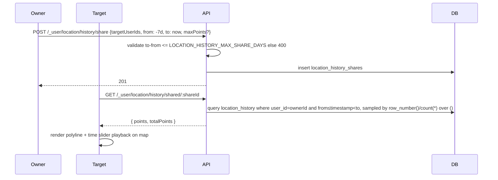
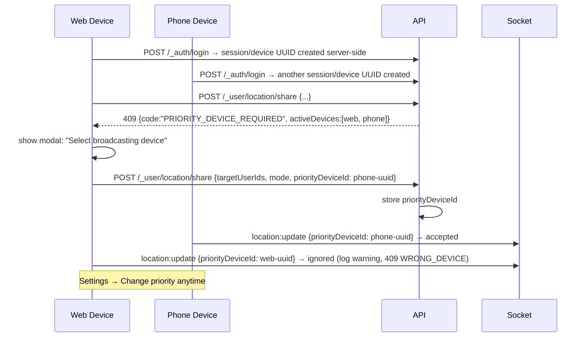
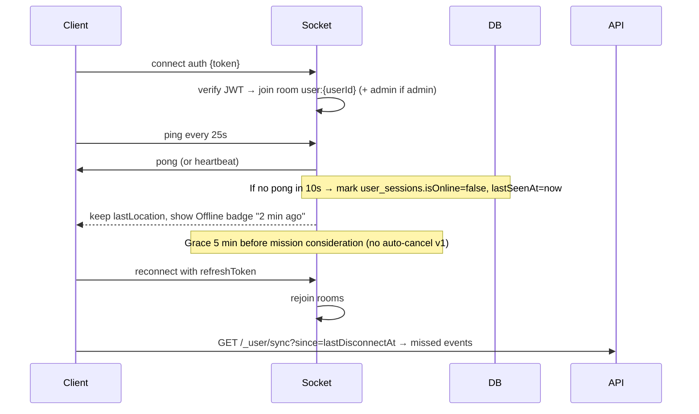
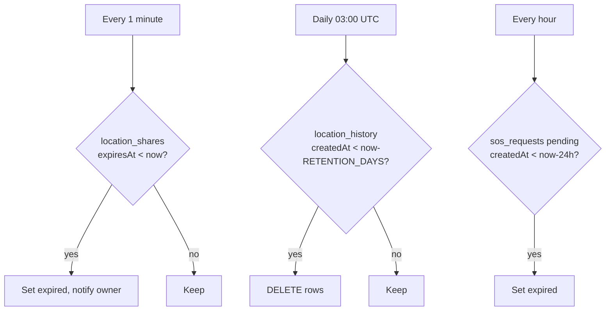

# Diagrams — Location Sharing Sequence

> Covers live sharing, history sharing, multi-device priority, and realtime updates.

---

## 1. Live Share — Create + Stream

```mermaid
sequenceDiagram
  participant Owner
  participant Target
  participant API
  participant Socket
  participant DB

  Owner->>API: POST /_user/location/share {targetUserIds, mode, durationMinutes, note}
  API->>API: if activeDevices>1 → require priorityDeviceId else assign current
  API->>DB: insert location_shares (expiresAt if timed)
  API-->>Owner: 201 {shareId, expiresAt}
  loop Every 3–5s (throttled)
    Owner->>Socket: location:update {lat,lon,accuracy,timestamp,priorityDeviceId}
    Socket->>API: verify JWT + priorityDeviceId match
    API->>DB: upsert users.lastLocation, insert location_history
    API->>Socket: emit location:peer-update to room user:{targetId}
    Socket-->>Target: update marker on MapLibre
  end
  Note over API,DB: Cron every 1m: expire timed shares; daily prune history >RETENTION_DAYS
  Owner->>API: DELETE /_user/location/share/:shareId → immediate revoke
  API->>DB: set isRevoked=true
  API->>Socket: emit share revoked
```

---

## 2. History Share — Send + View



---

## 3. Multi-Device Priority — Conflict Avoidance



---

## 4. Realtime + Disconnection



---

## 5. Retention & Expiry (Cron)



---

## 6. Socket Events Summary

| Event | Direction | Payload | Room |
|-------|-----------|---------|------|
| `location:update` | C→S | {lat,lon,accuracy,timestamp,priorityDeviceId} | — |
| `location:peer-update` | S→C | {userId,lat,lon,accuracy,timestamp} | `user:{targetId}`, `mission:{id}` |
| `system:offline` | S→C | {userId, lastSeenAt} | peers/admin |
| `sync` | C↔S fallback | | |

