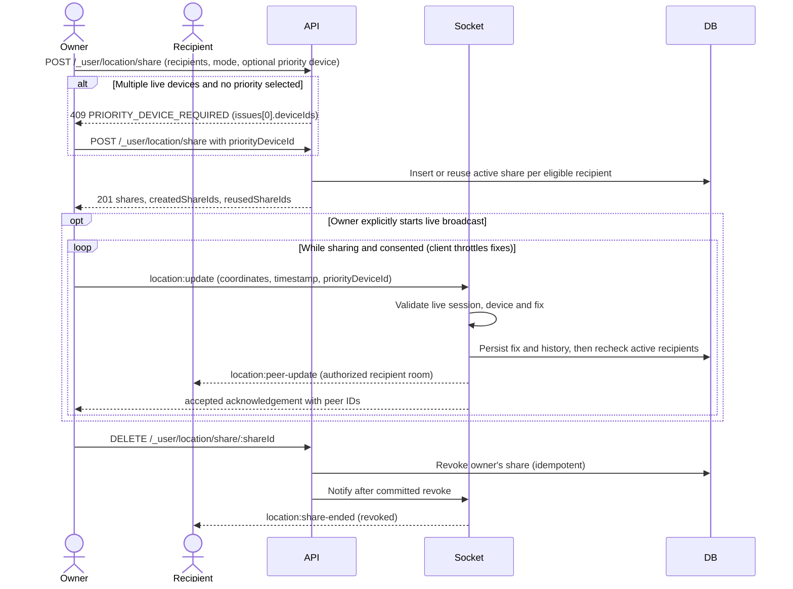
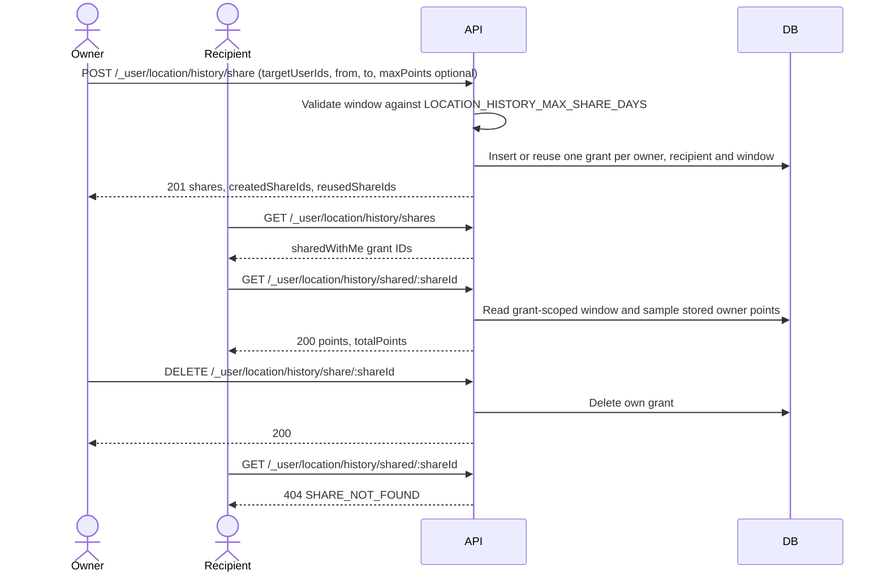
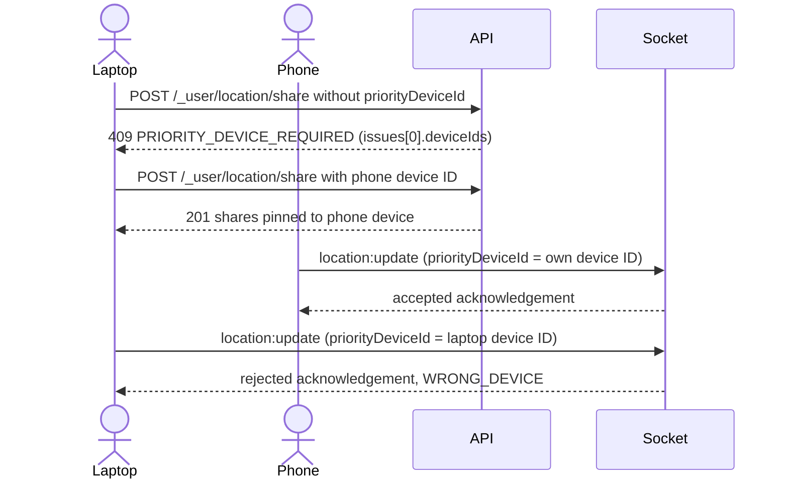
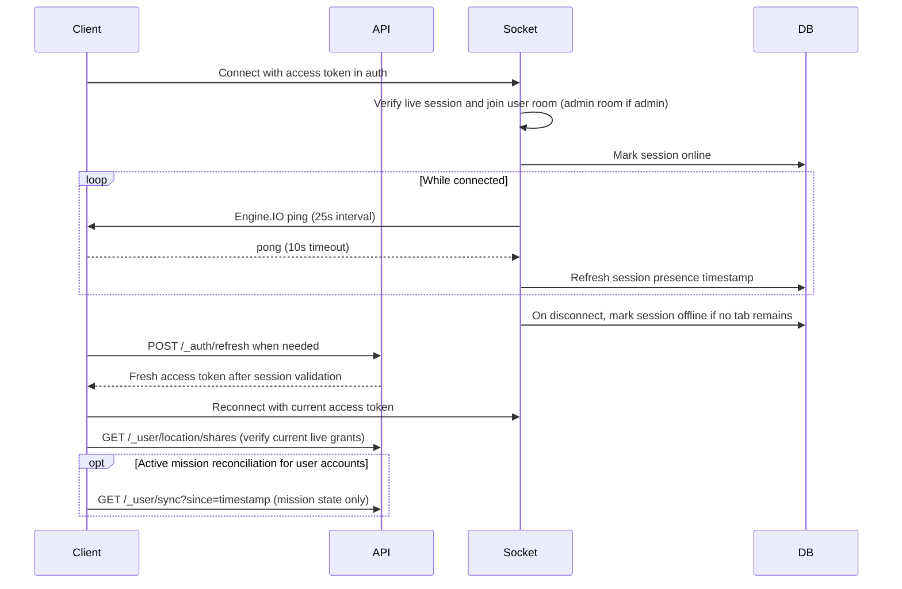
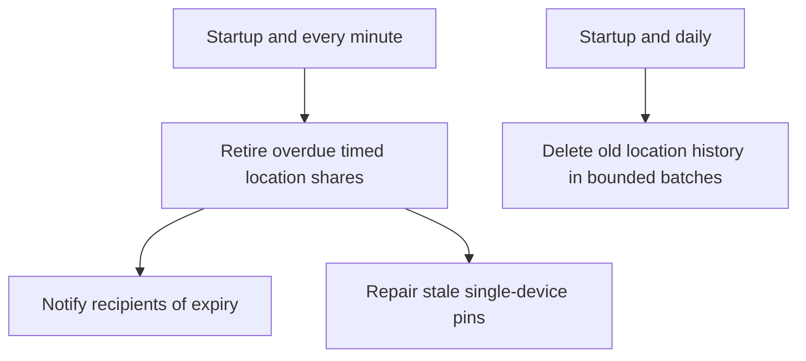

# Diagrams — Location Sharing (implemented contract)

> Source-level view of live sharing, history grants, priority-device selection and presence. All five blocks were rendered with Mermaid CLI 11.12.0 and visually inspected in headless Chromium; this is diagram review, not a live-app screenshot or target-VM review (T4.7.1). A Socket.IO acknowledgement is not an HTTP response; mission-location messages are separate from live-share peer updates.

## 1. Live share — create, broadcast and revoke

The `201` contains **share rows**, not a single `shareId`; each row includes its own nullable `expiresAt`. One live device is selected by the server when it is the only active device. An accepted fix can be saved to the owner's history even when there are no active recipients; only recipients authorized by active shares receive `location:peer-update`. The event also reaches the sender's *other tabs*; this is not a `mission:{id}` room broadcast. Revocation/expiry notifies the recipient after the database change; already-delivered coordinates cannot be recalled.

## 2. Bounded history grant — create, read and delete

The window is `[from, to)` and the sampling target comes from the grant's `maxPoints` or the configured default. A grant has no automatic expiry and needs no priority device; retention can remove points underneath it. Only the owner can delete the grant. A recipient cannot broaden its window, and a foreign or deleted grant reads as 404.

## 3. Priority device — selection and rejection

The server verifies the device against the authenticated session and share pin. An unselected device cannot publish a pinned share's location; `WRONG_DEVICE` here is a **Socket.IO ack**, not a `409` HTTP reply. Repeating `POST /_user/location/share` for an existing active target can change its pin; the server's minute sweep can repair a stale pin when only one device remains.

## 4. Reconnect and presence (not GPS consent)

A crashed process may leave an online flag stale; read-side presence also has a freshness window. Presence alone **does not** assert GPS sharing, publish a position, or automatically cancel an SOS. `/_user/sync` returns bounded mission status/history with `location: null`; it does not replay peer GPS or recover live shares. Share consumers separately read `/_user/location/shares` and wait for fresh authorized fixes.

## 5. Maintenance (no SOS expiry job here)

The retention cutoff is `LOCATION_HISTORY_RETENTION_DAYS` days before the job's current time, not a fixed 03:00 UTC schedule. There is **no** hourly `sos_requests` 24-hour expiry job in the implemented location scheduler. A minute sweep and a daily prune are independently retried if they fail; socket notifications are best-effort after committed expiry.

## 6. Relevant realtime and HTTP names

| Name | Transport and direction | Scope |
|------|-------------------------|-------|
| `location:update` | Socket.IO client → server, acknowledged | Authenticated device's fix; authorized peer fan-out |
| `location:peer-update` | Socket.IO server → client | Active live-share recipients and sender's other tabs |
| `location:share-ended` | Socket.IO server → client | Recipient notified of revoke or expiry |
| `mission:location-publish` / `mission:location` | Socket.IO client → server / server → client | Separate, participant-checked active-mission channel |
| `GET /_user/location/shares` | HTTP client → server | Verify current live grants, not GPS replay |
| `GET /_user/sync?since=…` | HTTP client → server | Mission status recovery only; `location: null`, not a socket event |

Contract references: `packages/shared/src/{schemas/location.ts,api/location.routes.ts,types/realtime.ts}`, `packages/server/src/{location/shares.ts,location/history.ts,location/live.ts,location/jobs.ts,realtime/socket.ts}`, `packages/client/src/composables/useLiveLocationBroadcast.ts`.
