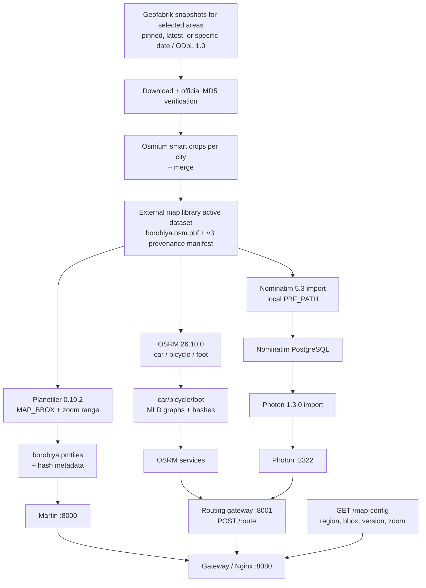
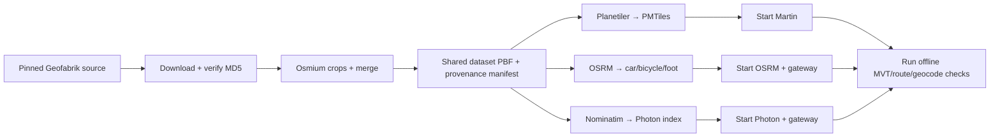

# Diagrams — Map Data Pipeline

> Selectable areas and snapshots (whole countries/cities from `map-server/regions.json`; pinned default Tehran/2026-10-18) are cropped and merged into one shared dataset in the standardized external map library for the tile/routing builders and the Nominatim→Photon import path; local proxies are configured. Live acceptance of the original Tehran pipeline passed on the target Ubuntu VM on 2026-10-20; the library refactor's VM migration/offline acceptance is the remaining pre-merge gate (see `../PROGRESS.md`).

---

## 1. Pipeline Overview



`prepare-regions-pbf.sh` downloads/caches and verifies the selected snapshot sources in the standardized map library, crops/merges them into the only permitted shared dataset, and writes its provenance manifest. Tile/routing builders verify that manifest before using it; Nominatim mounts that same output as local `PBF_PATH`. `MAP_REGION` (dataset slug), `MAP_BBOX` (area union), `MAP_DATA_VERSION`, and the zoom range are validated by the routing gateway and returned as public client settings. The browser uses same-origin `/map-config`, `/route`, `/geocode`, and `/reverse` paths and does not receive service URLs.

---

## 2. Update Flow (Build Artifacts)



The snapshot downloader/cache, hash manifest, crops/merge, import, service-start, current-pointer activation, and post-acceptance pruning paths are scripted (`scripts/setup-ubuntu-vm.sh` runs them end-to-end with a library/snapshot/policy/area form). Continuous replication feeds and zero-downtime activation are not implemented. The original three real-data checks passed live on the target VM (2026-10-20); library migration/offline acceptance remains to be repeated there.

---

## 3. Geographic Coverage and Settings

```mermaid
flowchart LR
  T[Area catalog: countries + cities<br/>regions.json] --> SEL[MAP_REGION_IDS selection<br/>default ir-tehran]
  SEL -.-> ENV
  ENV[MAP_LIBRARY_DIR + MAP_DATASET_DIR<br/>MAP_SNAPSHOT_DATE + MAP_SOURCE_POLICY<br/>MAP_REGION (dataset slug)<br/>MAP_BBOX (area union)<br/>MAP_DATA_VERSION<br/>MAP_MIN_ZOOM / MAP_MAX_ZOOM]
  ENV --> CFG[GET /map-config]
  CFG --> CLIENT[Client validates shared MapConfig schema]
```

The default selection targets Tehran: area `ir-tehran`, union bbox `51.0,35.5,51.7,35.9`, repository-pinned snapshot `2026-10-18`, cache-first source policy, zoom range 0–14, dataset slug `borobiya`, and the external map library under `~/.local/share/borobiya/map-library`. Planetiler and all OSRM profiles consume the merged dataset PBF, as does Nominatim before Photon import. Changing areas needs no style/client wiring changes — the dataset slug (and thus the Martin source) is constant; only the data builders rerun (the setup script detects staleness by dataset checksum).

Disk estimates are preliminary and OSRM values are per profile; this deployment runs three separate OSRM processes. Runtime memory has not been benchmarked.

---

## 4. Style & Assets

```
map-server/styles/light.json
map-server/styles/dark.json  ─┐ same sources.tiles = /borobiya/{z}/{x}/{y}
map-server/sprites/borobiya/*.svg ─┤ Martin creates sprite PNG/JSON on demand
map-server/fonts/*.ttf       ─┘ Martin creates glyph PBF ranges on demand
```

Theme switch: `map.setStyle(newStyle)` — same source, different `layers` paint. The dataset source in both committed styles is `borobiya`.

---

## 5. Verification Commands

```bash
# Prepare and verify the shared library dataset (once)
set -a; source .env; set +a
if [[ -z "${MAP_LIBRARY_DIR:-}" ]]; then
  if [[ -n "${XDG_DATA_HOME:-}" ]]; then
    [[ "$XDG_DATA_HOME" == /* ]] || { echo 'XDG_DATA_HOME must be absolute; set MAP_LIBRARY_DIR explicitly.' >&2; exit 1; }
    MAP_LIBRARY_DIR="$XDG_DATA_HOME/borobiya/map-library"
  elif [[ -n "${HOME:-}" && "$HOME" == /* ]]; then
    MAP_LIBRARY_DIR="$HOME/.local/share/borobiya/map-library"
  else
    echo 'Set MAP_LIBRARY_DIR to an external absolute path (or set absolute HOME/XDG_DATA_HOME).' >&2
    exit 1
  fi
fi
[[ "$MAP_LIBRARY_DIR" == /* ]] || { echo 'MAP_LIBRARY_DIR must be absolute.' >&2; exit 1; }
export MAP_LIBRARY_DIR
eval "$(python3 map-server/scripts/regions.py resolve "$MAP_REGION_IDS" --snapshot "${MAP_SNAPSHOT_DATE:-pinned}" --source-policy "${MAP_SOURCE_POLICY:-cache-first}" --library "$MAP_LIBRARY_DIR")"
./map-server/scripts/prepare-regions-pbf.sh
./map-server/scripts/verify-map-pbf.sh "$MAP_PBF"

# Tiles (after generating the archive and starting Martin)
./map-server/scripts/verify-tiles.sh
# Style and runtime-generated assets
curl http://localhost:8000/style/light | jq .sources
curl http://localhost:8000/sprite/borobiya.json | jq
curl 'http://localhost:8000/font/Borobiya%20Sans/0-255' -o /tmp/glyphs.pbf
# Public map settings through the same-origin gateway
curl http://localhost:8080/map-config | jq
# Route (after approved OSRM graphs are built)
./map-server/scripts/verify-routing.sh
# Photon forward and reverse (after local Nominatim/Photon import)
./map-server/scripts/verify-geocoding.sh
```

---

## 6. Remaining Data Tasks

| Task | Status |
|------|--------|
| Generate PMTiles and verify Martin MVT route | T1.4.2 complete on the target VM for Tehran; repeat after library migration and for each newly selected area |
| Build three OSRM graphs and verify a real offline route | T1.4.4 complete on the target VM for Tehran; repeat after library migration and for each newly selected area |
| Configure Photon and test geocode/reverse | T1.4.5 complete on the target VM for Tehran; repeat after library migration and for each newly selected area |
| Wire map settings through pipeline/runtime and document | T1.4.6 complete; checks recorded in `docs/PROGRESS.md` |
| Standardized external map library, snapshot/cache policies, migration, pruning | T1.4.7 code/tests complete; VM migration + offline acceptance pending before PR merge |
