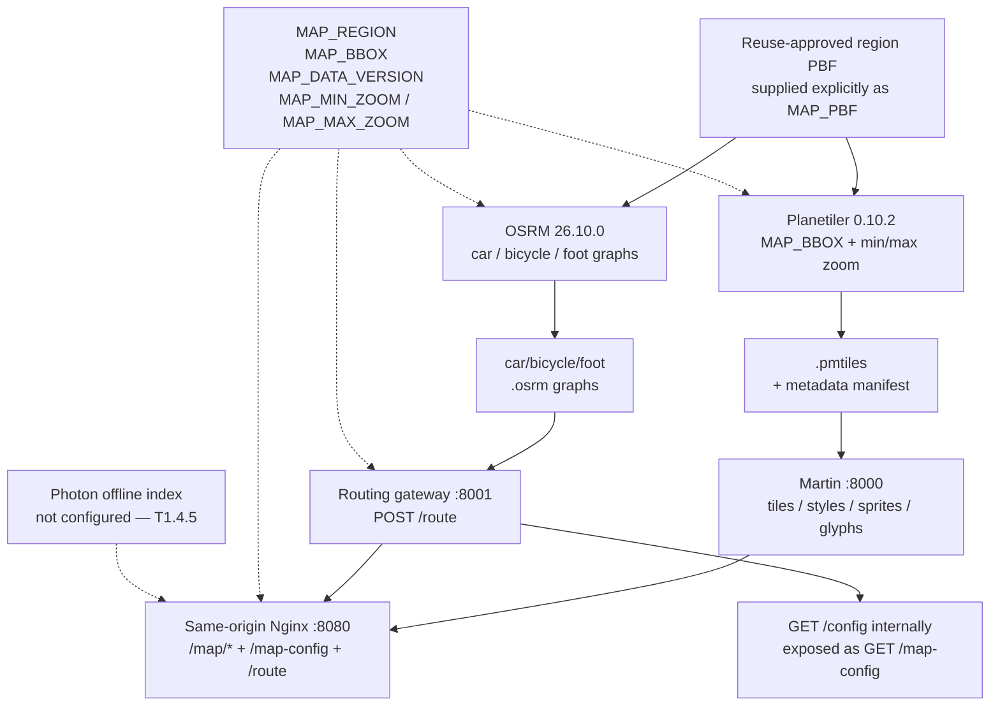
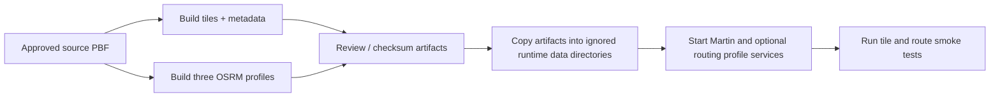
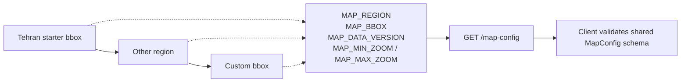

# Diagrams — Map Data Pipeline

> Current pipeline scaffolding from an explicitly approved OSM PBF to local map services. Photon import and automated promotion remain future work.

---

## 1. Pipeline Overview



`MAP_REGION`, `MAP_BBOX`, `MAP_DATA_VERSION`, and the zoom range are validated by the routing gateway and returned as public client settings. The browser fetches `/map-config`; it does not receive service URLs. The tile and OSRM build scripts require an explicit `MAP_PBF` (or the legacy `TEHRAN_PBF` alias) and never select or download an input dataset implicitly.

---

## 2. Update Flow (Build Artifacts)



Automated downloads, Photon indexing, staging promotion, and zero-downtime activation have not been implemented. Tile/archive generation and real route verification remain blocked until an approved PBF and suitable runtimes are available.

---

## 3. Geographic Coverage and Settings



The defaults target Tehran: region `tehran`, WGS84 bbox `51.0,35.5,51.7,35.9`, version `development`, and zoom range 0–14. The build scripts name the archive and OSRM graph from `MAP_REGION` and apply the bbox/zoom settings to Planetiler. A region change also requires matching data and runtime style/client source wiring; the committed MapLibre styles currently use the Tehran source.

Disk estimates are preliminary and OSRM values are per profile; this deployment runs three separate OSRM processes. Runtime memory has not been benchmarked.

---

## 4. Style & Assets

```
map-server/styles/light.json
map-server/styles/dark.json  ─┐ same sources.tiles = /tehran/{z}/{x}/{y}
map-server/sprites/borobiya/*.svg ─┤ Martin creates sprite PNG/JSON on demand
map-server/fonts/*.ttf       ─┘ Martin creates glyph PBF ranges on demand
```

Theme switch: `map.setStyle(newStyle)` — same source, different `layers` paint. The region source in both committed styles is currently `tehran`.

---

## 5. Verification Commands

```bash
# Tiles (after generating an archive and starting Martin)
curl http://localhost:8000/tehran/12/2632/1612 -o /tmp/t.pbf && ls -lh /tmp/t.pbf
# Style and runtime-generated assets
curl http://localhost:8000/style/light | jq .sources
curl http://localhost:8000/sprite/borobiya.json | jq
curl 'http://localhost:8000/font/Borobiya%20Sans/0-255' -o /tmp/glyphs.pbf
# Public map settings through the same-origin gateway
curl http://localhost:8080/map-config | jq
# Route (after approved OSRM graphs are built)
curl -X POST http://localhost:8080/route -d '{"from":{"lat":35.68,"lon":51.38},"to":{"lat":35.70,"lon":51.41},"profile":"car"}' -H 'Content-Type: application/json'
```

---

## 6. Remaining Data Tasks

| Task | Status |
|------|--------|
| Generate Tehran PMTiles and verify Martin MVT route | T1.4.2 open: PBF reuse approval and Java/Docker runtime pending |
| Build three OSRM graphs and verify a real offline route | T1.4.4 open: same approved-PBF/runtime blockers |
| Configure Photon and test geocode/reverse | T1.4.5 open: import source and index not selected |
| Wire map settings through pipeline/runtime and document | T1.4.6 complete; checks recorded in `docs/PROGRESS.md` |
