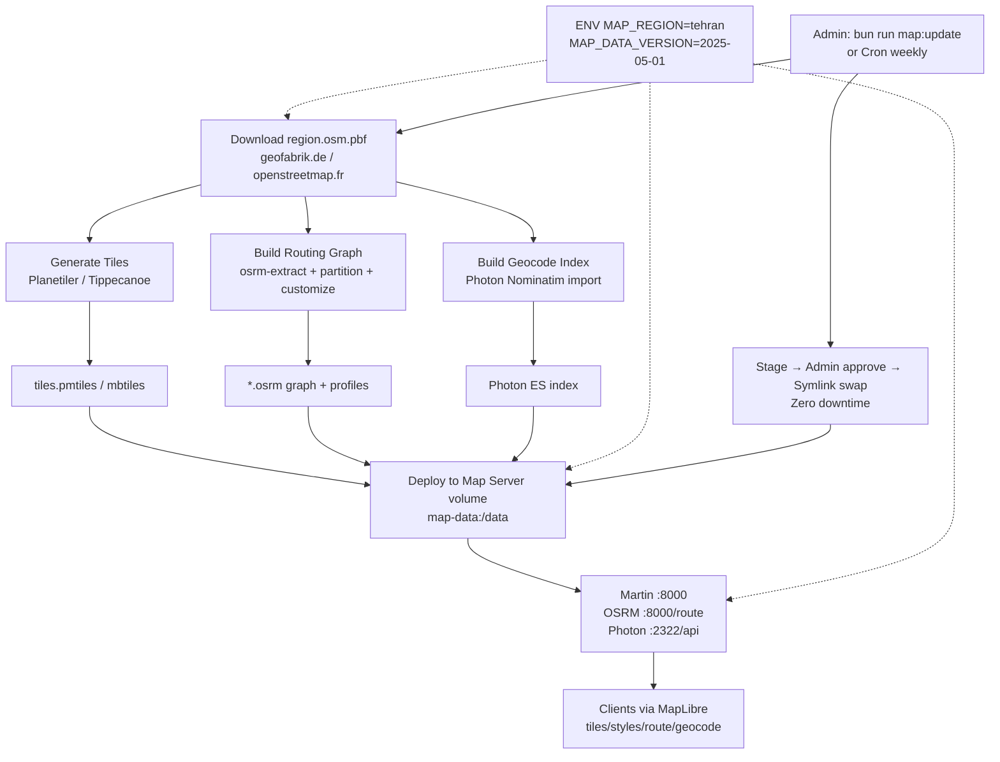
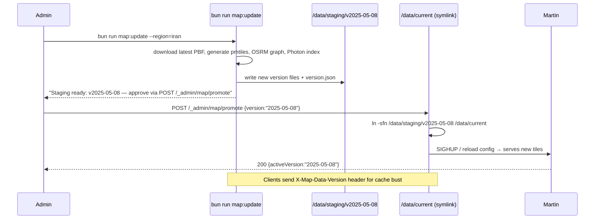
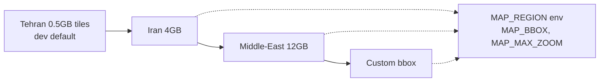

# Diagrams — Map Data Pipeline

> From OSM dump to serving PBF + routing + geocoding offline.

---

## 1. Pipeline Overview



---

## 2. Update Flow (Versioned, Zero-Downtime)



---

## 3. Geographic Coverage Matrix



| Region | PBF size | PMTiles | OSRM | Photon | Min RAM |
|--------|----------|---------|------|--------|---------|
| Tehran bbox | 100 MB | 0.5 GB | 0.8 GB | 1.2 GB | 2 GB |
| Iran | 600 MB | 3–5 GB | 2 GB | 4 GB | 4–8 GB |
| MENA | 2 GB | 12 GB | 6 GB | 10 GB | 16 GB |

Scale without code change — only ENV + volume.

---

## 4. Style & Assets

```
map-server/styles/light.json
map-server/styles/dark.json  ─┐ same sources.tiles = /tehran/{z}/{x}/{y}
map-server/sprites/borobiya/*.svg ─┤ Martin creates sprite PNG/JSON on demand
map-server/fonts/*.ttf       ─┘ Martin creates glyph PBF ranges on demand
```

Theme switch: `map.setStyle(newStyle)` — same source, different `layers` paint.

---

## 5. Verification Commands

```bash
# Tiles
curl http://localhost:8000/tehran/12/2632/1612 -o /tmp/t.pbf && ls -lh /tmp/t.pbf
# Style
curl http://localhost:8000/style/light | jq .sources
# Runtime-generated sprite and glyphs
curl http://localhost:8000/sprite/borobiya.json | jq
curl 'http://localhost:8000/font/Borobiya%20Sans/0-255' -o /tmp/glyphs.pbf
# Route
curl -X POST http://localhost:8000/route -d '{"from":{"lat":35.68,"lon":51.38},"to":{"lat":35.70,"lon":51.41},"profile":"car"}' -H 'Content-Type: application/json'
# Geocode
curl 'http://localhost:2322/api?q=azadi&limit=3' | jq
curl 'http://localhost:2322/reverse?lat=35.70&lon=51.38' | jq
```

---

## 6. Failure Modes

| Failure | Symptom | Mitigation |
|---------|---------|------------|
| PBF corrupt | Planetiler fails | Checksum (`sha256sum`), re-download |
| OSRM version mismatch | 500 on route | Rebuild after PBF update, lock OSRM version in Dockerfile |
| Tile missing at zoom>MAX | Blank tiles | Raise `MAP_MAX_ZOOM`, regenerate |
| Photon OOM | Index kill | Increase heap `-Xmx8g`, use SSD |

