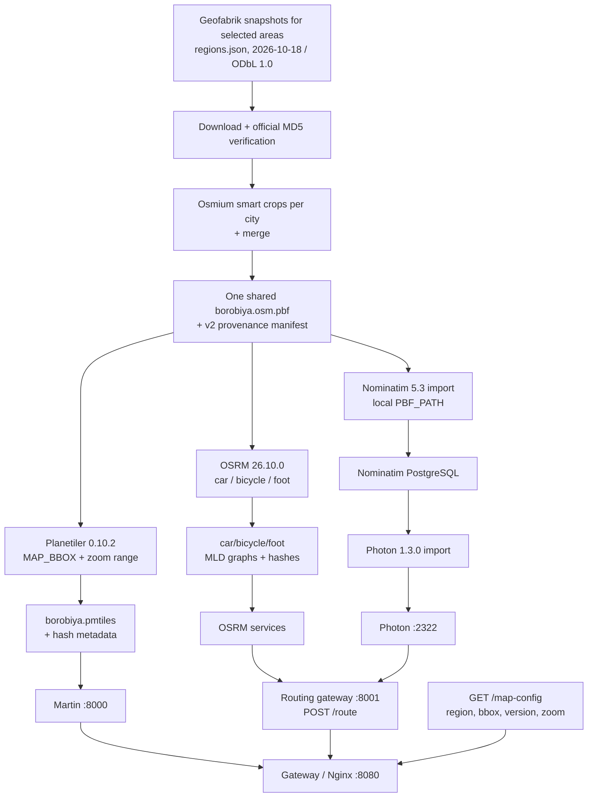
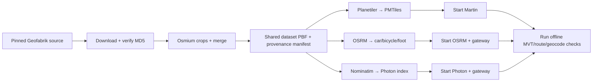

# Diagrams — Map Data Pipeline

> Selectable areas (whole countries/cities from the pinned `map-server/regions.json` catalog; default Tehran) are cropped and merged into one shared dataset for the tile/routing builders and the Nominatim→Photon import path; local proxies are configured. Live acceptance passed on the target Ubuntu VM on 2026-10-20 (see `../PROGRESS.md`); generated runtime data stays local and Git-ignored.

---

## 1. Pipeline Overview



`prepare-regions-pbf.sh` downloads and verifies the pinned sources for the selected areas, crops/merges them into the only permitted shared dataset, and writes its provenance manifest. Tile/routing builders verify that manifest before using it; Nominatim mounts that same output as local `PBF_PATH`. `MAP_REGION` (dataset slug), `MAP_BBOX` (area union), `MAP_DATA_VERSION`, and the zoom range are validated by the routing gateway and returned as public client settings. The browser uses same-origin `/map-config`, `/route`, `/geocode`, and `/reverse` paths and does not receive service URLs.

---

## 2. Update Flow (Build Artifacts)



The pinned source downloader, hash manifest, crops/merge, import, and service-start paths are scripted (`scripts/setup-ubuntu-vm.sh` runs them end-to-end with an area-selection form). Automated replication/update feeds, staged promotion, and zero-downtime activation are not implemented. The three real-data checks passed live on the target VM (2026-10-20).

---

## 3. Geographic Coverage and Settings

```mermaid
flowchart LR
  T[Area catalog: countries + cities<br/>regions.json] --> SEL[MAP_REGION_IDS selection<br/>default ir-tehran]
  SEL -.-> ENV
  ENV[MAP_REGION (dataset slug)<br/>MAP_BBOX (area union)<br/>MAP_DATA_VERSION<br/>MAP_MIN_ZOOM / MAP_MAX_ZOOM]
  ENV --> CFG[GET /map-config]
  CFG --> CLIENT[Client validates shared MapConfig schema]
```

The default selection targets Tehran: area `ir-tehran`, union bbox `51.0,35.5,51.7,35.9`, catalog snapshot `2026-10-18`, zoom range 0–14, dataset slug `borobiya`. Planetiler and all OSRM profiles consume the merged dataset PBF, as does Nominatim before Photon import. Changing areas needs no style/client wiring changes — the dataset slug (and thus the Martin source) is constant; only the data builders rerun (the setup script detects staleness by dataset checksum).

Disk estimates are preliminary and OSRM values are per profile; this deployment runs three separate OSRM processes. Runtime memory has not been benchmarked.

---

## 4. Style & Assets

```
map-server/styles/light.json
map-server/styles/dark.json  ─┐ same sources.tiles = /borobiya/{z}/{x}/{y}
map-server/sprites/borobiya/*.svg ─┤ Martin creates sprite PNG/JSON on demand
map-server/fonts/*.ttf       ─┘ Martin creates glyph PBF ranges on demand
```

Theme switch: `map.setStyle(newStyle)` — same source, different `layers` paint. The dataset source in both committed styles is `borobiya`.

---

## 5. Verification Commands

```bash
# Prepare and verify the shared crop (once)
set -a; source .env; set +a
./map-server/scripts/prepare-regions-pbf.sh
./map-server/scripts/verify-map-pbf.sh "$MAP_PBF"

# Tiles (after generating the archive and starting Martin)
./map-server/scripts/verify-tiles.sh
# Style and runtime-generated assets
curl http://localhost:8000/style/light | jq .sources
curl http://localhost:8000/sprite/borobiya.json | jq
curl 'http://localhost:8000/font/Borobiya%20Sans/0-255' -o /tmp/glyphs.pbf
# Public map settings through the same-origin gateway
curl http://localhost:8080/map-config | jq
# Route (after approved OSRM graphs are built)
./map-server/scripts/verify-routing.sh
# Photon forward and reverse (after local Nominatim/Photon import)
./map-server/scripts/verify-geocoding.sh
```

---

## 6. Remaining Data Tasks

| Task | Status |
|------|--------|
| Generate Tehran PMTiles and verify Martin MVT route | T1.4.2 open: pinned source/crop and builder configured; local data generation and MVT smoke test pending |
| Build three OSRM graphs and verify a real offline route | T1.4.4 open: shared-crop graphs and `POST /route` check configured; local route smoke test pending |
| Configure Photon and test geocode/reverse | T1.4.5 open: Nominatim→Photon import and proxy configured; local index and geocode/reverse checks pending |
| Wire map settings through pipeline/runtime and document | T1.4.6 complete; checks recorded in `docs/PROGRESS.md` |
