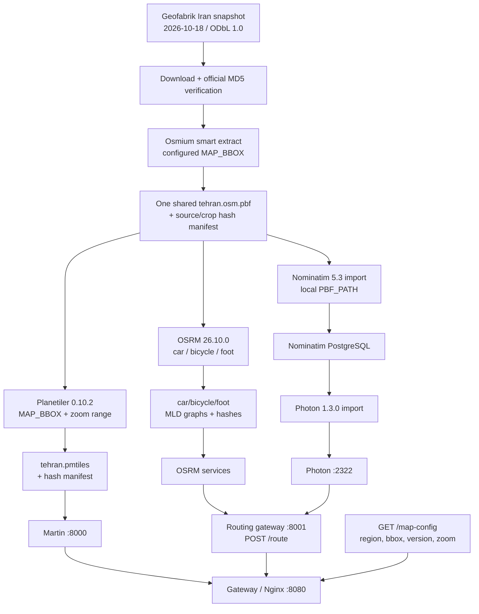
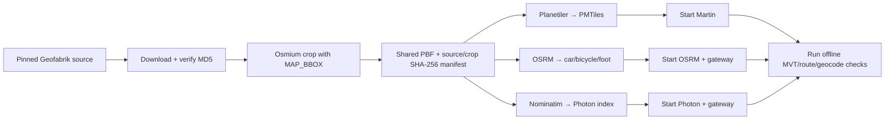
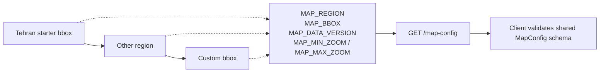

# Diagrams — Map Data Pipeline

> The pinned Geofabrik source and shared `MAP_BBOX` crop, tile/routing builders, Nominatim→Photon import path, and local proxies are configured. Live acceptance and generated runtime data remain pending.

---

## 1. Pipeline Overview



`prepare-tehran-pbf.sh` downloads and verifies the pinned source, then creates the only permitted shared crop. Tile/routing builders verify its manifest before using it; Nominatim mounts that same output as local `PBF_PATH`. `MAP_REGION`, `MAP_BBOX`, `MAP_DATA_VERSION`, and the zoom range are validated by the routing gateway and returned as public client settings. The browser uses same-origin `/map-config`, `/route`, `/geocode`, and `/reverse` paths and does not receive service URLs.

---

## 2. Update Flow (Build Artifacts)



The pinned source downloader, hash manifest, crop, import, and service-start paths are scripted. Automated replication/update feeds, staged promotion, and zero-downtime activation are not implemented. The three real-data checks remain pending local Docker/Java execution.

---

## 3. Geographic Coverage and Settings



The defaults target Tehran: region `tehran`, WGS84 bbox `51.0,35.5,51.7,35.9`, source version `2026-10-18`, and zoom range 0–14. The single crop uses `MAP_BBOX`; Planetiler and all OSRM profiles consume that PBF, as does Nominatim before Photon import. A region change also requires matching data and runtime style/client source wiring; the committed MapLibre styles currently use the Tehran source.

Disk estimates are preliminary and OSRM values are per profile; this deployment runs three separate OSRM processes. Runtime memory has not been benchmarked.

---

## 4. Style & Assets

```
map-server/styles/light.json
map-server/styles/dark.json  ─┐ same sources.tiles = /tehran/{z}/{x}/{y}
map-server/sprites/borobiya/*.svg ─┤ Martin creates sprite PNG/JSON on demand
map-server/fonts/*.ttf       ─┘ Martin creates glyph PBF ranges on demand
```

Theme switch: `map.setStyle(newStyle)` — same source, different `layers` paint. The region source in both committed styles is currently `tehran`.

---

## 5. Verification Commands

```bash
# Prepare and verify the shared crop (once)
set -a; source .env; set +a
./map-server/scripts/prepare-tehran-pbf.sh
./map-server/scripts/verify-map-pbf.sh "$MAP_PBF"

# Tiles (after generating the archive and starting Martin)
./map-server/scripts/verify-tehran-tiles.sh
# Style and runtime-generated assets
curl http://localhost:8000/style/light | jq .sources
curl http://localhost:8000/sprite/borobiya.json | jq
curl 'http://localhost:8000/font/Borobiya%20Sans/0-255' -o /tmp/glyphs.pbf
# Public map settings through the same-origin gateway
curl http://localhost:8080/map-config | jq
# Route (after approved OSRM graphs are built)
./map-server/scripts/verify-routing.sh
# Photon forward and reverse (after local Nominatim/Photon import)
./map-server/scripts/verify-geocoding.sh
```

---

## 6. Remaining Data Tasks

| Task | Status |
|------|--------|
| Generate Tehran PMTiles and verify Martin MVT route | T1.4.2 open: pinned source/crop and builder configured; local data generation and MVT smoke test pending |
| Build three OSRM graphs and verify a real offline route | T1.4.4 open: shared-crop graphs and `POST /route` check configured; local route smoke test pending |
| Configure Photon and test geocode/reverse | T1.4.5 open: Nominatim→Photon import and proxy configured; local index and geocode/reverse checks pending |
| Wire map settings through pipeline/runtime and document | T1.4.6 complete; checks recorded in `docs/PROGRESS.md` |
