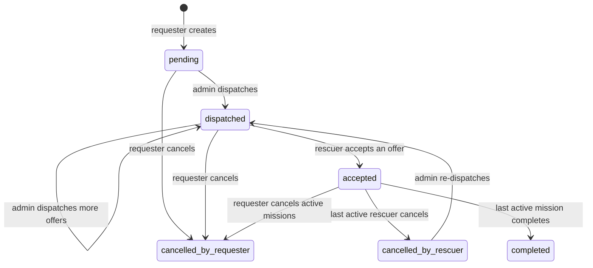
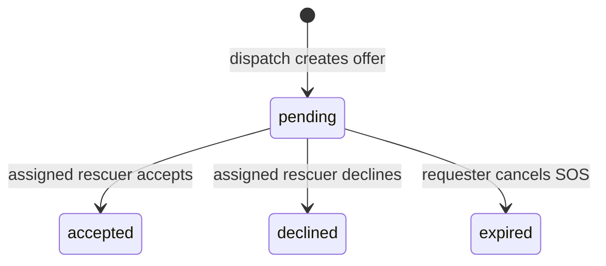
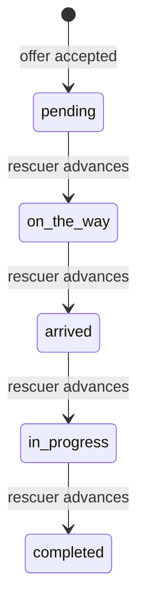
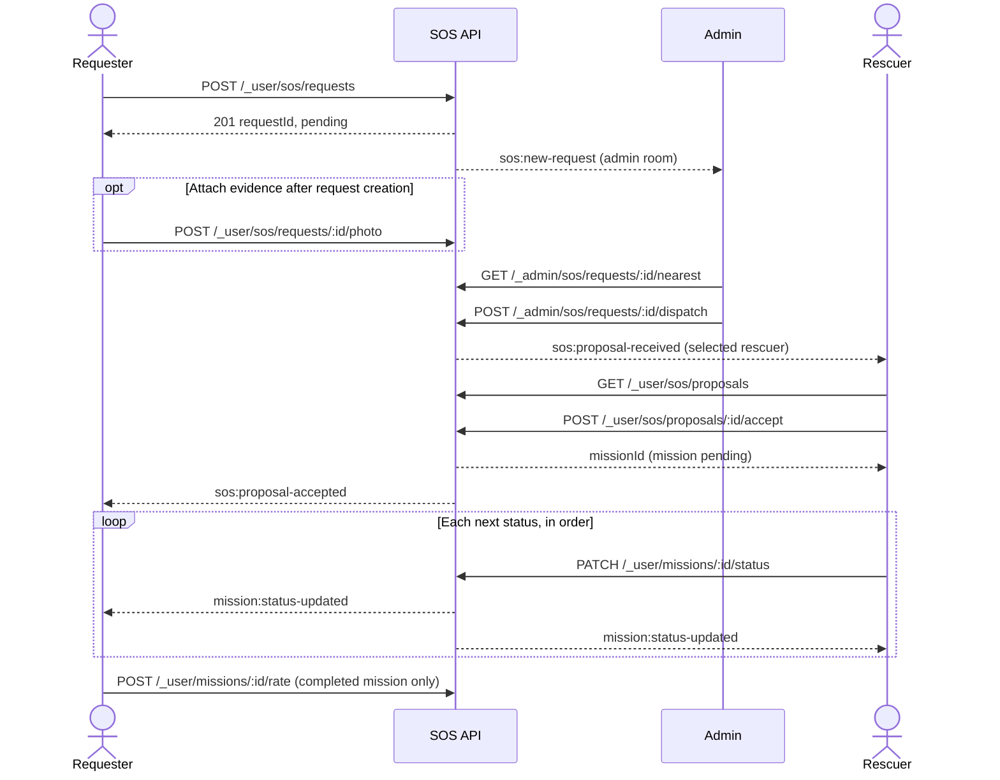
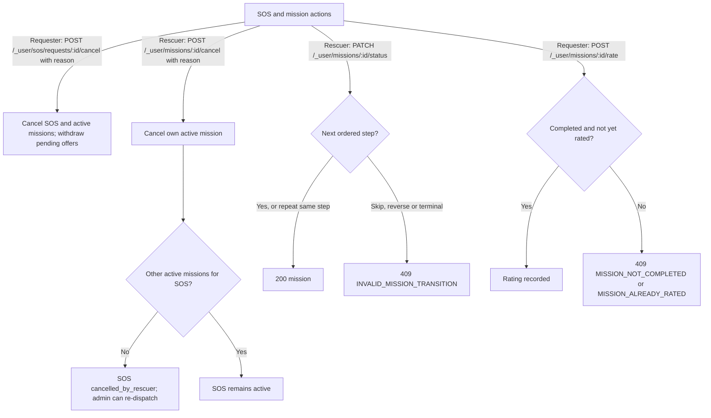
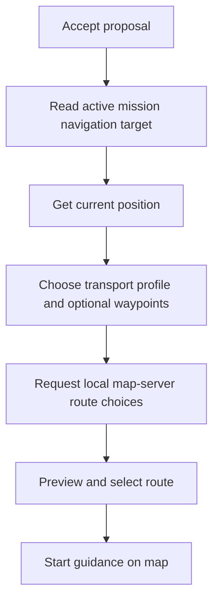

# Diagrams — SOS Lifecycle (implemented contract)

> Source-level view of the current SOS, proposal and mission handlers. The diagrams were rendered and visually reviewed in headless Chromium; this is not a live-app screenshot. The three records have **different** status vocabularies; do not use the SOS request's `dispatched` state as a mission status.

## 1. States (separate records)

**SOS request** (`sos_requests.status`):

**One proposal** (`mission_proposals.status`):

**One mission** (`missions.status`, ordered progress):

A requester may cancel their SOS (including its active missions) from `pending`, `dispatched` or `accepted`. A rescuer may cancel **their own** mission from any active progress step; these terminal mission states are `cancelled_by_requester` and `cancelled_by_rescuer` (see §3), not shortcuts in the ordered *progress* chain. The shared schemas also allow `expired` for SOS requests and missions, but these diagrams do **not** imply an automatic 24-hour expiry job. Advancing a mission is an explicit rescuer request, not a GPS-triggered 50 m arrival. Repeating the current step is an unchanged success; skipping, reversing or reviving a terminal step returns **409 `INVALID_MISSION_TRANSITION`**. When several rescuers accept for one SOS, the request becomes `completed` only after the last active mission completes; it becomes `cancelled_by_rescuer` only after the last active mission is cancelled by a rescuer.

## 2. Request → dispatch → mission → rating

The rate body requires an integer `rating` from 1 to 5 and permits an optional `comment` of at most 500 characters. Only the requester may rate their completed mission, once. Socket notifications follow committed writes; they are not a substitute for reading mission state. The list and read endpoints enforce participant scoping.

## 3. Cancellation and error paths

Cancellation requires an active reason from `GET /_user/sos/cancellation-reasons?type=requester|rescuer` (and custom text only for reasons that require it). A stale/closed request or inactive mission can also return 409; unauthorized resource IDs are not exposed as readable missions. Neither cancellation nor expiry is an automatic escalation to the authorities.

## 4. Rescuer navigation (client-side route preview)

The incident coordinate is readable only by the assigned rescuer of an active mission. Route choices depend on the available local routing service and location permission; no fixed number of alternatives or physical-arrival inference is promised.

## 5. Role summary

| Role | May write | May read / receive |
|------|-----------|--------------------|
| Requester | Create SOS, attach photo, cancel own SOS with reason, rate completed own mission | Own request/mission updates and rescuer location in active mission |
| Rescuer | Accept/decline own offer; advance/cancel own active mission with reason; publish mission location | Own offers and active mission's incident target |
| Admin | Dispatch and re-dispatch eligible SOS requests | SOS alerts and admin SOS/mission views |

Contract references: `packages/shared/src/types/enums.ts`, `packages/shared/src/api/{sos,admin}.routes.ts`, `packages/server/src/db/{sos-dispatch,sos-cancellation,mission-progress}-store.ts`, `packages/server/src/sos/{proposals,mission-progress,cancellation}.ts`, and `packages/client/src/composables/use-mission-routes.ts`.
