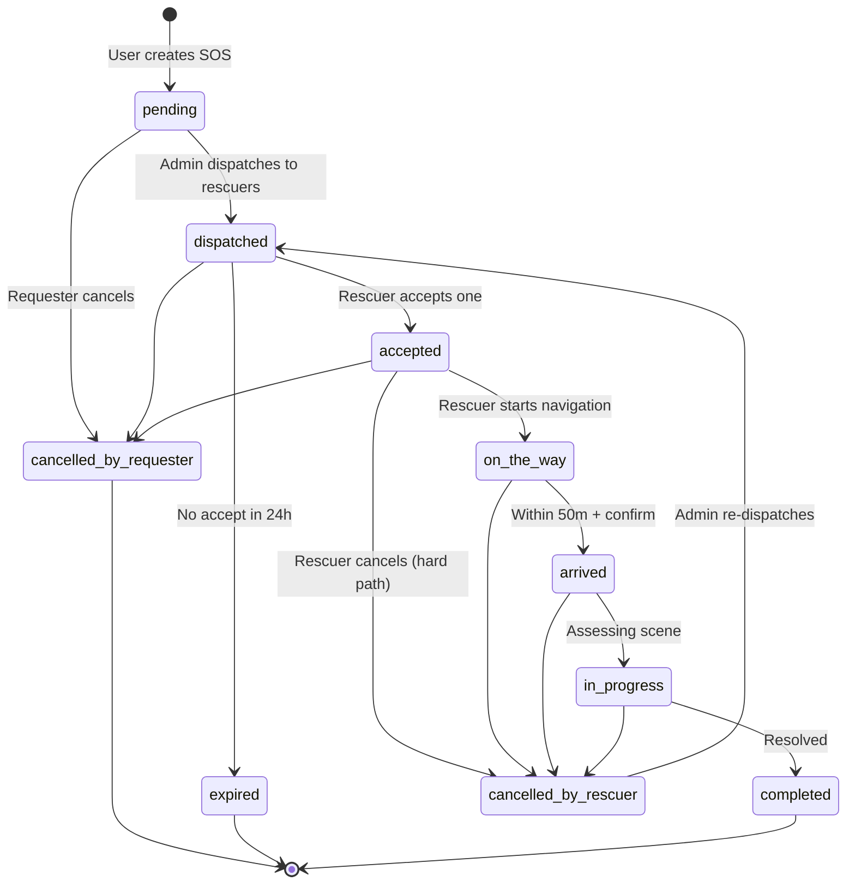
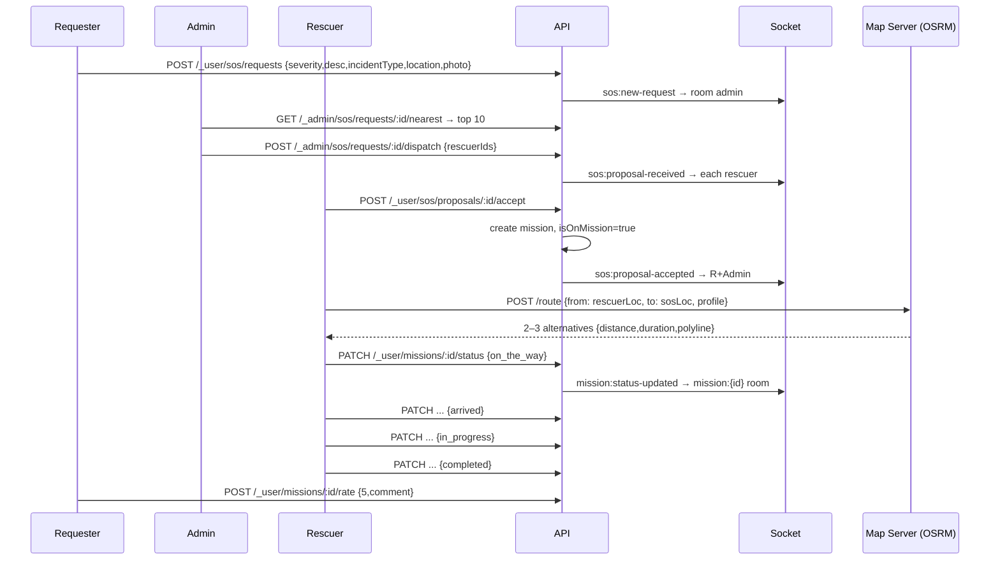
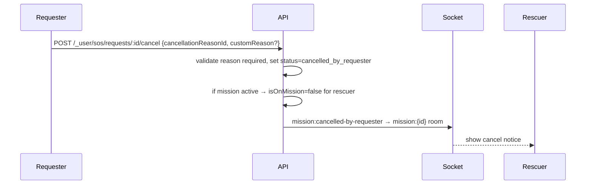
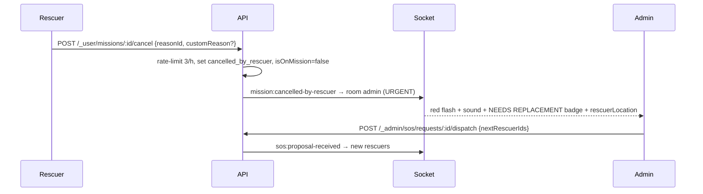
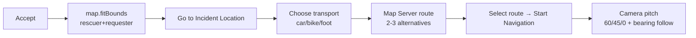

# Diagrams — SOS Rescue Flow

> State machine + sequence for the entire SOS lifecycle.

---

## 1. State Diagram

---

## 2. Lifecycle Sequence (Happy Path)

---

## 3. Cancellation Sequences

### 3a. By Requester

### 3b. By Rescuer (Hard Path + Admin Alert)

---

## 4. Mission Status Table (Rescuer Updates)

| Order | Status Enum | Persian Label | Trigger |
|-------|-------------|---------------|---------|
| 1 | `on_the_way` | در حال رفتن به محل حادثه | After “Start Navigation” |
| 2 | `arrived` | به محل حادثه رسیدم | Within 50m of SOS location (auto-detect + manual confirm) |
| 3 | `in_progress` | در حال رسیدگی | After assessing |
| 4 | `completed` | ماموریت با موفقیت انجام شد | Resolved |

Alternative terminals: `cancelled_by_requester`, `cancelled_by_rescuer`, `expired`.

Out-of-order transition → `400 INVALID_STATUS_TRANSITION`.

---

## 5. UI Map After Acceptance

---

## 6. Role Summary

| Role | Can Send | Can Receive | Can Cancel |
|------|----------|-------------|------------|
| Requester | SOS + photo | Status updates + rescuer location | Own SOS anytime (with reason) |
| Rescuer | Location while on mission | Proposals, SOS location | Own mission (hard path + reason) |
| Admin | Dispatch proposals | SOS alerts + urgent cancel alerts | Re-dispatch after rescuer cancel |

