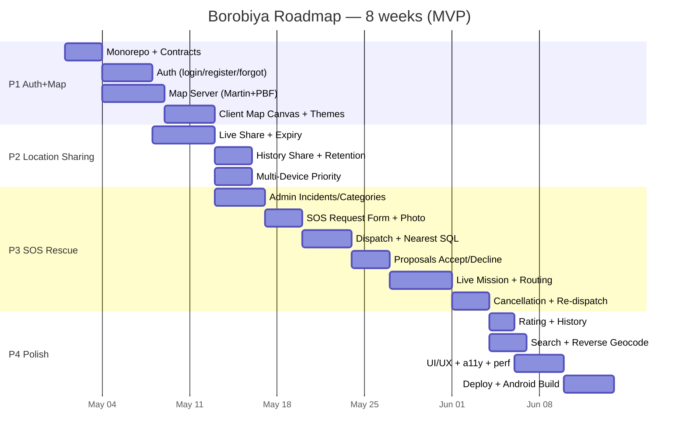

# Borobiya — Roadmap

> TL;DR: 4 phases — **P1 Auth+Map (2w), P2 Location Sharing (1.5w), P3 SOS Rescue (3w), P4 Polish & Ship (1.5w)**. Each phase is shippable and demoable. Docs & tasks check off as we go.

---

## Timeline Overview

---

## Phase 1 — Foundation: Auth & Map (Weeks 1-2)

**Goal:** User can register/login, recover password via 5Q, see offline vector map with dark/light toggle. Infra: monorepo + Docker + Postgres + Swagger.

### M1.1 Monorepo & Shared Contract
- [x] Init `packages/shared` with all Zod schemas — completed 2026-10-18
- [x] Init `packages/server` Fastify skeleton + `@borobiya/shared` — completed 2026-10-18
- [x] Init `packages/client` Vite+Vue+Vuetify+Tailwind + Pinia + VueUse — completed 2026-10-18
- [ ] Root `docker-compose.yml`, `.env.example`, `tsconfig` strict
- [x] OpenAPI at `/docs` + `/docs/json` via `@fastify/swagger` + Swagger UI — completed 2026-10-18
- [x] Zopia wired: `bun --filter @borobiya/client generate:api` — completed 2026-10-18

### M1.2 Auth System
- [ ] `security_questions` seed (15), `user_security_answers` table
- [ ] `POST /_auth/register` — 5 unique Q validation (zod superRefine)
- [ ] `POST /_auth/login` — username+password only, argon2id, rate-limit 5/15m
- [ ] Forgot flow: request → verify (server picks 3/5) → reset (10m token)
- [ ] `POST /_admin/users` (no questions) + `mustCompleteSecurityQuestions` flag + forced redirect
- [ ] JWT 15m/7d, refresh via httpOnly cookie
- [ ] Frontend: Login/Register/Forgot/CompleteSecurityQuestions views + guards (`_auth` guest-only)

### M1.3 Map Server (Independent)
- [ ] Choose stack: **Martin + Planetiler + OSRM + Photon** (ADR-10)
- [ ] Download Tehran PBF (sample), generate `tehran.pmtiles` (tippecanoe fallback)
- [ ] Serve `GET /tiles/{z}/{x}/{y}.pbf` + `GET /styles/{light,dark}.json` + fonts/sprites
- [ ] Document in `MAP_SERVER.md` with OS choice rationale

### M1.4 Client Map Canvas
- [ ] MapLibre GL JS init, center on Tehran, attribution
- [ ] Dark/Light styles (same source, different paint) with `<200ms` switch via `setStyle`
- [ ] Gesture-friendly controls, pitch/zoom preserve on style change
- [ ] Graceful fallback if Map Server down (toast + cached tiles)

**Exit Criteria:** Demo: register as user, login, toggle map theme, run fully on LAN with internet disabled.

---

## Phase 2 — Location Sharing (Weeks 3-4)

**Goal:** Users share live & history locations, manage shares, multi-device aware.

### M2.1 Live Sharing
- [ ] `POST /_user/location/share` (timed/permanent) + `DELETE /.../:shareId`
- [ ] Socket `location:update` (3-5s throttled) → broadcast to targets
- [ ] Cron: expire timed shares every minute
- [ ] Frontend: share dialog (pick users, timed slider), “My Shares” list, live markers on map

### M2.2 History Sharing
- [ ] `location_history` table + insert on each update (batched)
- [ ] `POST /_user/location/history/share` (from/to, maxPoints downsample)
- [ ] Receiver: polyline + time slider on map
- [ ] ENV retention 90d + maxShare 30d, daily prune cron
- [ ] Frontend: date range picker + polyline playback

### M2.3 Multi-Device Priority
- [ ] `user_sessions` table + `GET /_user/devices` + deviceName detection
- [ ] Warning modal if `activeDevices>1` on share start: “Select broadcasting device”
- [ ] Server only accepts GPS from `priorityDeviceId`
- [ ] Settings page: Active Devices Table

**Exit Criteria:** Two browsers as same user, pick priority device, see live dot moving; share last-7-days history as polyline.

---

## Phase 3 — SOS Rescue (Weeks 5-7)

**Goal:** Full SOS lifecycle — request → admin dispatch → rescuer accept → navigation → status timeline → cancellation/replacement.

### M3.1 Admin Domain Model
- [ ] `incident_types` + `categories` + pivots `category_users` + `category_incident_types`
- [ ] `POST /_admin/incidents`, `POST /_admin/categories`, `POST /_admin/categories/:id/users`
- [ ] Frontend: Admin /incidents & /categories CRUD + assign users

### M3.2 SOS Request
- [ ] `POST /_user/sos/requests` (severity, description, incidentTypeId, lat/lon manual fallback, optional photo 5MB)
- [ ] Photo upload endpoint + storage (local volume → S3 later)
- [ ] Socket `sos:new-request` to `admin` room + pulsing marker + sound

### M3.3 Dispatch & Nearest Responders
- [ ] Nearest SQL (PostGIS `ST_Distance`, filter category+active+not-on-mission) → 10 suggestions
- [ ] `POST /_admin/sos/requests/:id/dispatch` {rescuerIds} → `mission_proposals` + `sos:proposal-received`
- [ ] Admin panel: map alert + list with distance/rating/category

### M3.4 Proposals
- [ ] `POST /_user/sos/proposals/:id/accept` (only if not `isOnMission`) + auto-decline others
- [ ] `POST /_user/sos/proposals/:id/decline`
- [ ] Filter: `isOnMission=true` → no new proposals (query + runtime guard)
- [ ] UI: Bell inbox with count, proposal cards

### M3.5 Live Mission & Navigation
- [ ] Create `missions` + state `on_the_way → arrived → in_progress → completed`
- [ ] `PATCH /_user/missions/:id/status` + Socket `mission:status-updated` to `mission:{id}` room
- [ ] `map.fitBounds([rescuer, requester])` on accept, “Go to Incident” button
- [ ] Choose transport (car/bike/foot) → `POST /route` on Map Server → 2-3 alternatives
- [ ] Start Navigation → pitch per profile (60/45/0) + bearing follow + `easeTo` 1s
- [ ] Live location for all 3 (requester+rescuer+admin) on map

### M3.6 Cancellation (Critical)
- [ ] `cancellation_reasons` seed (requester 5 + rescuer 6 keys)
- [ ] `POST /_user/sos/requests/:id/cancel` (requester, needs reason)
- [ ] `POST /_user/missions/:id/cancel` (rescuer, hard path, rate-limit 3/h, flag >2/day)
- [ ] `mission:cancelled-by-rescuer` urgent → admin red flash + “NEEDS REPLACEMENT” + re-dispatch

**Exit Criteria:** E2E demo: User A SOS → Admin dispatches 2 → User B accepts → navigates (mock) → updates statuses → completes; cancellation demo.

---

## Phase 4 — Polish, Ship & Scale (Weeks 8-9)

### M4.1 Rating & History
- [ ] `POST /_user/missions/:id/rate` {1-5} after completed + `mission_ratings` + `avgRating` cached
- [ ] `GET /_user/sos/requests` + `GET /_user/sos/missions` (history for all users)
- [ ] Timeline UI with timestamps

### M4.2 Search & Geocoding
- [ ] `GET /_user/users/search` (advanced: q, category, incidentType, rating, online, distance)
- [ ] Map Server `GET /geocode?q=` + `GET /reverse?lat=&lon=` (Photon)
- [ ] Reverse on map click/long-press → bottom sheet with copyable address
- [ ] Frontend: debounced 300ms autocomplete

### M4.3 UI/UX & a11y
- [ ] Responsive mobile-first, 8px grid, design tokens, Vuetify+Tawind harmony
- [ ] skeletons, toasts, optimistic updates, no theme flash (`useDark`)
- [ ] a11y: aria, keyboard nav, contrast 4.5:1, WGAG AA audit
- [ ] Perf: lazy routes, virtual scroll, debounce search, map load <2s
- [ ] E2E smoke tests (Playwright)

### M4.4 Deploy & Android
- [ ] Lefthook/Husky: pre-commit lint+typecheck, pre-push test+build
- [ ] GitHub Actions `deploy.yml` → build images → push registry → SSH `docker compose pull && up -d`
- [ ] GitHub Actions `android.yml` on tag `v*` → `./gradlew assembleRelease` → APK/AAB
- [ ] `DEVELOPMENT.md` verified on Windows + Ubuntu

### M4.5 Docs Lock
- [ ] All `docs/*.md` reviewed, screenshots in `USER_MANUAL.md`
- [ ] Diagrams rendered correctly on GitHub

**Exit Criteria:** Production VM on Ubuntu runs `docker compose up -d` with LAN test passing; APK installs on Android and shares location.

---

## Future (Post-MVP, Not in 8w)

- Privacy v2: allowlist/blocklist, granular windows (TODO comment)
- Device offline pack: download PBF region to phone
- Voice/video call in mission (WebRTC)
- Push notifications (FCM)
- Sharded Postgres, Redis cluster, CDN
- Public landing + FAQs (`_public`)

---

## Milestones & Check-ins

| Week | Milestone Review |
|------|-----------------|
| 2 | P1 demo: Auth + Map offline |
| 4 | P2 demo: Live & History sharing |
| 7 | P3 demo: Full SOS with cancellation |
| 9 | MVP ship: deploy + APK |

Progress tracked in [PROGRESS.md](./PROGRESS.md) — update after every PR.

