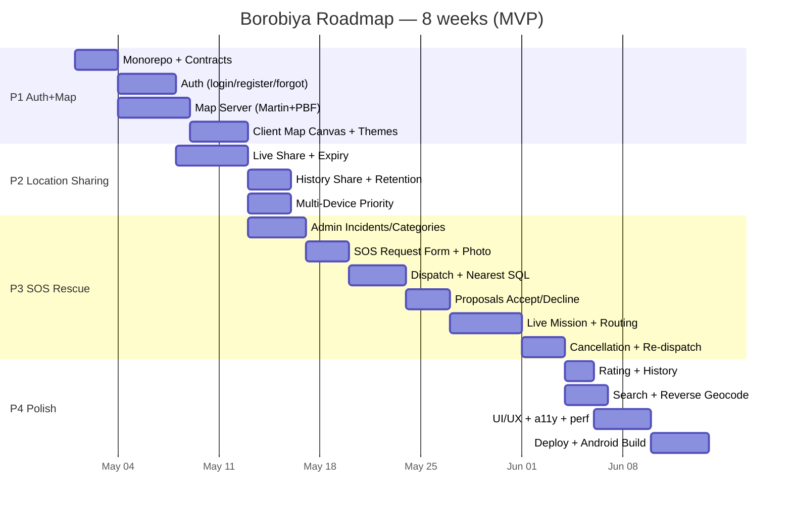

# Borobiya — Roadmap

> TL;DR: 4 phases — **P1 Auth+Map (2w), P2 Location Sharing (1.5w), P3 SOS Rescue (3w), P4 Polish & Ship (1.5w)**. Each phase is shippable and demoable. Docs & tasks check off as we go.

---

## Timeline Overview

---

## Phase 1 — Foundation: Auth & Map (Weeks 1-2)

**Goal:** User can register/login, recover password via 5Q, see offline vector map with dark/light toggle. Infra: monorepo + Docker + Postgres + Swagger.

### M1.1 Monorepo & Shared Contract
- [x] Init `packages/shared` with all Zod schemas — completed 2026-10-18
- [x] Init `packages/server` Fastify skeleton + `@borobiya/shared` — completed 2026-10-18
- [x] Init `packages/client` Vite+Vue+Vuetify+Tailwind + Pinia + VueUse — completed 2026-10-18
- [x] Root `docker-compose.yml` (api, postgres, map-server, nginx), `.env.example`, strict `tsconfig` — completed 2026-10-18
- [x] OpenAPI at `/docs` + `/docs/json` via `@fastify/swagger` + Swagger UI — completed 2026-10-18
- [x] Zopia wired: `bun --filter @borobiya/client generate:api` — completed 2026-10-18
- [x] Select Drizzle ORM + Postgres.js and scaffold initial auth/account schema (ADR-011) — completed 2026-10-18

### M1.2 Auth System
- [x] Initial `users`, `security_questions`, `user_security_answers`, and `user_sessions` schema/migration — T1.1.1–T1.1.2 completed 2026-10-18
- [x] `cancellation_reasons` table/migration + 15 security-question seeds, 11 cancellation reasons, and Argon2id bootstrap admin — T1.1.3 completed 2026-10-18
- [x] `POST /_auth/register` — 5 unique Q validation (T1.2.1)
- [x] `POST /_auth/login` — username+password, Argon2id verification, 5/15m limit, access/refresh JWT issuance (T1.2.2)
- [x] `POST /_auth/refresh` and `POST /_auth/logout` — refresh rotation/revocation via HttpOnly cookie or native body
- [x] Forgot flow: request → verify (server picks 3/5) → reset (10m token)
- [x] `POST /_admin/users` (no questions) + `mustCompleteSecurityQuestions` flag + forced redirect
- [x] Frontend: Login/Register/Forgot/CompleteSecurityQuestions views + guards (`_auth` guest-only)

### M1.3 Map Server (Independent)
- [x] Choose and pin **Martin + Planetiler + OSRM + Photon** (T1.4.1)
- [x] Generate the `borobiya.pmtiles` dataset archive from reuse-approved pinned PBFs (default Tehran) and verify Martin's `/{sourceID}/{z}/{x}/{y}` MVT route (T1.4.2)
- [x] Author light/dark styles and configure Martin to generate SVG sprites and TTF glyph ranges (T1.4.3; verified live incl. browser rendering 2026-10-20)
- [x] Configure car/bicycle/foot OSRM profiles and offline route adapter (T1.4.4; target-VM checks passed 2026-10-20)
- [x] Configure Nominatim import + Photon index and offline geocoding adapter (T1.4.5; target-VM checks passed 2026-10-20)
- [x] T1.4.7 — cache/reuse map data, safely remove map caches, and select whole-country or city-cropped areas through setup — implementation/tests/docs complete 2026-10-21
- [x] Document the stack, source IDs, style endpoints, and licenses in `MAP_SERVER.md`

### M1.4 Client Map Canvas
- [x] MapLibre GL JS init, configured bounds, attribution, and runtime map config (T1.5.1; Tehran rendered in the LAN browser on the target VM 2026-10-20)
- [x] Reactive light/dark style switch via `setStyle(..., { diff: true })` with a 150ms paint transition; styles share sources, layer structure, sprites, and glyphs (T1.5.2 implementation complete; live switch latency is unmeasured, tracked as informational P1-M1)
- [x] Preserve camera and DOM-backed markers by diffing styles on the existing map instance (T1.5.2)
- [x] Gesture-friendly pan/zoom controls; preserve camera state (including pitch, bearing, and zoom) when switching styles
- [x] App-wide Vuetify/Tailwind theme selection, `system`/`light`/`dark` persistence, OS preference updates, and pre-paint initialization (T1.5.3)
- [x] Graceful fallback if Map Server down (toast + cached tiles); implementation/tests complete, with live offline/5xx browser acceptance tracked separately as P1-A1

**Exit criteria:** All numbered T1.0–T1.5 implementation tasks are checked complete. The user reported the core Phase 1 human tests passing on Ubuntu 24.04 on 2026-10-21: setup, admin login, user registration/login, light/dark/system theme, admin user list/deactivation, map display/zoom/fullscreen, and denied login after deactivation (see [`PROGRESS.md`](./PROGRESS.md#phase-1-human-acceptance)). The release proceeds with the remaining P1-G1 external-Internet-offline library run, P1-A1 live outage test, P1-A2 extended database-flow evidence, and P1-M1 latency measurement documented as non-blocking follow-ups. Their untested behavior is not claimed as passed.

**Phase gate:** Phase 2 is active. PR #2 was merged to `main` as `95a88a3` and the Phase 1 Foundation `v0.1.0` release was published on 2026-10-21. Work started at T2.1.1; its `location_shares` table and migration are complete, while share APIs, realtime updates, expiry processing, history sharing, and multi-device UI remain future tasks. Per the user's explicit 2026-10-21 decision, the remaining Phase 1 follow-ups do not block the release or Phase 2. P1-G1 remains a separate operational follow-up, not part of T1.4.7's map-cache, cache-removal, and area-selection scope.

---

## Phase 2 — Location Sharing (Weeks 3-4)

**Status:** Active since 2026-10-21. T2.1.1 (`location_shares` schema and migration) is complete; API behavior and live sharing are not yet implemented.

**Goal:** Users share live & history locations, manage shares, multi-device aware.

### M2.1 Live Sharing
- [x] `POST /_user/location/share` (timed/permanent) + `DELETE /.../:shareId` — T2.1.2/T2.1.3
- [x] Socket `location:update` (3-5s throttled) → broadcast to targets — T2.1.5 with T2.3.4, client pacing at 4s
- [x] Cron: expire timed shares every minute — T2.1.6 (readers also filter `expiresAt`, so a deadline holds between sweeps)
- [x] Frontend: share dialog (user search, timed/permanent, duration slider), “My Shares” + “Shared With Me” lists — T2.1.7 (2026-10-22); the priority-device chooser rides along with the `409`
- [ ] Live companion markers on the map (peer positions from the socket)

### M2.2 History Sharing
- [x] `location_history` table + insert on each update — T2.2.1 with the writer inside `location:update`; deliberately one insert per accepted fix, since a 4s floor gives batching nothing to save
- [x] `POST /_user/location/history/share` (from/to, maxPoints stored on the grant) — done 2026-10-22; the read-side downsample lands with the receiver polyline task below
- [x] Receiver: polyline + time slider on map — T2.2.4 (server read) with T2.2.6 (client: sampled polyline, scrub slider, transport)
- [x] ENV retention 90d + maxShare 30d, daily prune cron — T2.2.5 (validated at startup, batched delete, catch-up pass on boot)
- [x] Frontend: date range picker + polyline playback — T2.2.6 (2026-10-22): 1/7/30-day presets with last-7-days as the default, hand-typed local window, playback at 1×/4×/16×/60× on the map

### M2.3 Multi-Device Priority
- [x] `user_sessions` table + `GET /_user/devices` + deviceName detection — T2.3.1/T2.3.2 (the label is a bounded human summary of the UA, not the raw header)
- [x] Warning modal if `activeDevices>1` on share start: “Select broadcasting device” — the `409 PRIORITY_DEVICE_REQUIRED` list opens the chooser inside the share dialog (T2.3.3's client half, landed with T2.1.7)
- [x] Server only accepts GPS from `priorityDeviceId` — T2.3.4, with T2.3.3 choosing the pin on share creation
- [x] Settings page: Active Devices Table + change-the-priority-anytime — T2.3.5 (2026-10-22) at `/_user/devices`, reached from the dashboard; the write reuses `POST /_user/location/share` with a body that cannot move the expiry

**Exit Criteria:** Two browsers as same user, pick priority device, see live dot moving; share last-7-days history as polyline. — the second half has its implementation (T2.2.6: grant → sampled polyline on the receiver's map, opened on the last 7 days) and is now measured by the browser run, not by code: P2-A1 covers both halves of the first clause and the playback panel's live behavior (fit-to-track, theme swap, scrub), so neither can be claimed from unit tests.

---

## Phase 3 — SOS Rescue (Weeks 5-7)

**Goal:** Full SOS lifecycle — request → admin dispatch → rescuer accept → navigation → status timeline → cancellation/replacement.

### M3.1 Admin Domain Model
- [ ] `incident_types` + `categories` + pivots `category_users` + `category_incident_types`
- [ ] `POST /_admin/incidents`, `POST /_admin/categories`, `POST /_admin/categories/:id/users`
- [ ] Frontend: Admin /incidents & /categories CRUD + assign users

### M3.2 SOS Request
- [ ] `POST /_user/sos/requests` (severity, description, incidentTypeId, lat/lon manual fallback, optional photo 5MB)
- [ ] Photo upload endpoint + storage (local volume → S3 later)
- [ ] Socket `sos:new-request` to `admin` room + pulsing marker + sound

### M3.3 Dispatch & Nearest Responders
- [ ] Nearest SQL (PostGIS `ST_Distance`, filter category+active+not-on-mission) → 10 suggestions
- [ ] `POST /_admin/sos/requests/:id/dispatch` {rescuerIds} → `mission_proposals` + `sos:proposal-received`
- [ ] Admin panel: map alert + list with distance/rating/category

### M3.4 Proposals
- [ ] `POST /_user/sos/proposals/:id/accept` (only if not `isOnMission`) + auto-decline others
- [ ] `POST /_user/sos/proposals/:id/decline`
- [ ] Filter: `isOnMission=true` → no new proposals (query + runtime guard)
- [ ] UI: Bell inbox with count, proposal cards

### M3.5 Live Mission & Navigation
- [ ] Create `missions` + state `on_the_way → arrived → in_progress → completed`
- [ ] `PATCH /_user/missions/:id/status` + Socket `mission:status-updated` to `mission:{id}` room
- [ ] `map.fitBounds([rescuer, requester])` on accept, “Go to Incident” button
- [ ] Choose transport (car/bike/foot) → `POST /route` on Map Server → 2-3 alternatives
- [ ] Start Navigation → pitch per profile (60/45/0) + bearing follow + `easeTo` 1s
- [ ] Live location for all 3 (requester+rescuer+admin) on map

### M3.6 Cancellation (Critical)
- [x] `cancellation_reasons` seed (requester 5 + rescuer 6 keys) — completed with T1.1.3 on 2026-10-18
- [ ] `POST /_user/sos/requests/:id/cancel` (requester, needs reason)
- [ ] `POST /_user/missions/:id/cancel` (rescuer, hard path, rate-limit 3/h, flag >2/day)
- [ ] `mission:cancelled-by-rescuer` urgent → admin red flash + “NEEDS REPLACEMENT” + re-dispatch

**Exit Criteria:** E2E demo: User A SOS → Admin dispatches 2 → User B accepts → navigates (mock) → updates statuses → completes; cancellation demo.

---

## Phase 4 — Polish, Ship & Scale (Weeks 8-9)

### M4.1 Rating & History
- [ ] `POST /_user/missions/:id/rate` {1-5} after completed + `mission_ratings` + `avgRating` cached
- [ ] `GET /_user/sos/requests` + `GET /_user/sos/missions` (history for all users)
- [ ] Timeline UI with timestamps

### M4.2 Search & Geocoding
- [ ] `GET /_user/users/search` (advanced: q, category, incidentType, rating, online, distance)
- [ ] Map Server `GET /geocode?q=` + `GET /reverse?lat=&lon=` (Photon)
- [ ] Reverse on map click/long-press → bottom sheet with copyable address
- [ ] Frontend: debounced 300ms autocomplete

### M4.3 UI/UX & a11y
- [ ] Responsive mobile-first, 8px grid, design tokens, Vuetify+Tawind harmony
- [ ] skeletons, toasts, optimistic updates, no theme flash (`useDark`)
- [ ] a11y: aria, keyboard nav, contrast 4.5:1, WGAG AA audit
- [ ] Perf: lazy routes, virtual scroll, debounce search, map load <2s
- [ ] E2E smoke tests (Playwright)

### M4.4 Deploy & Android
- [ ] Lefthook/Husky: pre-commit lint+typecheck, pre-push test+build
- [ ] GitHub Actions `deploy.yml` → build images → push registry → SSH `docker compose pull && up -d`
- [ ] GitHub Actions `android.yml` on tag `v*` → `./gradlew assembleRelease` → APK/AAB
- [ ] `DEVELOPMENT.md` verified on Windows + Ubuntu

### M4.5 Docs Lock
- [ ] All `docs/*.md` reviewed, screenshots in `USER_MANUAL.md`
- [ ] Diagrams rendered correctly on GitHub

**Exit Criteria:** Production VM on Ubuntu runs `docker compose up -d` with LAN test passing; APK installs on Android and shares location.

---

## Future (Post-MVP, Not in 8w)

- Privacy v2: allowlist/blocklist, granular windows (TODO comment)
- Device offline pack: download PBF region to phone
- Voice/video call in mission (WebRTC)
- Push notifications (FCM)
- Sharded Postgres, Redis cluster, CDN
- Public landing + FAQs (`_public`)

---

## Milestones & Check-ins

| Week | Milestone Review |
|------|-----------------|
| 2 | P1 demo: Auth + Map offline |
| 4 | P2 demo: Live & History sharing |
| 7 | P3 demo: Full SOS with cancellation |
| 9 | MVP ship: deploy + APK |

Progress tracked in [PROGRESS.md](./PROGRESS.md) — update after every PR.

