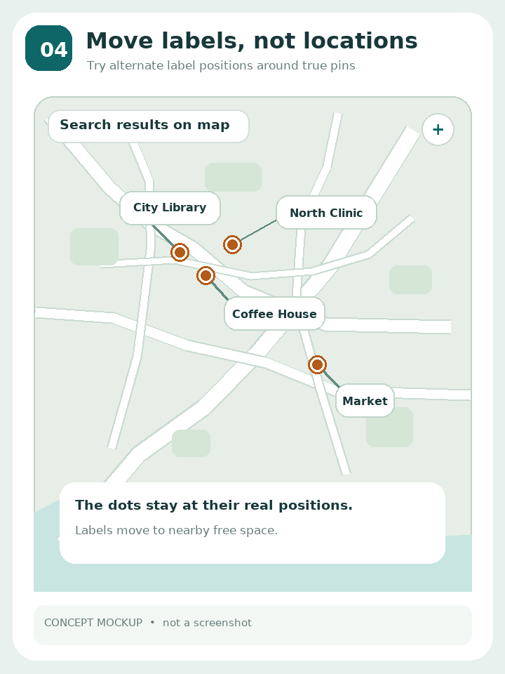
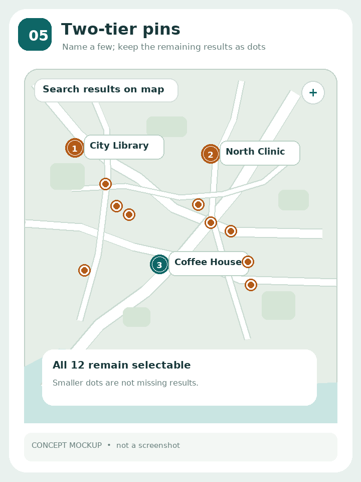
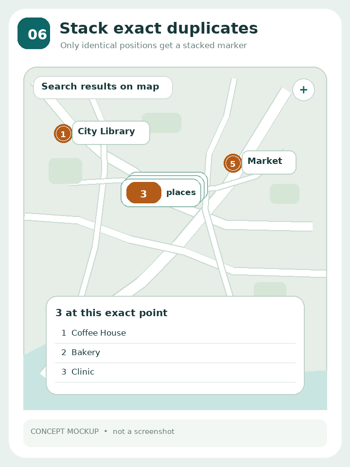
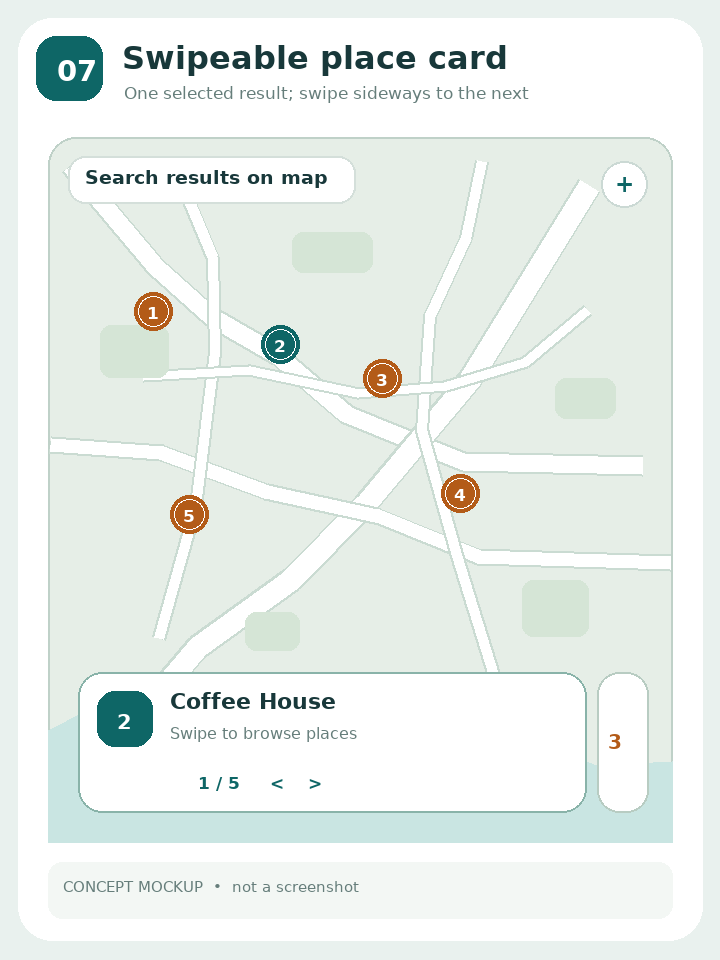
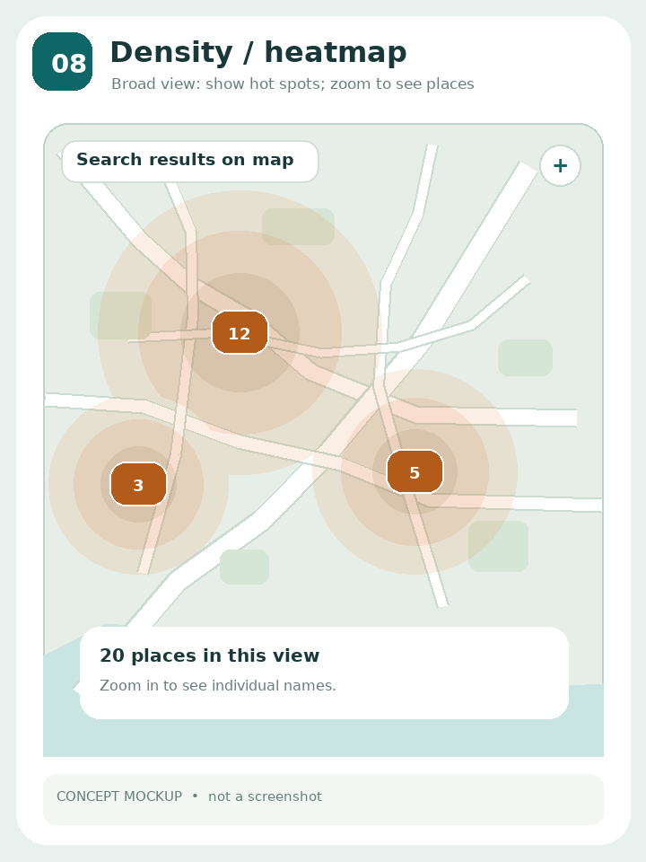
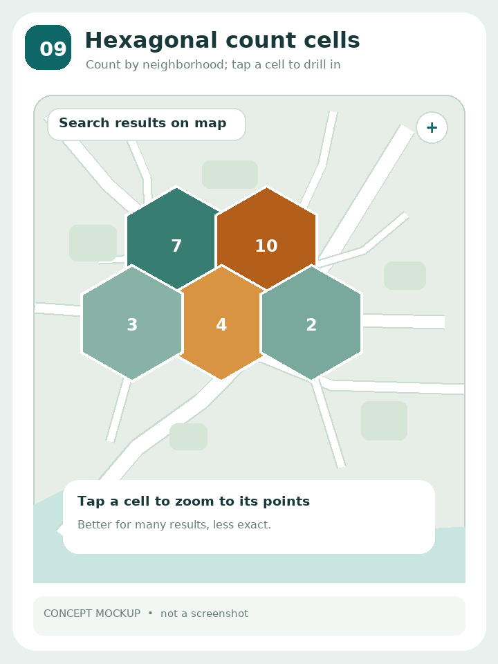
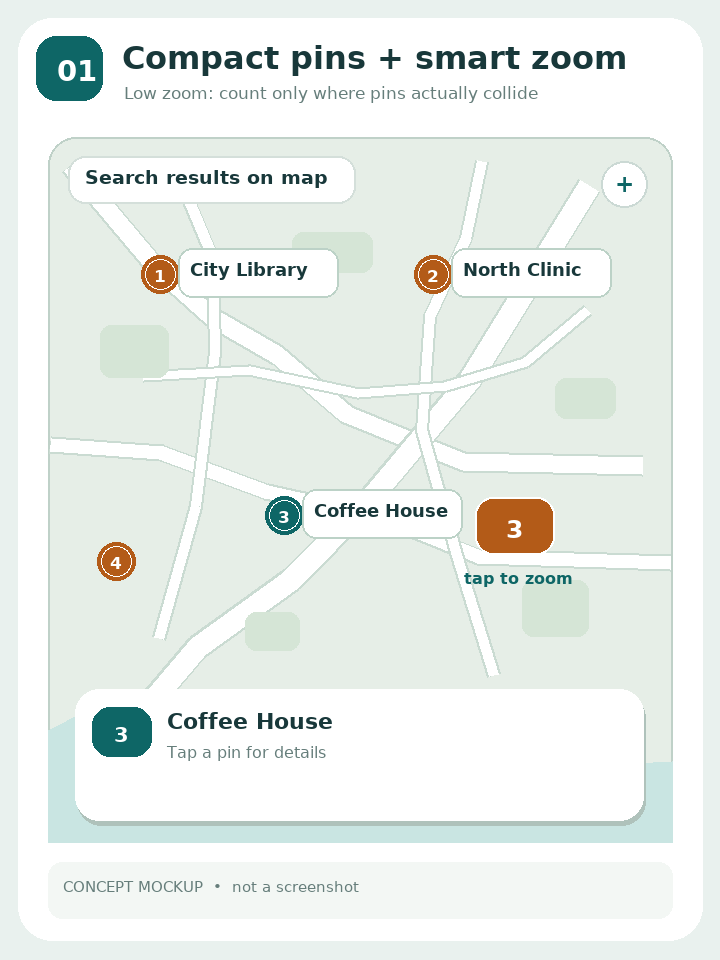
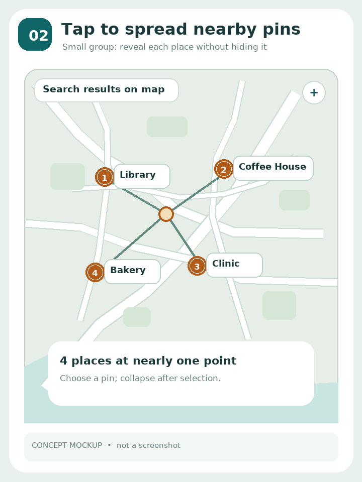
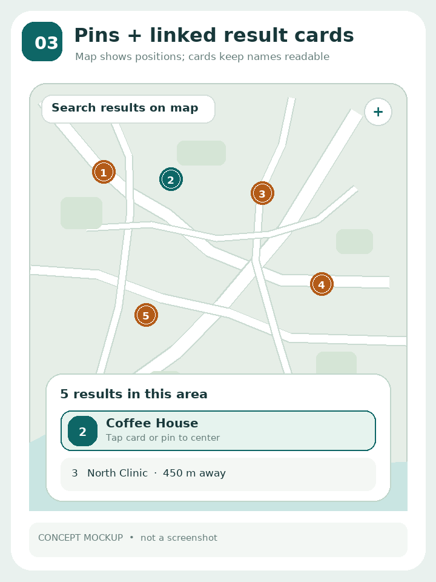

**04 · Move labels around fixed pins.** Try the name above, below, left, or right of its *real* point; a short leader line makes the association clear. Keep all pins visible. A map label-placement guide documents collision testing and alternate anchors. It still needs a separate answer for identical coordinates or too many labels. [1](https://docs.mapbox.com/help/dive-deeper/optimize-map-label-placement/)

**05 · Important labels + small remaining pins.** Show names for a manageable subset and unobtrusive mini-pins for the other results, with every result still reachable by tap or the search list. Airbnb has documented this regular-pin/mini-pin approach on desktop. It reduces clutter, but unlabeled places may feel hidden to someone who asked to see names on the map. The tiny *visual* dots in this illustration would still need proper-sized tap targets in the app. [1](https://arxiv.org/html/2407.00091v1)

**06 · Stack only truly identical positions.** Do **not** merge nearby but distinct places. Show a small stacked symbol only for exactly coincident coordinates; tap it to see those names in a short chooser. This is a deliberately narrower variant of the overlapping-marker disambiguation pattern, not a full solution for near-but-distinct labels. Leaflet documents alternate spread shapes and mobile list patterns for coincident markers. [1](https://github.com/leaflet/leaflet.markercluster)

**07 · One-card carousel linked to pins.** Keep the map largely visible, with one selected name/address card at the bottom; swipe between results, and the selected pin follows the card. Unlike option 03's taller visible list, this prioritizes map space. Agoda has shown a hotel-map card carousel concept; a Mapbox repository also describes synchronized map pins and results cards. Swipe must have visible Previous/Next buttons for keyboard use. [5](https://dribbble.com/shots/9519788-Prototype-Carousel-and-Bottom-Sheet) [2](https://github.com/mapbox/mcp-server/pull/292)

**08 · Heatmap at far zoom only.** Show *where* results concentrate at an overview zoom, then replace the heatmap with individual pins/names as the user zooms in. MapLibre has a heatmap-layer example. This is for discovering dense regions, **not** a replacement for selecting each place; with this app's small search-result set, it may be too indirect. [1](https://maplibre.org/maplibre-gl-js/docs/examples/create-a-heatmap-layer/)

**09 · Counted grid/hexagons at far zoom.** Aggregate results by area into selectable cells; tap a cell to drill down to actual places. deck.gl documents hexagon and screen-grid aggregation. Very clear for *large datasets*, but it obscures precise locations and adds a new map language for this app's relatively small result sets; I would not choose it here. [1](https://deck.gl/docs/api-reference/aggregation-layers/hexagon-layer) [3](https://deck.gl/docs/api-reference/aggregation-layers/screen-grid-layer)

## Earlier three examples (for comparison)

**01 · Compact pins + smart zoom.** Use counts only when compact pins genuinely collide, zoom on count tap, then resolve exact overlaps with a short chooser or spread. Google Maps and MapLibre document counted clusters changing as the map zooms. [1](https://developers.google.com/maps/documentation/javascript/marker-clustering) [1](https://maplibre.org/maplibre-gl-js/docs/examples/)

**02 · Tap to spread.** Fan out a small group of nearby results with connection lines, then tap an individual name. Leaflet.markercluster documents spiderfying clusters. Large groups and narrow screens need a list fallback. [1](https://github.com/leaflet/leaflet.markercluster)

**03 · Pins + visible list.** Smaller map pins stay paired with always-visible result cards; selecting one highlights the other. Airbnb's published map-search study discusses the relation between map pins and list results. More information is visible, but the list takes map space. [1](https://arxiv.org/html/2407.00091v1)

*All nine images are original concept mockups—not screenshots of these sources, and not the app's current appearance. The links support the underlying interaction patterns, not the specific illustrated design.*

## What I would shortlist for this app

| Choice | Preserves names on the map? | Handles near points? | Handles identical coordinates? | Phone-map cost |
|---|---|---|---|---|
| **04 + 06**: adaptive labels, exact-position stack | Mostly | Yes, until very crowded | Yes, on tap | Low |
| **04 + 02**: adaptive labels, tap-to-spread overflow | Mostly | Yes, after tap | Yes, after tap | Low–medium |
| **01 + 07**: compact pins, zoom-first, linked card | Selected place | Yes | Needs final chooser | Medium |
| **05 + 03**: mini-pins, linked list | Only some | Yes | Via list | Medium–high |
| **08 or 09**: density overview | Not at low zoom | Yes as density | Only after drilldown | Low at overview |

**My updated recommendation is 04 + 06**, *with a tiny group/list fallback only when there is truly no room*. It addresses the complaint with the current implementation: **two places should not turn into one count simply because their wide name cards are near each other**. First try alternate label positions while preserving the actual point; only exact duplicates get stacked. If the viewport is genuinely too crowded, use a small tap-only disambiguation control—not hover information. This is an application-specific recommendation, not a claim that the cited sources prescribe this exact combination.

**Which examples feel closer to what you want?** You can choose a number or say, for example, “04 + 06, but no mini-pins.” No app code has been changed pending your decision.
